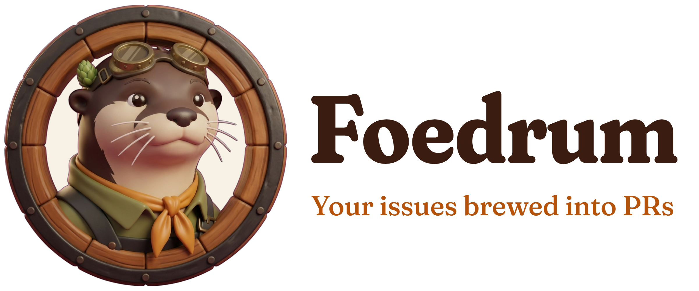
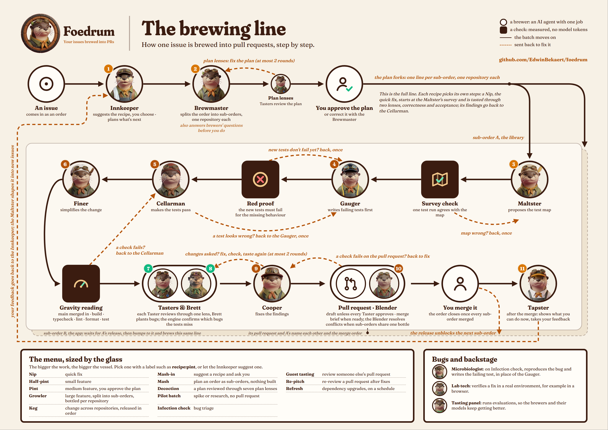

<h1 align="center">
  <picture>
    <source media="(prefers-color-scheme: dark)" srcset="docs/images/foedrum-logo-white.png">
    
  </picture>
</h1>

[](https://github.com/EdwinBekaert/foedrum/actions/workflows/ci.yml)

**Your issues, brewed into pull requests.**

📖 **[Meet the brewers](docs/foedrum-brewers-comic.pdf)** (comic, PDF, 8 pages): the whole crew as designed, in the order they work. Nip's brewers work today; the rest are on the way.

[](docs/images/foedrum-brewery.jpg)

Foedrum is a GitHub-native orchestrator for Claude agents. You file an issue in a control repository (*the Brewery*); Foedrum runs it through a pipeline you define (*a Recipe*) made of specialised agents (*Brewers*), and delivers a pull request in the target repository — with quality gates, budgets, and a promise: **a batch is never silently stuck.**

> 🚧 **Status: early development.** Milestone M1 (First pour) takes an issue in a Brewery to a pull request end to end: the Nip recipe, the `claude` CLI runner, `foedrum serve` and `foedrum brew`, and the Claude Code plugin. It is not on npm yet. See it in [M1's "See it"](docs/milestones/m1.md#see-it), and what comes next in [ROADMAP.md](ROADMAP.md).

## Requirements

- **Node 24.15** or later (`package.json`'s `engines`).
- **git 2.38** or later: the check of an open pull request against a moved base runs `git merge-tree --write-tree`, and a brewer's git is configured through `GIT_CONFIG_COUNT`.
- **GitHub CLI (gh) 2.97** or later, logged in with `gh auth login`: Foedrum reaches GitHub through gh's own login, and reads a failed CI job's log without terminal escape sequences.
- **Claude Code** (`claude`), logged in.

`foedrum doctor` checks each of them, and `foedrum serve` does not start on a required problem doctor finds.

## Set up a Brewery

Create an empty repository for the Brewery on GitHub (private, say `<you>/foedrum-brewery`), clone it, and in the clone run (`node <checkout>/src/cli/main.ts init` until `foedrum` is on your PATH, as below):

```sh
foedrum init
```

It asks the Brewery's name and its target repositories, reads each target's default branch and, for a Node repository, its checks from `package.json` through gh's own login, and writes `foedrum.jsonc`, `models.jsonc`, `.gitignore` and `.claude/settings.json`, each checked against its schema. It asks before it changes a file that is already there, before it creates the label `foedrum:brew` in each target repository, before it commits and pushes the files, and before it writes the `foedrum` command, then runs `foedrum doctor`. The Cellar claims an issue once someone in the Brewery's `users` added that label to it, whoever opened it, so a team adds its colleagues to `users` in `foedrum.jsonc` ([ADR 0359](docs/adr/0359-the-intake-takes-an-issue-only-when-someone-in-users-added-its-labels.md)), and brews each once its Brewery issue has a `recipe:<name>` label ([ADR 0156](docs/adr/0156-a-claimed-order-is-routed-by-its-brewery-issue-s-recipe-label.md)).

## Install the plugin

In a terminal, in the Brewery's clone, once per machine:

```sh
claude plugin marketplace add EdwinBekaert/foedrum
claude plugin install foedrum@foedrum --scope project
```

or, from a checkout of this repository, start the session in the Brewery's root with `claude --plugin-dir <checkout>/plugin`. Then, in that session:

```text
/foedrum:brew <issue>
```

To brew an issue with another recipe, `/foedrum:recipe '#<n>' <recipe> "<why>"` labels it `recipe:<recipe>` and orders it again once its last batch has ended ([ADR 0240](docs/adr/0240-order-and-recipe-work-by-the-brewery-issue-on-both-surfaces.md)); then `/foedrum:brew '#<n>'` brews it.

The plugin's skills run the `foedrum` command from your PATH. The npm package is not published yet, so run `node <checkout>/src/cli/main.ts init` once, where `<checkout>` is the folder of your clone of this repository after `npm ci`: it offers to write a `foedrum` command that runs that checkout into a folder of yours on the PATH ([ADR 0210](docs/adr/0210-foedrum-init-writes-the-foedrum-command-into-a-user-folder-on-the-path.md)).

From a terminal outside a Claude Code session, `foedrum brew <issue>` drives under the name `terminal`; to run a second driver beside it, give it a name of its own with `--as <name>`.

## What Foedrum changes

Everything Foedrum writes, on your machine, in the Brewery and on GitHub, and how to take it away.
"A driver" is `foedrum serve`, `foedrum brew` or another command that brews a batch; "the work root" is `~/.foedrum/<owner>.<name>` of the Brewery, or the `workRoot` in the Brewery's `.foedrum/local.jsonc`.
Remove what the work root and `.foedrum/` hold only while no driver runs.

| Where | When | What | Why | To remove |
|---|---|---|---|---|
| Your machine | Installing | Nothing yet: the npm package is not published (`"private": true`), so neither `npm install` nor `npx` can fetch it, and you run Foedrum from a checkout, as above. The package has no install scripts. | | Delete the checkout. |
| Your machine | `foedrum init`, outside a clone | A clone of the new Brewery repository, in a folder of the Brewery's name. | [ADR 0207](docs/adr/0207-foedrum-init-creates-the-brewery-s-repository-labels-the-targets-and-pushes.md) | Delete the folder. |
| Your machine | `foedrum init` from a checkout only, after you pick a folder (Enter picks the first) | The `foedrum` command in a folder on your PATH inside your home: a `foedrum` script, and on Windows `foedrum.cmd` beside it, each with a line saying init wrote it. It never edits your PATH or a shell profile, and never replaces a file it did not write. From the installed package it writes nothing and, when no `foedrum` but npx's own is on your PATH, says to run `npm install --global foedrum` or `npx foedrum <command>`. | [ADR 0210](docs/adr/0210-foedrum-init-writes-the-foedrum-command-into-a-user-folder-on-the-path.md), [ADR 0212](docs/adr/0212-foedrum-init-takes-every-answer-as-an-option-and-foedrum-init-asks-them-in-a-session.md), [ADR 0390](docs/adr/0390-foedrum-init-offers-the-shim-only-from-a-checkout.md) | Delete the files. |
| Your machine | Each driver | In the work root: `brewery.json`, a lock per driver in `drivers/`, the state branch's worktree `state/` and its `state.lock`, an empty `no-hooks/`, each brewer's settings and prompts in `attempt-settings/`, a checkout of each target repository per read-only attempt of a Brewery order in `brewery-orders/`, and per target repository its clone (`clone.git`, when its `source` is `managed`), the attempts' worktrees in `attempts/` and short-lived git folders in `git-dirs/`. | [ADR 0037](docs/adr/0037-attempt-worktrees-in-the-engine-and-driver-locks.md), [ADR 0012](docs/adr/0012-worktrees-from-local-clones.md), [ADR 0301](docs/adr/0301-a-brewery-order-s-read-only-attempt-reads-every-repository-in-a-checkout-of-each.md) | A batch's worktrees and settings go when it ends, or at the next start, except a Stuck batch's, one in use and one with changes; the rest stays: delete the work root. |
| Your machine | Each driver, for a target whose `source` is `local` | In your own clone of that target: a worktree record and a branch `foedrum/<batch>/<step>/<n>` per attempt, `git fetch --prune origin`, and git objects. A branch with commits no push sent is kept, and `foedrum status` lists it. | [ADR 0084](docs/adr/0084-a-batch-s-commits-end-in-a-pull-request-or-on-a-kept-branch.md) | The rest goes with the batch; `git branch -D` a kept branch, as `foedrum status` says. |
| Your machine | While a brewer runs | No file: a helper process keeps the machine awake, and ends a minute after the last attempt or with Foedrum. | [ADR 0195](docs/adr/0195-brew-and-serve-keep-the-machine-awake-while-an-attempt-runs.md) | `"keepAwake": false` in `foedrum.jsonc` or `.foedrum/local.jsonc`. |
| Your machine | Each brewer | Claude Code keeps the brewer's session under `~/.claude` (or `CLAUDE_CONFIG_DIR`), as for any session; `foedrum resume` opens it. | [ADR 0126](docs/adr/0126-foedrum-resume-opens-a-finished-attempt-s-session-in-its-worktree.md) | As for your other Claude Code sessions. |
| Your machine | Each check step, on macOS | A `foedrum-check-*` folder in the system's temporary folder, the check's home, removed after the check. | [ADR 0076](docs/adr/0076-check-steps-run-in-an-os-sandbox-with-no-network.md) | Nothing to do. |
| The Brewery | `foedrum init` | `foedrum.jsonc`, `models.jsonc`, `.gitignore` (with `.foedrum/`) and `.claude/settings.json` (with the plugin `foedrum@foedrum` on). A file already there changes only after you agree. | [ADR 0199](docs/adr/0199-foedrum-init-writes-a-brewery-s-files-in-its-clone.md) | Delete or revert them. |
| The Brewery | Installing the plugin | What `claude plugin install` records, and, for your user, the marketplace `claude plugin marketplace add` records. The plugin's skills only run `foedrum <command>`: no hooks, settings or servers. | [ADR 0125](docs/adr/0125-the-foedrum-plugin-is-markdown-skills-that-run-the-terminal-with-via-plugin.md) | `claude plugin uninstall foedrum@foedrum`, then `claude plugin marketplace remove foedrum`. |
| The Brewery | Each driver | `.foedrum/index.db` (with `-wal` and `-shm`), the event store; a local branch `foedrum/state` with its worktree in the work root. | [ADR 0024](docs/adr/0024-state-branch-layout-outbox-and-divergence.md) | Delete `.foedrum/index.db*`; `git worktree remove` the state worktree and `git branch -D foedrum/state`. |
| GitHub, the Brewery's repository | `foedrum init`, outside a clone | The Brewery repository, private unless you answer public. | [ADR 0207](docs/adr/0207-foedrum-init-creates-the-brewery-s-repository-labels-the-targets-and-pushes.md) | Delete the repository. |
| GitHub, the Brewery's repository | `foedrum init`, after a yes | A commit "Set up the Brewery with foedrum init", pushed with any earlier commits GitHub does not have yet, which init lists first. | [ADR 0207](docs/adr/0207-foedrum-init-creates-the-brewery-s-repository-labels-the-targets-and-pushes.md) | Revert the commit. |
| GitHub, the Brewery's repository | Each driver | The branch `foedrum/state`, never forced. An issue per claimed target issue, reopened for its next batch. A status comment per batch, edited in place. A plan's comment and its sub-order issues, linked as sub-issues and blocked by each other. An issue per pre-existing finding once the pull request merges. A comment and a close when a batch's pull request merges. Labels on these issues: `foedrum:ordered`, `foedrum:brewing`, `foedrum:conditioning`, `foedrum:awaiting-approval`, `foedrum:awaiting-answer`, `foedrum:stuck`, `foedrum:awaiting-merge`, `foedrum:sub-orders`, `recipe:<name>`, `foedrum:sub-order`, `needs-refinement` and `foedrum:pre-existing`. | [ADR 0024](docs/adr/0024-state-branch-layout-outbox-and-divergence.md), [ADR 0072](docs/adr/0072-the-status-comment-edits-as-revisions-in-the-ledger.md), [ADR 0154](docs/adr/0154-lane-labels-on-the-order-s-issue-and-the-status-comment-s-path-line.md), [ADR 0285](docs/adr/0285-an-approved-plan-becomes-brewery-sub-issues-through-the-ledger.md), [ADR 0356](docs/adr/0356-a-pre-existing-finding-becomes-a-brewery-issue-once-the-pull-request-merges.md) | Foedrum deletes nothing here but a lane or recipe label it replaces on an issue: delete the rest by hand. |
| GitHub, each target repository | `foedrum init`, after a yes | The label `foedrum:brew`. | [ADR 0359](docs/adr/0359-the-intake-takes-an-issue-only-when-someone-in-users-added-its-labels.md) | Delete the label. |
| GitHub, each target repository | A claimed issue | The ref `refs/foedrum/claims/issues/<n>` on an empty commit, the label `foedrum:claimed`, your gh account as assignee, and a comment when the claim is taken and when it is released. | [ADR 0043](docs/adr/0043-target-repository-issues-as-a-work-queue-claimed-by-a-ref.md) | The ref and the label go when the claim is released; the assignee stays, so no other Brewery takes the issue: unassign it by hand. |
| GitHub, each target repository | Each batch | A branch `foedrum/<brewery owner>.<name>/<batch>/…`, never forced. A pull request, opened as a draft and marked ready, or back to a draft, by its merge brief, whose body Foedrum updates. Its merge brief and base-check comments, an older brief hidden as outdated. | [ADR 0167](docs/adr/0167-a-brewed-pull-request-follows-one-layout-and-opens-as-a-draft-unless-every-taster-approves.md), [ADR 0350](docs/adr/0350-a-brewed-pull-request-is-a-draft-until-its-merge-brief-and-the-next-line-follows-the-brief.md) | Foedrum never deletes the branch: turn on GitHub's "Automatically delete head branches", or delete it by hand. |

## Why Foedrum

| Principle | What it means |
|---|---|
| **Never silently stuck** | Every step ends in a typed outcome, every wait has a deadline, and anything that needs a human is surfaced loudly. Proven by fault-injection tests, not claimed. |
| **Recipes, not one pipeline** | A change that stays inside the code it touches doesn't need the ceremony of one that can reach a lot. Compose your own recipes from your own brewers, with loops. |
| **Bring your own Claude** | Foedrum drives your installed `claude` CLI — it works with a Claude subscription, an API key, Bedrock or Vertex. Foedrum never touches your credentials. |
| **Orchestration costs (almost) no tokens** | The engine is plain code. Tokens are spent on the work, not on coordinating it. |
| **Measured quality** | Deterministic checks first (tests, lint, types), AI review second. When a new Claude model ships, Foedrum evaluates it on your own tasks and proposes the upgrade as a PR. |
| **Minimal supply chain** | One runtime dependency. No install scripts. Built-in Node features first. |

## How it fits together

[](docs/images/foedrum-brewing-line.png)

The full line as designed. Each recipe picks its own steps: Nip, which builds a change whose effect stays inside the code it changes and works today, starts at the Maltster's survey and is tasted through four lenses, correctness, acceptance, security and design conformance.

## Documentation

- [Architecture](docs/architecture.md), the map of the [design pages](docs/design/)
- [Brewers and recipes](docs/design/recipes/README.md)
- [Glossary](docs/glossary.md)
- [Architecture decision records](docs/adr/README.md)
- [Dependencies](DEPENDENCIES.md)
- [Security](SECURITY.md)

## Contributing

Foedrum is not open to outside pull requests yet: they will be closed until the public launch (milestone M3), when the contribution guide is published. Issues with questions, ideas or feedback are welcome now.

## Licence

Foedrum is licensed under the [GNU Affero General Public License v3.0](LICENSE). Contributions require the [Contributor License Agreement](CLA.md), a licence grant: you keep your copyright. To sign it, add `- @<your GitHub login>, CLA 1.0, <YYYY-MM-DD>` to [`.github/cla-signatures.md`](.github/cla-signatures.md) in a commit of its own in your first pull request; a CI check on every pull request reads that file. The Foedrum name, logo and mascot are not covered by the code licence.

---

Brewed in Belgium 🍺
