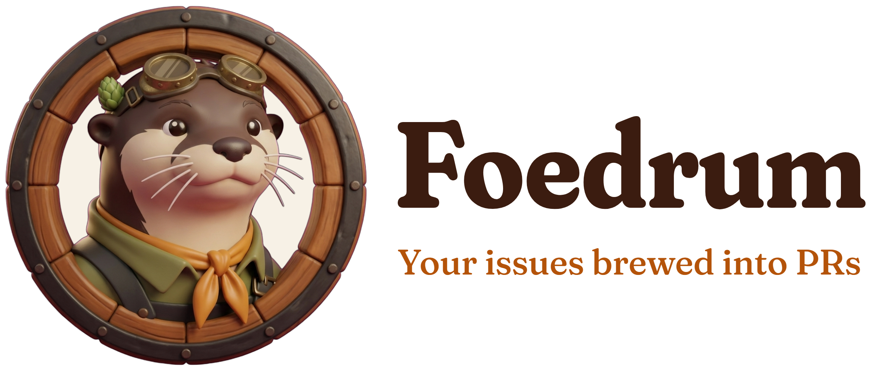
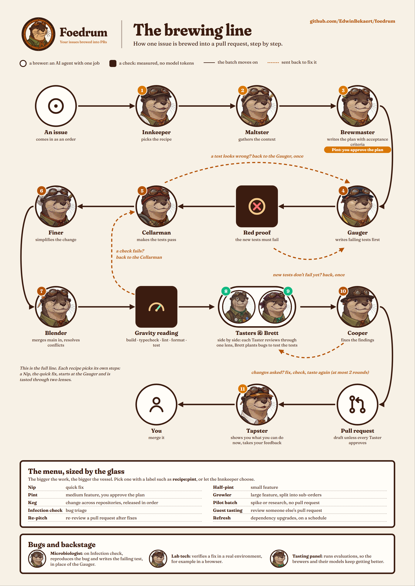

<h1 align="center">
  <picture>
    <source media="(prefers-color-scheme: dark)" srcset="docs/images/foedrum-logo-white.png">
    
  </picture>
</h1>

[](https://github.com/EdwinBekaert/foedrum/actions/workflows/ci.yml)

**Your issues, brewed into pull requests.**

📖 **[Meet the brewers](docs/foedrum-brewers-comic.pdf)** (comic, PDF, 8 pages): the whole crew as designed, in the order they work. Nip's brewers work today; the rest are on the way.

[](docs/images/foedrum-brewery.jpg)

Foedrum is a GitHub-native orchestrator for Claude agents. You file an issue in a control repository (*the Brewery*); Foedrum runs it through a pipeline you define (*a Recipe*) made of specialised agents (*Brewers*), and delivers a pull request in the target repository — with quality gates, budgets, and a promise: **a batch is never silently stuck.**

> 🚧 **Status: early development.** Milestone M1 (First pour) takes an issue in a Brewery to a pull request end to end: the Nip recipe, the `claude` CLI runner, `foedrum serve` and `foedrum brew`, and the Claude Code plugin. It is not on npm yet. See it in [M1's "See it"](docs/milestones/m1.md#see-it), and what comes next in [ROADMAP.md](ROADMAP.md).

## Requirements

- **Node 24.15** or later (`package.json`'s `engines`).
- **git 2.38** or later: the check of an open pull request against a moved base runs `git merge-tree --write-tree`, and a brewer's git is configured through `GIT_CONFIG_COUNT`.
- **GitHub CLI (gh) 2.97** or later, logged in with `gh auth login`: Foedrum reaches GitHub through gh's own login, and reads a failed CI job's log without terminal escape sequences.
- **Claude Code** (`claude`), logged in.

`foedrum doctor` checks each of them, and `foedrum serve` does not start on a required problem doctor finds.

## Set up a Brewery

Create an empty repository for the Brewery on GitHub (private, say `<you>/foedrum-brewery`), clone it, and in the clone run (with `foedrum` on your PATH, as below):

```sh
foedrum init
```

It asks the Brewery's name and its target repositories, reads each target's default branch and, for a Node repository, its checks from `package.json` through gh's own login, and writes `foedrum.jsonc`, `models.jsonc`, `.gitignore` and `.claude/settings.json`, each checked against its schema. It asks before it changes a file that is already there, then runs `foedrum doctor`. Commit and push the files, and create the label `foedrum:brew` in each target repository: the Cellar claims its issues with that label, and brews each once its Brewery issue has a `recipe:<name>` label ([ADR 0156](docs/adr/0156-a-claimed-order-is-routed-by-its-brewery-issue-s-recipe-label.md)).

## Install the plugin

In a terminal, in the Brewery's clone, once per machine:

```sh
claude plugin marketplace add EdwinBekaert/foedrum
claude plugin install foedrum@foedrum --scope project
```

or, from a checkout of this repository, start the session in the Brewery's root with `claude --plugin-dir <checkout>/plugin`. Then, in that session:

```text
/foedrum:brew <issue>
```

The plugin's skills run the `foedrum` command from your PATH. The npm package is not published yet, so put a command named `foedrum` on your PATH that runs `node <checkout>/src/cli/main.ts` with its arguments, where `<checkout>` is the folder of your clone of this repository after `npm ci`.

From a terminal outside a Claude Code session, `foedrum brew` needs a name for its driver: run `foedrum brew <issue> --as <name>`, or it refuses with "give --as <name>".

## Why Foedrum

| Principle | What it means |
|---|---|
| **Never silently stuck** | Every step ends in a typed outcome, every wait has a deadline, and anything that needs a human is surfaced loudly. Proven by fault-injection tests, not claimed. |
| **Recipes, not one pipeline** | A quick fix doesn't need the ceremony of a large feature. Compose your own recipes from your own brewers, with loops. |
| **Bring your own Claude** | Foedrum drives your installed `claude` CLI — it works with a Claude subscription, an API key, Bedrock or Vertex. Foedrum never touches your credentials. |
| **Orchestration costs (almost) no tokens** | The engine is plain code. Tokens are spent on the work, not on coordinating it. |
| **Measured quality** | Deterministic checks first (tests, lint, types), AI review second. When a new Claude model ships, Foedrum evaluates it on your own tasks and proposes the upgrade as a PR. |
| **Minimal supply chain** | One runtime dependency. No install scripts. Built-in Node features first. |

## How it fits together

[](docs/images/foedrum-brewing-line.png)

The full line as designed. Each recipe picks its own steps: Nip, the quick fix that works today, starts at the Gauger and is tasted through two lenses.

## Documentation

- [Architecture](docs/architecture.md), the map of the [design pages](docs/design/)
- [Brewers and recipes](docs/design/recipes/README.md)
- [Glossary](docs/glossary.md)
- [Architecture decision records](docs/adr/README.md)
- [Dependencies](DEPENDENCIES.md)
- [Security](SECURITY.md)

## Contributing

Foedrum is not open to outside pull requests yet: they will be closed until the public launch (milestone M3), when the Contributor License Agreement and the contribution guide are published. Issues with questions, ideas or feedback are welcome now.

## Licence

Foedrum is licensed under the [GNU Affero General Public License v3.0](LICENSE). Contributions require agreeing to a Contributor License Agreement (details will be published before the project opens to contributions). The Foedrum name, logo and mascot are not covered by the code licence.

---

Brewed in Belgium 🍺
