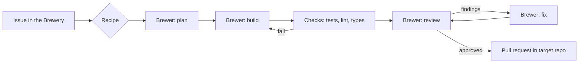

# Foedrum

**Your issues, brewed into pull requests.**

Foedrum is a GitHub-native orchestrator for Claude agents. You file an issue in a control repository (*the Brewery*); Foedrum runs it through a pipeline you define (*a Recipe*) made of specialised agents (*Brewers*), and delivers a pull request in the target repository — with quality gates, budgets, and a promise: **a batch is never silently stuck.**

> 🚧 **Status: early development.** The foundations are being built (milestone M0): formats, schemas, CI on Windows, macOS and Linux, and the dependency guard. There is nothing to install or run yet. See [ROADMAP.md](ROADMAP.md).

## Why Foedrum

| Principle | What it means |
|---|---|
| **Never silently stuck** | Every step ends in a typed outcome, every wait has a deadline, and anything that needs a human is surfaced loudly. Proven by fault-injection tests, not claimed. |
| **Recipes, not one pipeline** | A quick fix doesn't need the ceremony of a large feature. Compose your own recipes from your own brewers, with loops. |
| **Bring your own Claude** | Foedrum drives your installed `claude` CLI — it works with a Claude subscription, an API key, Bedrock or Vertex. Foedrum never touches your credentials. |
| **Orchestration costs (almost) no tokens** | The engine is plain code. Tokens are spent on the work, not on coordinating it. |
| **Measured quality** | Deterministic checks first (tests, lint, types), AI review second. When a new Claude model ships, Foedrum evaluates it on your own tasks and proposes the upgrade as a PR. |
| **Minimal supply chain** | One runtime dependency. No install scripts. Built-in Node features first. |

## How it fits together

## Documentation

- [Architecture](docs/architecture.md)
- [Brewers and recipes](docs/brewers-and-recipes.md)
- [Glossary](docs/glossary.md)
- [Architecture decision records](docs/adr/README.md)
- [Dependencies](DEPENDENCIES.md)

## Contributing

Foedrum is not open to outside pull requests yet: they will be closed until the public launch (milestone M3), when the Contributor License Agreement and the contribution guide are published. Issues with questions, ideas or feedback are welcome now.

## Licence

Foedrum is licensed under the [GNU Affero General Public License v3.0](LICENSE). Contributions require agreeing to a Contributor License Agreement (details will be published before the project opens to contributions). The Foedrum name, logo and mascot are not covered by the code licence.

---

Brewed in Belgium 🍺
