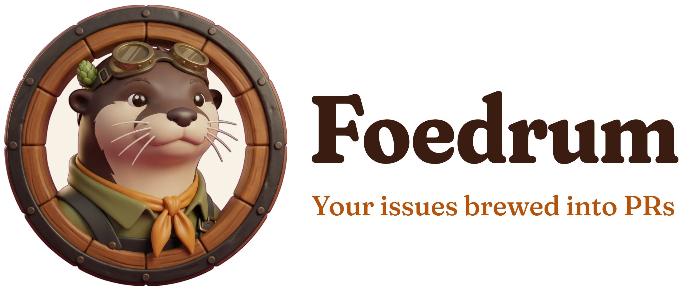
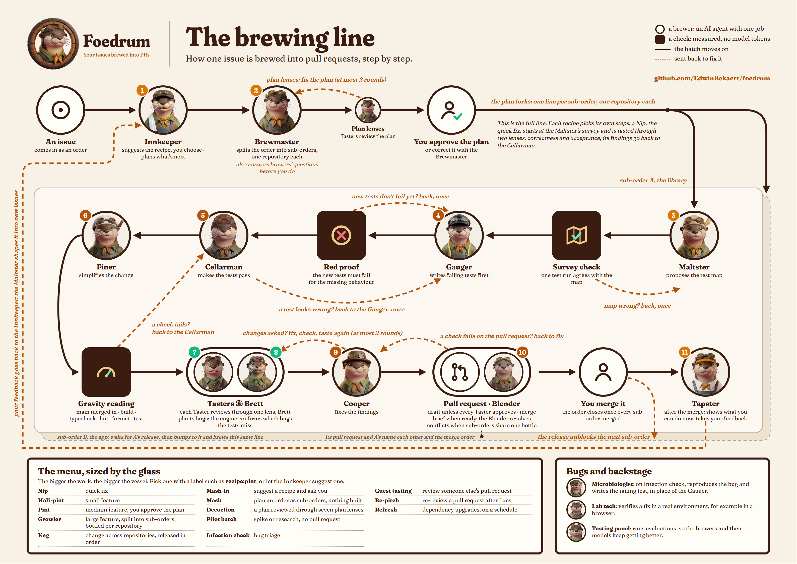

<h1 align="center">
  <picture>
    <source media="(prefers-color-scheme: dark)" srcset="docs/images/foedrum-logo-white.png">
    
  </picture>
</h1>

[](https://github.com/EdwinBekaert/foedrum/actions/workflows/ci.yml)

**Your issues, brewed into pull requests.**

📖 **[Meet the brewers](docs/foedrum-brewers-comic.pdf)** (comic, PDF, 8 pages): the whole crew as designed, in the order they work. Nip's brewers work today; the rest are on the way.

[](docs/images/foedrum-brewery.jpg)

Foedrum is a GitHub-native orchestrator for Claude agents. You file an issue in a control repository (*the Brewery*); Foedrum runs it through a pipeline you define (*a Recipe*) made of specialised agents (*Brewers*), and delivers a pull request in the target repository — with quality gates, budgets, and a promise: **a batch is never silently stuck.**

> 🚧 **Status: early development.** Milestones M1 (First pour) to M3 (Open doors) are done: an issue in a Brewery goes to a pull request end to end through the default recipes (Nip, Mash, Deep-mash and Deep-brew), with `foedrum serve`, `foedrum brew` and the Claude Code plugin. M4 (Blind tasting), measuring brewers and models on the tasting room, is under way. Foedrum is not on npm yet. See [M1's "See it"](docs/milestones/m1.md#see-it), and what comes next in [ROADMAP.md](ROADMAP.md).

## Requirements

- **Node 24.15** or later (`package.json`'s `engines`).
- **git 2.38** or later: the check of an open pull request against a moved base runs `git merge-tree --write-tree`, and a brewer's git is configured through `GIT_CONFIG_COUNT`.
- **GitHub CLI (gh) 2.97** or later, logged in with `gh auth login`: Foedrum reaches GitHub through gh's own login, and reads a failed CI job's log without terminal escape sequences.
- **Claude Code** (`claude`), logged in.

`foedrum doctor` checks each of them, and `foedrum serve` does not start on a required problem doctor finds.

## Set up a Brewery

Run, in the folder the Brewery goes in or the one beside it (`node <checkout>/src/cli/main.ts init` until `foedrum` is on your PATH, as below):

```sh
foedrum init
```

A Brewery is a repository of its own, with `foedrum.jsonc` at its top. Inside one, from any folder in it, init updates that Brewery. Anywhere else it asks whether to create one and in which folder: by default the folder it runs in, or, inside another repository, `foedrum-brewery` beside it, since it never writes into another project. For a name GitHub already has, it asks whether that is your Brewery and clones it. It ends with the `cd` line to the Brewery's folder ([ADR 0393](docs/adr/0393-foedrum-init-finds-where-it-is-and-asks-where-the-brewery-goes.md)). It asks the Brewery's name and its target repositories, reads each target's default branch and, for a Node repository, its checks from `package.json` through gh's own login, and writes `foedrum.jsonc`, `models.jsonc`, `.gitignore` and `.claude/settings.json`, each checked against its schema. It asks before it changes a file that is already there, before it creates the label `foedrum:brew` in each target repository, before it commits and pushes the files, and before it writes the `foedrum` command, then runs `foedrum doctor`. The Cellar claims an issue once someone in the Brewery's `users` added that label to it, whoever opened it, so a team adds its colleagues to `users` in `foedrum.jsonc` ([ADR 0359](docs/adr/0359-the-intake-takes-an-issue-only-when-someone-in-users-added-its-labels.md)), and brews each once its Brewery issue has a `recipe:<name>` label ([ADR 0156](docs/adr/0156-a-claimed-order-is-routed-by-its-brewery-issue-s-recipe-label.md)).

## Install the plugin

In a terminal, in the Brewery's clone, once per machine:

```sh
claude plugin marketplace add EdwinBekaert/foedrum
claude plugin install foedrum@foedrum --scope project
```

or, from a checkout of this repository, start the session in the Brewery's root with `claude --plugin-dir <checkout>/plugin`. Then, in that session:

```text
/foedrum:brew <issue>
```

To brew an issue with another recipe, `/foedrum:recipe '#<n>' <recipe> "<why>"` labels it `recipe:<recipe>` and orders it again once its last batch has ended ([ADR 0240](docs/adr/0240-order-and-recipe-work-by-the-brewery-issue-on-both-surfaces.md)); then `/foedrum:brew '#<n>'` brews it.

The plugin's skills run the `foedrum` command from your PATH. The npm package is not published yet, so run `node <checkout>/src/cli/main.ts init` once, where `<checkout>` is the folder of your clone of this repository after `npm ci`: it offers to write a `foedrum` command that runs that checkout into a folder of yours on the PATH ([ADR 0210](docs/adr/0210-foedrum-init-writes-the-foedrum-command-into-a-user-folder-on-the-path.md)).

From a terminal outside a Claude Code session, `foedrum brew <issue>` drives under the name `terminal`; to run a second driver beside it, give it a name of its own with `--as <name>`.

## What Foedrum changes

Foedrum lists everything it writes on your machine, in the Brewery and on GitHub, and how to take each away, in [What Foedrum changes](docs/what-foedrum-changes.md).

## Why Foedrum

| Principle | What it means |
|---|---|
| **Never silently stuck** | Every step ends in a typed outcome, every wait has a deadline, and anything that needs a human is surfaced loudly. Proven by fault-injection tests, not claimed. |
| **Recipes, not one pipeline** | A change that stays inside the code it touches doesn't need the ceremony of one that can reach a lot. Compose your own recipes from your own brewers, with loops. |
| **Bring your own Claude** | Foedrum drives your installed `claude` CLI — it works with a Claude subscription or an API key. Foedrum never reads or stores your credentials. |
| **Orchestration costs (almost) no tokens** | The engine is plain code. Tokens are spent on the work, not on coordinating it. |
| **Measured quality** | Deterministic checks first (tests, lint, types), AI review second. Lenses and models are measured on planted defects and practice orders, [the tasting room](tasting-room/README.md); proposing a model upgrade as a pull request is the goal of milestone M4. |
| **Minimal supply chain** | One runtime dependency. No install scripts. Built-in Node features first. |

## How it fits together

[](docs/images/foedrum-brewing-line.png)

The full line as designed. Each recipe picks its own steps: Nip, which builds a change whose effect stays inside the code it changes and works today, starts at the Maltster's survey and is tasted through four lenses, correctness, acceptance, security and design conformance.

## Documentation

- [Architecture](docs/architecture.md), the map of the [design pages](docs/design/)
- [Brewers and recipes](docs/design/recipes/README.md)
- [Testing](docs/design/testing/README.md)
- [Evaluation: the tasting room and the Flight](docs/design/evaluation.md)
- [Glossary](docs/glossary.md)
- [Architecture decision records](docs/adr/README.md)
- [What Foedrum changes](docs/what-foedrum-changes.md) on your machine, in the Brewery and on GitHub
- [Dependencies](DEPENDENCIES.md)
- [Security](SECURITY.md)

## Contributing

Foedrum is not open to outside pull requests yet: they will be closed until the public launch (milestone M7). Issues with questions, ideas or feedback are welcome now. How to contribute is in [`CONTRIBUTING.md`](CONTRIBUTING.md).

## Licence

Copyright (C) 2026 Edwin Bekaert

Foedrum is free software: you can redistribute it and modify it under the terms of the [GNU Affero General Public License version 3](LICENSE). It comes without any warranty; see [`LICENSE`](LICENSE) for the details.

Contributions require the [Contributor License Agreement](CLA.md), a licence grant: you keep your copyright. To sign it, add `- @<your GitHub login>, CLA 1.0, <YYYY-MM-DD>` to [`.github/cla-signatures.md`](.github/cla-signatures.md) in a commit of its own in your first pull request; a CI check on every pull request reads that file. The Foedrum name, logo and mascot are not covered by the code licence: the [trademark policy](TRADEMARK.md) says how you may use them.

---

Brewed in Belgium 🍺
