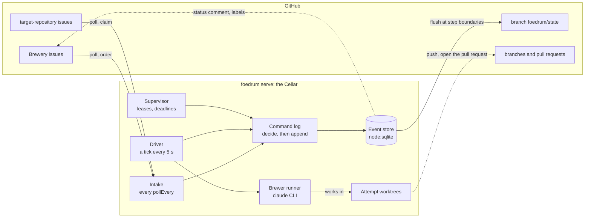

# Architecture

Status: design (v0.1, October 2026).
Decisions are recorded as [ADRs](adr/README.md).
This page is the map: what Foedrum is, its parts, and where each part is described.
The detail lives in the pages under [`design/`](design/), one concept per page ([ADR 0149](adr/0149-docs-layout-a-map-and-one-page-per-concept.md)).

## 1. Purpose

Foedrum turns issues in a control repository (the **Brewery**) into pull requests in other repositories, by running Claude agents (**Brewers**) through user-defined pipelines (**Recipes**).
Every step has a typed outcome, a deadline and a visible trace.

### Goals for 1.0

1. Issue → pull request in one or more registered repositories via a chosen recipe.
2. Stability as a measurable property: no batch is ever silently stuck.
3. User-defined brewers and recipes, with good defaults.
4. An evaluation harness that scores models, brewers and recipes on real tasks, including new Claude models as they are released.
5. Runs locally on Windows, macOS and Linux.
6. A codebase a reviewer can read in an afternoon.

### Non-goals for 1.0

Hosted or multi-tenant service · public webhook server (1.0 polls) · trackers and code hosts other than GitHub (the interfaces allow them later, see [trackers and code hosts](design/intake/trackers.md)) · non-Claude agents · code plugins.

## 2. Concepts

| Concept | Term |
|---|---|
| Control repository | **Brewery** |
| Issue in the Brewery | **Order** |
| Single-repository part of an order (sub-issue) | **Sub-order** |
| Pull request bundling one or more sub-orders | **Bottle** |
| A batch waiting for a merge or release | **Conditioning** ⏳ |
| Agent role (prompt, inputs, output, model, tools, permissions, budget) | **Brewer** |
| Pipeline: brewers and checks in order, with loops | **Recipe** |
| One execution of a recipe for an order | **Batch** |
| One position in a recipe | **Step** |
| One try at a step | **Attempt** |
| Deterministic check (tests, lint, types, diff limits) | **Gravity reading** |
| AI review | **Tasting** |
| Needs a human | **Stuck** 🔔 |
| Rules learned from reviews | **House yeast** |
| Evaluation suite | **Flight** |

Full list: [glossary](glossary.md).

## 3. System overview

The Cellar (`foedrum serve`, `src/cli/serve.ts`) polls GitHub for orders and writes everything it learns as events through one command log into one event store, the single source of truth; the driver runs brewers in attempt worktrees, and the store's events reach GitHub as the state branch.
Dotted lines are designed but not built yet.

- **Brewers run as `claude` CLI child processes** that the engine spawns and owns: it streams their events live and kills the whole process tree on deadline, stall or cancel ([ADR 0003](adr/0003-drive-the-claude-cli.md)).
- **One event store per Brewery**, written through one command log ([drivers](design/engine/drivers.md)).
- **Polling intake**, with zero infrastructure ([polling](design/intake/polling.md)).
- **Always worktrees, never a clone per batch** ([worktrees](design/engine/worktrees.md)).

## 4. The parts

**[The engine](design/engine/README.md).**
State is an append-only event log; every change is a command decided against the folded state, and state is a pure fold over the events.
The pages cover the [events](design/engine/events.md), [leases](design/engine/leases.md), the [event store](design/engine/event-store.md), the [fold and the guard](design/engine/fold.md), the [step outcome](design/engine/step-outcome.md), the [batch lifecycle](design/engine/lifecycle.md), the [invariants](design/engine/invariants.md), the [failure modes designed out](design/engine/failure-modes.md), the [state branch](design/engine/state-branch.md), [worktrees](design/engine/worktrees.md), [drivers](design/engine/drivers.md) and the [usage window](design/engine/usage-window.md).

**[Intake](design/intake/README.md).**
Orders come from Brewery issues and from issues claimed in target repositories, are broken down into single-repository sub-orders, and get their recipe by label or router: [trackers and code hosts](design/intake/trackers.md), [polling](design/intake/polling.md), [work breakdown](design/intake/work-breakdown.md), [target-repository issues](design/intake/target-issues.md), [ranking](design/intake/ranking.md), [limits](design/intake/limits.md), [open pull requests](design/intake/open-pull-requests.md), [triage](design/intake/triage.md), [routing](design/intake/routing.md).

**[Brewers and recipes](design/recipes/README.md).**
A brewer is a reusable agent role; a recipe puts brewers, checks and actions in order, with loops: [brewers](design/recipes/brewers.md), [the out doc contract](design/recipes/out-doc.md), [recipes](design/recipes/recipes.md), [tasting](design/recipes/tasting.md), [fining](design/recipes/fining.md), [the openPullRequest action](design/recipes/open-pull-request.md), [interactive steps](design/recipes/interactive-steps.md), [how a brewer runs](design/recipes/how-a-brewer-runs.md), [a session on another machine](design/recipes/sessions-elsewhere.md), [defaults](design/recipes/defaults.md), [configuration files](design/recipes/configuration.md).

**[Checks](design/checks/README.md).**
Gravity readings run the repository's own commands at zero model tokens, in an OS sandbox where one exists, and the red proof makes recipes test-first by structure: [check steps](design/checks/check-steps.md), [the check sandbox](design/checks/sandbox.md), [the red proof](design/checks/red-proof.md).

**[Humans in the loop](design/humans/README.md).**
An engineer drives a batch from a Claude Code session, every action is one typed command, and GitHub shows the status: [foedrum brew and the plugin](design/humans/brew.md), [one command layer](design/humans/commands.md), [pause, continue and stop](design/humans/pause.md), [the plugin](design/humans/plugin.md), [on GitHub](design/humans/github.md), [interactive refinement](design/humans/refinement.md).

**[Testing strategy](design/testing/README.md).**
Stability is proven, not claimed: [unit](design/testing/unit.md), [integration](design/testing/integration.md), [fake brewer runner](design/testing/fake-runner.md), [property](design/testing/property.md), [chaos](design/testing/chaos.md) and [end-to-end](design/testing/end-to-end.md) tests.

**[Platform support](design/platform/README.md).**
Windows, macOS and Linux: [isolation levels](design/platform/isolation.md), [cross-platform rules for the code](design/platform/cross-platform.md), and [keeping the machine awake](design/platform/keep-awake.md) while an attempt runs.

**[Security model](design/security.md).**
A brewer reads untrusted text, so it runs as the least trusted part; [`trust-boundaries.md`](trust-boundaries.md) says which mechanism owns each boundary.

**Also:** [token economy](design/token-economy.md), [evaluation](design/evaluation.md), [extensibility](design/extensibility.md), [house yeast](design/house-yeast.md), [delivery](design/delivery.md), [layout](design/layout.md).

## 5. Where the old sections went

Older ADRs, issues and code comments name sections of this page and of `brewers-and-recipes.md` by number.
Those numbers lead here:

| Old section | Now |
|---|---|
| §1 Purpose, §2 Concepts | above |
| §3 System overview | above; its bullets: [drivers](design/engine/drivers.md), [polling](design/intake/polling.md), [worktrees](design/engine/worktrees.md) |
| §3.1 Trackers and code hosts | [intake/trackers.md](design/intake/trackers.md) |
| §3.2 Work breakdown | [intake/work-breakdown.md](design/intake/work-breakdown.md) |
| §3.3 Target-repository issues, triage | [intake/target-issues.md](design/intake/target-issues.md), [intake/triage.md](design/intake/triage.md) |
| §3.4 State in the Brewery repository | [engine/state-branch.md](design/engine/state-branch.md) |
| §3.5 Interactive refinement | [humans/refinement.md](design/humans/refinement.md) |
| §3.6 Delivery | [delivery.md](design/delivery.md) |
| §4 Data model, §4.1 Events | [engine/events.md](design/engine/events.md), [engine/leases.md](design/engine/leases.md), [engine/event-store.md](design/engine/event-store.md), [engine/fold.md](design/engine/fold.md) |
| §4.2 Step outcome | [engine/step-outcome.md](design/engine/step-outcome.md); the brewer runner: [recipes/how-a-brewer-runs.md](design/recipes/how-a-brewer-runs.md) |
| §4.3 Batch lifecycle | [engine/lifecycle.md](design/engine/lifecycle.md) |
| §4.4 Invariants | [engine/invariants.md](design/engine/invariants.md) |
| §5 Failure modes designed out | [engine/failure-modes.md](design/engine/failure-modes.md) |
| §6 Brewers and recipes | [recipes/](design/recipes/README.md); check steps: [checks/](design/checks/README.md); routing: [intake/routing.md](design/intake/routing.md) |
| §7 Token economy | [token-economy.md](design/token-economy.md) |
| §8 Humans in the loop | [engine/drivers.md](design/engine/drivers.md), [humans/](design/humans/README.md) |
| §9 Testing strategy | [testing/](design/testing/README.md) |
| §10 Security model | [security.md](design/security.md) |
| §11 Evaluation | [evaluation.md](design/evaluation.md) |
| §12 Extensibility | [extensibility.md](design/extensibility.md) |
| §12b House yeast | [house-yeast.md](design/house-yeast.md) |
| §13 Platform support and isolation | [platform/](design/platform/README.md) |
| §14 Layout | [layout.md](design/layout.md) |
| brewers-and-recipes §1–§6 | [brewers-and-recipes.md](brewers-and-recipes.md) lists them |
