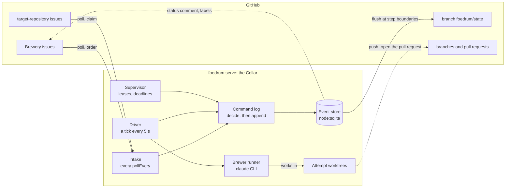
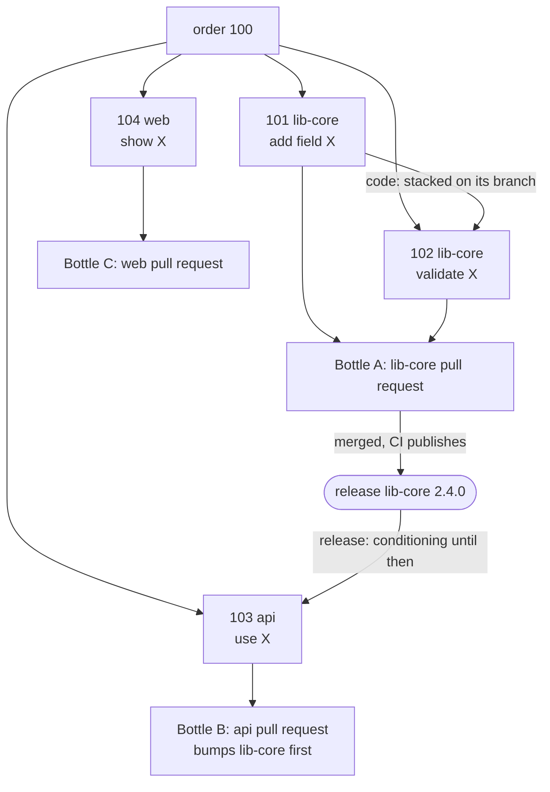
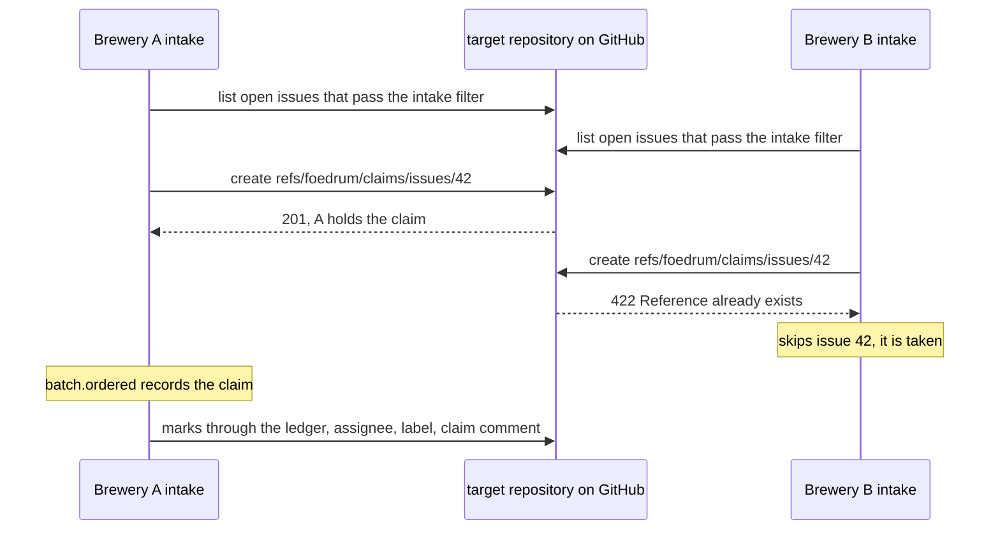
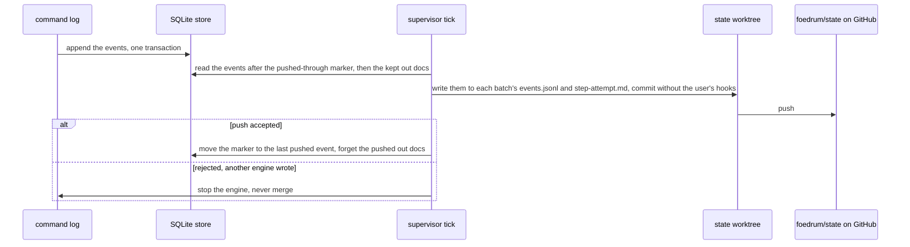
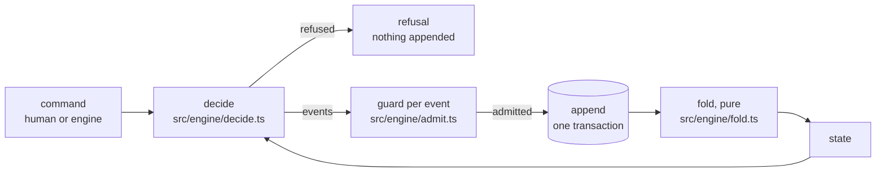
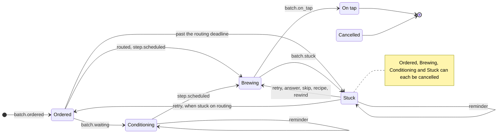
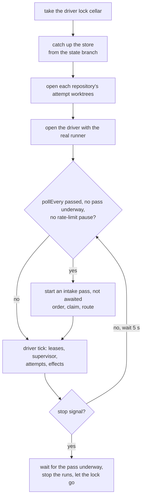
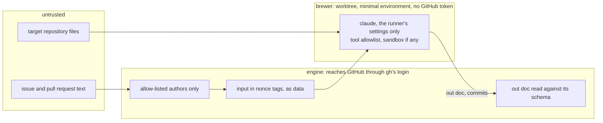

# Architecture

Status: design (v0.1, October 2026). Decisions are recorded as [ADRs](adr/README.md).

## 1. Purpose

Foedrum turns issues in a control repository (the **Brewery**) into pull requests in other repositories, by running Claude agents (**Brewers**) through user-defined pipelines (**Recipes**). Every step has a typed outcome, a deadline and a visible trace.

### Goals for 1.0

1. Issue → pull request in one or more registered repositories via a chosen recipe.
2. Stability as a measurable property: no batch is ever silently stuck.
3. User-defined brewers and recipes, with good defaults.
4. An evaluation harness that scores models, brewers and recipes on real tasks, including new Claude models as they are released.
5. Runs locally on Windows, macOS and Linux.
6. A codebase a reviewer can read in an afternoon.

### Non-goals for 1.0

Hosted or multi-tenant service · public webhook server (1.0 polls) · trackers and code hosts other than GitHub (the interfaces allow them later, see §3.1) · non-Claude agents · code plugins.

## 2. Concepts

| Concept | Term |
|---|---|
| Control repository | **Brewery** |
| Issue in the Brewery | **Order** |
| Single-repository part of an order (sub-issue) | **Sub-order** |
| Pull request bundling one or more sub-orders | **Bottle** |
| Waiting for a merge or release | **Conditioning** ⏳ |
| Agent role (prompt, inputs, output, model, tools, permissions, budget) | **Brewer** |
| Pipeline: brewers and checks in order, with loops | **Recipe** |
| One execution of a recipe for an order | **Batch** |
| One position in a recipe | **Step** |
| One try at a step | **Attempt** |
| Deterministic check (tests, lint, types, diff limits) | **Gravity reading** |
| AI review | **Tasting** |
| Needs a human | **Stuck** 🔔 |
| Rules learned from reviews | **House yeast** |
| Evaluation suite | **Flight** |

Full list: [glossary](glossary.md).

## 3. System overview

The Cellar (`foedrum serve`, `src/cli/serve.ts`) polls GitHub for orders and writes everything it learns as events through one command log into one event store, the single source of truth; the driver runs brewers in attempt worktrees, and the store's events reach GitHub as the state branch. Dotted lines are designed but not built yet.



- **One event store per Brewery**, which the Cellar (`foedrum serve`) and interactive sessions drive batches on; every writer appends through the command log, one write transaction at a time ([ADR 0044](adr/0044-batch-leases-held-by-the-driver-and-one-command-log.md)).
- **Brewers run as `claude` CLI child processes** that the engine spawns and owns: it streams their events live and kills the whole process tree on deadline, stall or cancel ([ADR 0003](adr/0003-drive-the-claude-cli.md)).
- **Polling intake** with conditional requests: works on a laptop with zero infrastructure ([ADR 0008](adr/0008-polling-intake.md)). ADR 0052 sets the polling interval at a minute, which `foedrum serve` applies (`pollEvery`, ADR 0068); every GET carries the ETag of the answer before, so an unchanged poll is a 304 that costs no rate limit, and a list is read along its `Link` pages, 10 items a page, so the longest bodies anyone can write never pass the answer limit. A target repository's listing asks GitHub for its filter's labels, and the cache keeps at most 64 MiB of answers, one list at most 32 MiB ([ADR 0068](adr/0068-the-intake-in-foedrum-serve-brewery-orders-and-routing-by-label.md)). On a rate limit the GitHub client pauses as GitHub's answer says and fails every request until then, never waiting inside a call, so no intake pass or effect overruns its deadline (`createGitHubReads`, `src/github/reads.ts`; `githubTargetTracker`, `githubIssueMarks`; [ADR 0052](adr/0052-github-reads-rate-limit-pauses-and-the-polling-interval.md)).
- **Always worktrees, never a clone per batch** ([ADR 0012](adr/0012-worktrees-from-local-clones.md)). Per repository, `source` is `local` (default: worktrees from the user's existing clone, in Foedrum's own branch namespace `foedrum/…`, never touching the checked-out branch) or `managed` (one bare partial clone per repository, created once, optionally borrowing objects from a local clone). Worktrees live in a **work root outside the Brewery checkout** (default `~/.foedrum/<owner>.<name>/`, set per machine in `.foedrum/local.jsonc`; short on Windows), so a brewer only ever sees the target repository's own instruction files — never anything placed in the Brewery. A repository's `source` and `base` (the branch a batch starts from, at `origin/<base>`, default `main`; later attempts continue from its task tree, [ADR 0066](adr/0066-the-task-tree-continues-from-the-latest-succeeded-attempt.md)) are in `foedrum.jsonc`; the path of the user's clone of a `local` repository is in `.foedrum/local.jsonc`, since it differs per machine ([ADR 0063](adr/0063-foedrum-serve-its-configuration-and-wiring.md)).
- **Attempt worktrees** ([ADR 0029](adr/0029-attempt-worktrees-layout-claims-and-repair.md)) live at `<workRoot>/<owner>.<name>/attempts/<batchId>/<stepId>/<attempt>` on the branch `foedrum/<batchId>/<stepId>/<attempt>`; a managed clone is `<workRoot>/<owner>.<name>/clone.git`. One cleanup, at engine start (crash repair) and when a batch ends, removes what the state no longer claims: everything in the attempts root of an ended or unknown batch, and the local branches of an ended one. A Stuck batch, a worktree with a live lease, and a worktree with changes are kept, except that its step's own untracked out doc, alone, does not count: it is deleted and the worktree goes ([ADR 0081](adr/0081-the-cleanup-ignores-the-steps-own-out-doc.md)); branches of a batch the state does not know stay and are reported, also when its clean worktree goes, since they may hold the only copy of unpushed work and another Brewery may share the clone. So does the branch of an ended batch's task tree that no push recorded, or for a rewound task tree the attempt branches that may hold the rewind's commit ([ADR 0101](adr/0101-the-cleanup-keeps-the-attempt-branches-that-hold-a-rewound-task-tree.md)), while it holds commits past the batch's start (`Claims.unpushed`, [ADR 0084](adr/0084-a-batch-s-commits-end-in-a-pull-request-or-on-a-kept-branch.md)); `foedrum status` lists each such branch with its batch, its commits past the start and the line that drops it, read through the engine's git in the clone ([ADR 0092](adr/0092-foedrum-status-lists-the-task-tree-branches-the-cleanup-keeps.md)). A retry that resumes a session (`retryMode: resume`, `answer`) runs in the worktree of the attempt whose session it continues, covered by its own lease, once that attempt's process is gone; otherwise it starts fresh in a worktree of its own. Removal uses `removeTree`, records are pruned one by one (never `git worktree prune` in the user's clone), kept worktrees no attempt runs in lose a stale `index.lock`, and git never runs by discovery inside an attempt worktree: its state is read against its record, and that status, which looks into no submodule, and `git worktree remove` run with `core.fsmonitor` off and no hooks, so a brewer that rewrites its `.git` file cannot make the engine run a command ([ADR 0095](adr/0095-the-cleanups-read-a-worktree-through-its-record-and-run-no-fsmonitor-or-hook.md)). A pure core (`src/workspace/attempt-worktrees.ts`) decides, the shell (`attempt-worktrees-git.ts`) runs git. An attempt writes in its batch's repository: a claimed issue's, a sub-order's, or the Brewery's only one for a Brewery order; an order that names none among several fails its attempts retryably until it is Stuck (`repositoryOf`, `src/engine/driver.ts`, ADR 0063). A driver makes an attempt's worktree under the attempt's lease and records it in `step.started` (`worktree: { repo, path, branch, commit }`); an attempt whose worktree cannot be made fails retryably. A new attempt's worktree starts at the batch's **task tree**: the branch of its latest attempt that succeeded with a worktree, or its latest rewind's commit, whichever came last, else the base (`Batch.taskTree` in the fold, `taskTreeStart`, `src/engine/task-tree.ts`). So a step sees the earlier steps' commits, a retry starts where the failed attempt started, and attempts still never share a worktree; check steps and the push find the task tree the same way ([ADR 0066](adr/0066-the-task-tree-continues-from-the-latest-succeeded-attempt.md)). It cleans a batch's worktrees, and its attempt settings files under `<workRoot>/attempt-settings/<batch>/`, when the batch ends, again when an attempt of the ended batch lets its lease go, and again once no lease of a batch whose cleanup kept a worktree under one is alive, also when that lease expired because its run never ended ([ADR 0061](adr/0061-chaos-faults-at-sites-shrinking-worktrees-and-the-state-branch.md)), and repairs every batch at its start (`createWorktreeCleanup`, `src/engine/worktree-cleanup.ts`; `startDriver`, `src/engine/driver-start.ts`; [ADR 0037](adr/0037-attempt-worktrees-in-the-engine-and-driver-locks.md)).
- **One Brewery per work root, one process per driver** ([ADR 0037](adr/0037-attempt-worktrees-in-the-engine-and-driver-locks.md)). The work root records its Brewery in `brewery.json`, a marker that stays, and refuses the drivers of any other Brewery. Each driver (the Cellar as `cellar`, each interactive session under an id it keeps when resumed) holds `drivers/<owner>.lock`, an exclusive SQLite lock that the operating system frees when the process dies, so a crashed driver's lock is taken over without cleanup and a second process of a live driver is refused (`lockDriver`, `src/engine/driver-lock.ts`).

### 3.1 Trackers and code hosts

Foedrum separates three roles that GitHub happens to play all at once in 1.0:

| Role | Interface | 1.0 | Later candidates |
|---|---|---|---|
| Where orders come from and where status is shown | `Tracker`: list orders, read comments/commands, post and edit the status comment, set state markers (labels, statuses) | GitHub Issues | Jira, Linear, GitLab Issues |
| Where code lives and pull requests are opened | `CodeHost`: clone, push, open pull request, read review comments; for now its push is `BranchPush` (git in the clone) and its pull requests `PullRequestHost` ([ADR 0071](adr/0071-the-openpullrequest-action-two-effects-of-the-batch.md)) | GitHub | GitLab, Bitbucket, Azure DevOps |
| Where configuration lives | the Brewery: any git repository | GitHub | any git host |

The user chooses a tracker and a code host per Brewery (`foedrum.jsonc`), and they may differ (for example Jira orders, GitHub pull requests).

**Design rule: a tracker is intake and projection only.** The event store is the source of truth; Foedrum reads orders and commands from the tracker and writes status back to it, but never synchronises workflow state two ways. Tracker-specific concepts (issue types, workflow transitions, re-parenting, key renames) are mapped at the edge, in the adapter, and never leak into the engine. Two-way tracker synchronisation is the most expensive part of an orchestrator to build and keep correct; this rule keeps adapters small. The claim on a target-repository issue (§3.3) is no exception: its ref is the one fact Breweries share: the engine creates it, reads only its record to tell its own claim from another's, and deletes it, and never reads workflow state back from it.

### 3.2 Work breakdown: orders, sub-orders and bottles

Enterprise changes usually span several repositories. Cross-repository work is a core capability, not an add-on ([ADR 0013](adr/0013-single-repo-sub-orders-bottles-and-releases.md)).

- **Work items live in the Brewery, or are claimed from a target repository.** Orders and sub-orders are Brewery issues, private to the Brewery; an order may also be an issue of a target repository that this Brewery claimed (§3.3, [ADR 0043](adr/0043-target-repository-issues-as-a-work-queue-claimed-by-a-ref.md)). Foedrum never creates issues in target repositories, and edits only the issues it claimed.
- **Decomposition.** A decomposition step (Maltster + Brewmaster) splits an order into **sub-orders** — GitHub sub-issues of the order — and records dependencies between them as native "blocked by" links. The breakdown is posted as **READY / NOT READY** and brewing starts after `/foedrum approve` — **approval is on by default**; recipes can switch it off. A breakdown produced interactively with the `/foedrum:refine` plugin (§3.5) counts as approved.
- **One sub-order, one repository.** A sub-order never spans repositories. A brewer *writes* in exactly one repository and may *read* sibling repositories for context.
- **Each sub-order gets its own batch** and recipe; batches are scheduled in dependency order.
- **Bottling: choosing what goes into a pull request.** A **bottle** is a pull request. It bundles one or more finished sub-orders of the same repository: their branches are merged into a bottle branch by plain git (conflicts go to the Blender). Policy per recipe: `"bottling": "perSubOrder" | "perRepo" | "manual"`; manually with `/foedrum bottle #101 #102`. Bottles of the same order reference each other and carry a suggested merge order.
- **Dependency kinds:**

| Kind | Meaning | The dependent batch waits for |
|---|---|---|
| `code` | Builds on another sub-order's code in the same repository | That sub-order's branch (stacked) |
| `release` | Needs a published version of another repository's library | The bottle to be merged, CI to publish, and the **release signal** to report the new version; the dependent batch then starts by bumping the dependency |

- **Release signals** are configured per repository: **GitHub release or tag** first; package registries (NuGet, npm, Maven, …) later through the same interface. Developing against a pre-release build is a later option.

An example: order 100 splits into four sub-orders, one repository each, bottled per repository. The api sub-order needs a published lib-core, so it conditions until the release signal reports it.



### 3.3 Target-repository issues: a work queue, and triage

A team often shares a target repository while every member has a private Brewery, so several Breweries pick issues from one repository ([ADR 0043](adr/0043-target-repository-issues-as-a-work-queue-claimed-by-a-ref.md)). GitHub refuses to create a ref that exists, so the claim ref decides which Brewery takes an issue (`githubClaimHost`, `src/github/claims.ts`):



- **A work queue where a Brewery asks for it.** A repository with an **intake filter** (labels, optionally a milestone) has its open issues polled. The intake picks an issue that passes the filter, has no assignee or only this Brewery's own GitHub user (assign an issue to yourself and your Brewery picks it up), was opened by one of the Brewery's allow-listed users (§10), and has no batch in this Brewery in any lane (`isCandidate`, `src/engine/issue-claims.ts`). A pass claims candidates oldest first, only up to the Brewery's free capacity (`claimCandidates`'s `limit`: the capacity less its Ordered and Brewing batches), and leaves the rest for the next pass and for the other Breweries. Such a repository names a short **alias** in `foedrum.jsonc` (a lower-case letter, then letters and digits, at most 20, unique; `foedrum doctor` refuses a duplicate), and the batch of a claimed issue is `<alias>-<issue>`, which never collides with a Brewery issue's `<issue>-<n>`. Its `OrderRef` names the repository; the issue is an order, but its batch is kept apart from the Brewery's own orders and sub-orders, whose numbers it would collide with (`createIntake`, `src/engine/intake.ts`; [ADR 0050](adr/0050-the-intake-of-target-repository-issues.md)).
- **The claim** is the ref `refs/foedrum/claims/issues/<n>` in the target repository, created through the API: creating a ref that exists fails, so exactly one Brewery wins. It points at a commit whose message names the Brewery (`{"brewery","issue","claimedAt"}`, no host or user names). A ref that names this Brewery is its own claim, left by a run killed before it ordered the batch, or by a `foedrum order` refused or stopped after its claim (running it again finds the claim as its own, [ADR 0105](adr/0105-foedrum-order-orders-an-issue-again-as-a-human-command-recorded-on-batch-ordered.md)); any other ref, or one that cannot be read, skips the issue. The claim comes before the order, and is the second effect outside the idempotency ledger next to the state branch's push: it is idempotent by its own atomic creation, and `batch.ordered` records it.
- **The marks** follow the order, through the ledger as the driver's effects of the batch (`claimEffectsDue`, `claimEffects`): the issue is assigned to the Brewery's user, labelled `foedrum:claimed` (the claim, not the lane: it stays through Stuck and Conditioning), and gets a claim comment naming the Brewery and batch, a comment of its own next to the status comment (§8).
- **Release** when the batch is cancelled or every pull request it opened is merged or closed: the label goes, a release comment says why, and the ref is deleted if it still names this Brewery, only while it points at the commit that was read (GraphQL `updateRefs` with `beforeOid`, proven against GitHub in an opt-in integration test, [ADR 0050](adr/0050-the-intake-of-target-repository-issues.md)). The end of each pull request is a recorded event, `pull_request.ended`, which the intake appends when its poll sees a merge or a close; what is due follows from it, never from asking the code host. The assignee stays, so the release comment of a batch that was not merged ends with "Unassign the issue to make it available again." A silent Brewery's claim is never taken over automatically; a human releases it (delete the ref, unassign the issue).
- **Ordering again** is a person's: `foedrum order <alias>#<n>` claims the issue again (won or ours; taken is refused with its holder) and orders it as `<alias>-<n>-<k>`, and `foedrum order #<n>` orders a Brewery issue again as `<n>-<k>`. `decide` refuses it while the issue has a live batch, or while its last claim is held or its release not yet applied (`claimStanding`), and records it on `batch.ordered` with `by` and `via`; the intake's own order of a target issue is refused the same way, so the two never order one issue twice ([ADR 0105](adr/0105-foedrum-order-orders-an-issue-again-as-a-human-command-recorded-on-batch-ordered.md)).
- Orders made in the Brewery and their sub-orders need no claim: nobody else can see them. Every branch pushed to a target repository carries the Brewery (§3.4), so two Breweries never push the same branch.

**Triage.** Issues filed in target repositories configured as triage sources (bug reports, user requests) go to the Infection check recipe instead. It reads them — selected by repository and label/filter, by explicit references, or on a schedule — reproduces the problem in a clean worktree, confirms the root cause at file and line, and records the findings as one or more **orders in the Brewery** that link back to the source issue. It stops there: it never fixes, assigns, labels or closes anything in the target repository. Commenting a link back on the source issue is an opt-in setting.

### 3.4 State in the Brewery repository

The Brewery is a git repository, so it also holds Foedrum's durable state ([ADR 0011](adr/0011-state-in-the-brewery-repository.md)). SQLite is written first; the supervisor's next tick flushes the new events to the state branch, and a rejected push stops the engine instead of merging (`StateBranchStopError`, `src/engine/state-branch-git.ts`):



- On a dedicated **`foedrum/state` branch** (keeping `main` for configuration), each batch has a folder with an append-only `events.jsonl` and its **out docs** (plans, reviews, reports) — readable, reviewable history. Events without a batch (bottles, releases) go to a top-level `events.jsonl`. Every line carries the store's event id, so a rebuild merges the files by id and gets the same ids and state ([ADR 0024](adr/0024-state-branch-layout-outbox-and-divergence.md)). Batch and step ids are path segments: lower case, a letter or digit at both ends, at most 64 characters, no Windows device names (`src/schemas/ids.ts`). A remote branch with a symbolic link or submodule is refused before checkout.
- **Out docs** go through the store ([ADR 0103](adr/0103-out-docs-reach-the-state-branch-through-the-store.md)): the runner ends an attempt with the text it read, `keepOutDocs` keeps it in the store before the driver records `step.finished`, and the flush writes it at `batches/<batch>/<step>-<attempt>.md` in the commit of that event, then forgets it with the marker. A kill in between leaves both on the branch, or the next flush writes the doc again; a doc kept after its events were pushed (an abandoned attempt's) is pushed alone. The text is model output: stored byte for byte, never a log, never read back as an instruction, and past 256 KiB replaced by a fixed line. So its body outlives the worktree the cleanup deletes; `foedrum replay` points at it.
- State is committed at **every step boundary** (`step.finished`, or any event that changes a batch's lane) and pushed. SQLite is written first; a flush writes every event after the store's pushed-through marker, commits, pushes and only then moves the marker. The local SQLite database is an index and working store that `foedrum serve` rebuilds from the state branch on any machine.
- The branch has its own worktree of the Brewery clone in the work root. Commits and pushes skip the user's git hooks; signing follows the clone, and a test commit at start-up refuses to start when signing cannot work unattended.
- **One writer of the state worktree at a time:** a start and a flush hold its writer lock, `<workRoot>/state.lock` (a SQLite file lock, as the driver locks are), so an `index.lock` or `HEAD.lock` a killed git left in the worktree's git folder, and the branch's ref lock (`refs/heads/foedrum/state.lock`) in the clone's common git folder, are stale at once: the start removes them before the test commit, a flush before it writes, each saying so in one line ([ADR 0111](adr/0111-the-state-branch-s-ref-lock-and-head-lock-are-stale-under-the-writer-lock.md)). A start waits up to 150 s for another driver's writer lock; a flush that finds it held fails, and the next tick retries ([ADR 0107](adr/0107-one-writer-of-the-state-worktree-at-a-time-and-its-stale-index-lock.md)).
- **One active engine per Brewery:** a rejected push means another engine wrote in between; the engine stops instead of diverging. At start-up a missing or behind database is rebuilt from the branch; unpushed local events while the branch moved stop the engine with an error naming both heads. Foedrum never merges or rewrites state history.
- **Rewind:** every step records the commit SHA of each repository involved. `/foedrum rewind <step>`, offered when a batch is Stuck, resets the batch's branches to those SHAs and appends a `batch.rewound` event that records them. History is never rewritten; work continues from an earlier point. An already open bottle is **updated in place**: its branch is force-pushed to the rewound state and a comment on the pull request explains the rewind. Not yet: for now a batch whose task tree moved after its push fails its openPullRequest action and goes Stuck, rather than going on tap with the old pull request ([ADR 0071](adr/0071-the-openpullrequest-action-two-effects-of-the-batch.md)).
- **No duplicate pull requests after a crash:** branch names are deterministic (`foedrum/<batch>/<repo>`, the repository as `<owner>.<name>`), so Foedrum looks up an existing pull request before creating one, even if the last event never reached the state branch; the push and the pull request are effects of the batch in the ledger ([ADR 0071](adr/0071-the-openpullrequest-action-two-effects-of-the-batch.md)). A branch is pushed to a target repository as `foedrum/<brewery>/<rest>` for the local `foedrum/<rest>`, the Brewery as `<owner>.<name>` in lower case (`remoteBranch`, `src/workspace/attempt-worktrees.ts`), so two Breweries with the same batch ids never push the same branch; the lookup uses that name ([ADR 0043](adr/0043-target-repository-issues-as-a-work-queue-claimed-by-a-ref.md)).

### 3.5 Interactive refinement

Good automation starts with a sharp breakdown. Analysis and decomposition are where a human adds the most value, so Foedrum offers them interactively ([ADR 0014](adr/0014-interactive-refinement-plugin.md)):

- A small **Claude Code plugin** provides `/foedrum:refine #<order>`. You run it in your own interactive Claude Code session, investigate the order together with Claude — across the registered repositories, read-only — and steer until the path is obvious.
- When you are satisfied, the plugin writes the result into the Brewery: the analysis as an out doc on the state branch, the sub-orders as sub-issues with dependencies, and a plan per sub-order. The breakdown counts as approved; Foedrum starts brewing.
- Re-running `/foedrum:refine` on an order that already has sub-orders shows the current breakdown and lets you deepen, add or cancel sub-orders (never silently delete).
- The plugin is Markdown commands and skills only — no npm packages — and talks to the Brewery through the `foedrum` CLI.

Since [ADR 0019](adr/0019-interactive-sessions-and-one-command-layer.md), refinement is one of several interactive steps (refine, triage, review) that run in the engineer's session, with or without the Cellar running.

### 3.6 Delivery

Foedrum ships as an npm command-line program with a companion Claude Code plugin ([ADR 0016](adr/0016-delivery-npm-cli-and-companion-plugin.md)):

| Part | What it is | How users get it |
|---|---|---|
| `foedrum` CLI | The engine (`foedrum serve`), `init`, `doctor`, `status`, `stuck`, `replay`, and the default brewers, recipes and lenses | `npm install --global foedrum` or `npx foedrum`, published with provenance |
| Claude Code plugin | Interactive commands (`/foedrum:refine`); Markdown only, calls the CLI | `/plugin marketplace add EdwinBekaert/foedrum` |
| Brewery | The user's control repository | `foedrum init` |
| Brewhouse (M6) | Dashboard served by the engine | `foedrum serve` prints its local address |

The engine runs in a terminal or as a service the user sets up (documented for systemd, launchd and Task Scheduler); it never depends on an open Claude Code session.

## 4. Data model

### 4.1 Events

State is derived from an append-only event log ([ADR 0002](adr/0002-event-sourced-engine-on-node-sqlite.md)). Every change takes one path: `decide` turns a command and the folded state into events or a refusal, the guard checks each event against the state the ones before it lead to, the command log appends them in the transaction it decided in, and the pure fold turns the log back into state (`createCommandLog`, `src/engine/command-log.ts`):



```ts
type Event =
  | { type: 'batch.ordered';       batchId: string; order: OrderRef; parentBatchId?: string; routeBy: string; by?: string; via?: Surface } // by and via together, when a person ordered it (ADR 0105)
  | { type: 'batch.recipe_chosen'; batchId: string; recipe: string; reason: string; source: 'label' | 'router' }
  | { type: 'batch.recipe_chosen'; batchId: string; recipe: string; reason: string; source: 'human'; by: string; via: Surface }
  | { type: 'step.scheduled';      batchId: string; stepId: string; attempt: number; deadlineAt: string; route?: { from: string; why: 'failed' | 'findings' } }  // route: scheduled by an onFail or onBlocked route (ADR 0064)
  | { type: 'step.skipped';        batchId: string; stepId: string; when: string }  // the step's when was false when the batch reached it (ADR 0064)
  | { type: 'step.started';        batchId: string; stepId: string; attempt: number; session?: SessionRef; worktree?: WorktreeRef }  // session required for brewer and session steps
  // SessionRef = { id: string; resumes?: string; worktree: string; claudeVersion: string }
  // WorktreeRef = { repo: string; path: string; branch: string; commit: string }  // the worktree the attempt was given; none for a resumed session's attempt (ADR 0037)
  | { type: 'step.finished';       batchId: string; stepId: string; attempt: number; outcome: StepOutcome; usage?: Usage; readings?: GravityReading[] }  // readings: a check step's (ADR 0069)
  // GravityReading = { result: 'skipped'; check } | { result: 'exited'; check?; command; exitCode; tail } | { result: 'killed'; check?; command; killed: 'timed-out' | 'stopped' | 'too-much-output'; tail } | { result: 'signaled'; check?; command; signal; tail } | { result: 'unstarted'; check?; command; tail }  // tail: the last 4,000 characters of the output, lines that look like secrets left out
  | { type: 'input.received';      batchId: string; stepId: string; by: string; via: Surface; answers: Answer[] }
  | { type: 'batch.stuck';         batchId: string; reason: StuckReason; options: StuckOption[]; remindAt: string }
  | { type: 'batch.resumed';       batchId: string; by: string; via: Surface; action: 'retry' | 'skip' | 'recipe' | 'answer'; routeBy?: string }  // routeBy: a retry back to ordered
  | { type: 'order.decomposed';    batchId: string; subOrders: SubOrderRef[]; dependencies: Dependency[] }
  | { type: 'batch.waiting';       batchId: string; on: WaitCondition; remindAt: string }   // merge, release, sibling batch
  | { type: 'bottle.opened';       bottleId: string; repo: string; subOrders: number[]; pullRequest: string }
  | { type: 'release.observed';    repo: string; package: string; version: string }
  | { type: 'batch.rewound';       batchId: string; toStepId: string; by: string; via: Surface; shas: Record<string, string> }
  | { type: 'batch.on_tap';        batchId: string; pullRequests: string[] }
  | { type: 'batch.cancelled';     batchId: string; by: string; via: Surface }
  | { type: 'pull_request.ended';  batchId: string; pullRequest: string; state: 'merged' | 'closed' }  // recorded once, by the intake
  | { type: 'effect.applied';      key: string; result: unknown }   // idempotency ledger for external side effects
```

`Surface` is `plugin`, `terminal`, `comment` or `dashboard`. Session ids are part of the state, so any action can resume the right session ([ADR 0019](adr/0019-interactive-sessions-and-one-command-layer.md)).

```ts
type OrderRef    = { issue: number; repo?: string }                    // a Brewery issue, or a claimed issue of the target repository repo
type SubOrderRef = { issue: number; repo: string }                     // repo is owner/name; one repository per sub-order
type Dependency  = { subOrder: number; blockedBy: number; kind: 'code' | 'release' }
type Usage       = { inputTokens: number; outputTokens: number; cacheReadTokens: number; cacheWriteTokens: number }
type Answer      = { q: string; answer: string }
type StuckOption = 'answer' | 'retry' | 'skip' | 'recipe' | 'rewind' | 'cancel'
type StuckReason =
  | { kind: 'needs_input';         stepId: string; questions: Question[] }
  | { kind: 'blocked';             stepId: string; blockerKind: BlockerKind; summary: string }
  | { kind: 'attempts_exhausted';  stepId: string; attempts: number; lastReason: string }
  | { kind: 'deadline_passed';     stepId: string; deadlineAt: string }
  | { kind: 'waiting_for_session'; stepId: string }
  | { kind: 'stalled';             stepId: string; lastProgressAt: string; turnsWithoutProgress: number }
  | { kind: 'routing';             deadlineAt: string }                  // ordered past its routing deadline
type WaitCondition =
  | { kind: 'merge';   pullRequest: string }
  | { kind: 'release'; repo: string; package: string; minVersion: string }
  | { kind: 'sibling'; batchId: string }
```

The zod schemas in `src/schemas/` are the source of these types. Every object is strict (unknown fields are rejected), batch and step ids are path segments ([ADR 0024](adr/0024-state-branch-layout-outbox-and-divergence.md)), timestamps are ISO 8601 in UTC, pull requests are `https` URLs without credentials, shas are full commit hashes, an effect key is the canonical JSON text `["batchId","stepId",attempt,"effect"]`, or `["batchId","effect"]` for an effect of a batch rather than one of its attempts (a claim's marks and release, [ADR 0043](adr/0043-target-repository-issues-as-a-work-queue-claimed-by-a-ref.md)), exactly as `JSON.stringify` writes it, and a breakdown's dependencies may only name its own sub-orders and never form a cycle.

Leases live in a separate mutable table (`attempt_key, owner, expires_at`; a lease covers the attempt's session as well): they are renewed every few seconds. An attempt that ended releases its lease, also when its finish is refused because Stuck abandoned it: a step runs one attempt at a time, so a second live lease of a step is an attempt that no longer runs (I2). A driver starts no attempt of a step while another attempt of it holds a live lease, one that Stuck abandoned and whose stopped run has not ended: it starts it once that lease is released or expired, which the heartbeat no longer renews; the attempt's deadline runs through the wait ([ADR 0055](adr/0055-a-step-waits-for-the-lease-of-its-abandoned-attempt.md)). Once expired, a lease is released; when its attempt is still the started, running latest attempt of its step, the supervisor treats that attempt as lost. A driver that starts on a store sets the leases its own earlier run left to expire at once (`expireOwnLeases`, `src/engine/leases.ts`): their processes died with that run, so the supervisor's next tick loses those attempts, and no new attempt of a step runs beside one of them ([ADR 0033](adr/0033-chaos-tests-effects-found-by-key-and-leases-at-start.md)). It does so through `startDriver`, only under its own driver lock, whose owner it takes, so a second process with the same owner cannot expire the live leases of the first ([ADR 0037](adr/0037-attempt-worktrees-in-the-engine-and-driver-locks.md)). An attempt key is the canonical JSON text `["batchId","stepId",attempt]` (`src/engine/attempt-key.ts`); the store refuses a lease under any other key (`AttemptKeyText` in `src/schemas/store.ts`), so a runner that writes a wrong one finds out at once instead of when the lease expires. The store lists both the leases alive and those expired at a given time, so the supervisor can tell which attempt an expired lease held ([ADR 0027](adr/0027-supervisor-lost-and-stalled-attempts.md)).

A batch lease says which driver drives a batch until when (`batch_id, owner, expires_at`, the owner being the driver's lock owner). `holdBatch` (`src/engine/batch-leases.ts`) takes a free or expired one, renews its owner's and refuses another driver's live one, in a transaction, so two drivers cannot both take a batch. The driver renews it on every tick, never the brewer runner, so a driver that dies frees its batches once their leases expire, even while an orphaned brewer runs on. With it the driver renews the lease of each attempt its runner runs, but not of one the log shows finished or abandoned, whose run goes on only until the driver stops it ([ADR 0051](adr/0051-chaos-runs-on-the-real-driver-with-two-drivers-and-a-terminal.md)). Unlike an attempt lease, a batch lease is not expired at a driver's start: a driver that starts again under its owner drives on the batches it held ([ADR 0044](adr/0044-batch-leases-held-by-the-driver-and-one-command-log.md)). A driver's step boundaries are pushed by its supervisor's next tick; a terminal command's events wait in the store until a driver's tick pushes them.

The `EventStore` interface (`src/engine/event-store.ts`) hides the storage; its implementation on `node:sqlite` keeps seven tables under a schema version (`PRAGMA user_version`) with a migration per version: `events`, append-only through triggers; `leases`; `batch_leases`; `pushed`, the state branch's pushed-through marker (the last event on the remote branch and the commit that holds it; it only moves forward); `out_docs`, the out doc text of each attempt until a flush puts it on the state branch, outside the log and never folded (ADR 0103); and two indexes of the events, maintained on append, so `replay` and `restore` rebuild them from a log (ADR 0011, ADR 0024). `restore` appends events read from the state branch keeping their ids, after every stored event, and marks them pushed in the same transaction:

- `effects`: the idempotency ledger is the `effect.applied` events. Recording an effect appends one, keyed by the canonical JSON array `[batch, step, attempt, effect]` or `[batch, effect]` (`src/engine/effect-key.ts`), and the index holds each key once. A trigger on `events` fills it, so the database itself refuses a second event for a key (the failed insert leaves no row), and `replay` refuses a log that contains one. An effect is applied through `applyEffect` (`src/engine/effects.ts`): the ledger's result when it is recorded, else the target's when the target finds the effect by its key (an engine killed after applying it and before recording it), else the result of applying it now. So every effect carries its key to its target, where only an object Foedrum's own identity made counts as found (keys are predictable), and is due because of recorded events, so a restarted engine finds it due again with the same key ([ADR 0033](adr/0033-chaos-tests-effects-found-by-key-and-leases-at-start.md)).
- `deadlines`: the pending deadline of each step of a batch, and of the batch itself while it waits to be routed or for a reminder, so "batches past their deadline" is one indexed query (a batch's earliest). `batch.ordered` sets the routing deadline, and so does `batch.resumed` when a retry sends the batch back to Ordered ([ADR 0032](adr/0032-routing-deadline-for-ordered-batches.md)); `step.scheduled` sets its step's deadline and ends a routing deadline or a Conditioning or Stuck reminder; `batch.waiting` sets the reminder in place of a routing deadline; `batch.stuck` replaces every deadline of the batch with its reminder ([ADR 0025](adr/0025-batch-lifecycle-stuck-reminders-and-rewind.md)); `step.finished` clears its own attempt's deadline; `batch.on_tap` and `batch.cancelled` clear every deadline of the batch.

Events are validated against the zod schemas when appended and when read. All writes go through `withTransaction` (`BEGIN IMMEDIATE`; rolled back on any throw; not nestable), in WAL mode with a busy timeout. The store reads no clock: callers pass `now`.

Current state is a pure fold over events (`src/engine/fold.ts`): orders and sub-orders (one repository each) with their dependencies, batches with their lane, steps, attempts, rewinds, bottles, observed releases and the idempotency ledger. An issue is in at most one of `orders` and `subOrders`, and every batch is listed on exactly one of them. Breakdowns have one level (§3.2): only an order is decomposed. Several sub-orders of one order may target the same repository; the fold orders nothing among them beyond the recorded dependencies. A new breakdown replaces the order's sub-order list and dependencies; the sub-orders it leaves out are marked `cancelled`, never deleted, and keep their batches, and a later breakdown that lists one again un-cancels it.

The fold records what the events say and leaves the batch lifecycle to the state machine; it only requires attempts to go from scheduled to started to finished. It throws an `InvalidLogError`, naming the index and type of the event and the reason, when an event:

- refers to a batch, step or attempt the log never created (an applied effect refers to the batch or attempt its key names), repeats one, or takes an attempt out of that order;
- opens a bottle or applies an effect twice (invariant I4);
- decomposes a sub-order, lists an order as a sub-order, or moves a sub-order to another order.

Such a log is corrupt. The command layer refuses these events before they are appended; the fold's check is the last line of defence. Crash recovery is replay.

The guard before append (`src/engine/admit.ts`) checks each event against the folded state: its schema, the lanes it may come from (§4.3), and then the fold itself. The fold marks the unfinished attempts of a batch abandoned when it gets Stuck, and the guard refuses a late start or finish of one. It also refuses two things the fold records as they come ([ADR 0025](adr/0025-batch-lifecycle-stuck-reminders-and-rewind.md)): a breakdown that moves a sub-order with batches to another repository, and a bottle that lists a sub-order that does not exist, targets another repository or has no batch on tap ([ADR 0013](adr/0013-single-repo-sub-orders-bottles-and-releases.md)).

### 4.2 Step outcome — the single contract

```ts
type StepOutcome =
  | { kind: 'succeeded';   output: unknown }
  | { kind: 'failed';      retryable: boolean; reason: string }
  | { kind: 'needs_input'; questions: Question[] }
  | { kind: 'cancelled' }
```

Every step kind (brewer, check, human gate, action, fan-out) ends in exactly one of these. An exhaustive `switch` makes an unhandled outcome a compile error ([ADR 0005](adr/0005-typed-step-outcomes-and-out-docs.md)).

A brewer attempt runs through the `BrewerRunner` interface (`src/engine/brewer-runner.ts`), which also reports progress to the supervisor. One pure rule, `settleAttempt`, shared by the real runner and the fake, turns what the runner saw (exit, stream, denials, turns, out doc) into the ending, the first rule that applies winning: a session that is not what the runner asked for (its init event), or a failure before the model replied (an unknown model, no login, refused arguments; a failure before the stream that names no lasting cause gets one more start first, [ADR 0048](adr/0048-retried-pre-stream-failures-commit-detection-and-out-doc-identity.md)), is `blocked` + `environment` ([ADR 0046](adr/0046-only-the-runners-settings-the-init-check-and-a-line-by-line-stream.md), [ADR 0047](adr/0047-the-claude-brewer-runner-its-stream-endings-and-progress.md)); so is an error result that says a usage window of claude's subscription ran out, in one of the messages Claude Code's error reference gives, naming the limit and its reset ([ADR 0091](adr/0091-a-run-out-usage-window-blocks-on-the-environment.md)); a process that could not start fails; reached `maxDenials` is `blocked` + `environment`, naming the denied tools; passed `maxTurns` is a failure that is not retried; a stop within the limits is `cancelled`; then a crash, output past a limit of the runner, an error the stream's result reported (`is_error`), garbage in the stream, and a missing, unread or invalid out doc each fail retryably; only then does the out doc's status count ([ADR 0028](adr/0028-brewer-runner-outcomes-environment-and-test-first.md)). A `done` of a brewer that produces commits also needs a commit after its worktree's start commit, which the limits carry: after the stream the real runner asks git on the attempt's branch in the clone its worktree was added to, never in the worktree, whose `.git` file the brewer can write (`countCommits`, `src/workspace/attempt-commits-git.ts`); a stop while it counts ends the attempt cancelled, and no commit is `blocked` + `divergence` with the brewer's summary, a rewritten start commit a retryable failure, and git's failure `blocked` + `environment` ([ADR 0074](adr/0074-git-commit-grants-fixed-git-rules-and-done-needs-a-commit.md)). The real runner, `claudeBrewerRunner` (`src/brewers/claude-runner.ts`), writes the attempt's settings, starts `claude` with the `BrewerPrompt` on stdin inside a Job Object on Windows, and reads its stream line by line with `readClaudeStream` (`src/brewers/claude-stream.ts`), a pure reader that also gives the supervisor its progress: when the brewer last wrote a file or made a commit, read from its tool calls (ADR 0047). Its plan comes from the brewer of the attempt's step (`createAttemptPlans`, `src/brewers/attempt-plans.ts`, over the pure `planAttempt`): the worktree recorded in `step.started`, `buildBrewerEnv`, the brewer's body with the out doc contract and its inputs in nonce tags, the model behind its alias in `models.jsonc`, its tools and permissions with the repository's toolchain rules (and, for `git.commit: true`, `Bash(git status *)`, `Bash(git add *)` and `Bash(git commit *)` with a contract line that says to commit, ADR 0074; every brewer whose Bash rules do not allow any program is told its commands in the contract, ADR 0085), a settings file under `<workRoot>/attempt-settings/`, and a new session. The driver asks for each attempt's limits by the attempt, so they are its batch's brewer's ([ADR 0059](adr/0059-attempt-plans-from-the-brewer-of-the-step.md)). The `order` input is the body of the batch's issue, read through the GitHub reads (`githubOrderText`, `src/github/order-text.ts`), and the brewer's base environment is an allowlist of `serve`'s own that never holds a GitHub token (`brewerBaseEnv`, [ADR 0063](adr/0063-foedrum-serve-its-configuration-and-wiring.md)).

### 4.3 Batch lifecycle

A batch's lane is the state of its state machine: each event moves it, and the guard allows each event only from the lanes it may come from (`rule`, `src/engine/admit.ts`; the lane it leads to, `src/engine/fold.ts`).



Brewing → Conditioning between steps comes once a recipe step needs it (ADR 0025); until then a batch enters Conditioning only from Ordered. A retry of a batch Stuck on routing sends it back to Ordered with a new routing deadline; `recipe` brews it (ADR 0032).

The state machine (`src/engine/decide.ts`) is the core of the command layer: it takes the folded state and one command and returns the events to append, or a refusal ([ADR 0025](adr/0025-batch-lifecycle-stuck-reminders-and-rewind.md)). It handles every step outcome and blocker kind itself, and asks the recipe only where a step leads, through a small interface (`src/engine/recipes.ts`). On tap and cancelled are terminal. A blocked out doc is recorded as a final failure and routed by its blocker kind (brewers-and-recipes §2). Rewind is allowed only from Stuck.

The supervisor (`src/engine/supervisor.ts`, run on an interval by `src/engine/supervisor-loop.ts`) is the engine's one liveness mechanism ([ADR 0027](adr/0027-supervisor-lost-and-stalled-attempts.md)). Each tick it turns the due deadlines, the expired leases and the runner's progress signals into engine commands for the state machine, at most one per batch: an attempt past its deadline is expired (Stuck, `deadline_passed`); an Ordered batch past its routing deadline is unrouted (Stuck, `routing`, [ADR 0032](adr/0032-routing-deadline-for-ordered-batches.md)); a due Conditioning or Stuck reminder is repeated; a started attempt whose lease expired is lost and retried while the step has attempts left (else Stuck, `attempts_exhausted`); an attempt without a file write or commit for the step's `stall` limit makes the batch Stuck (`stalled`). Every expired lease is released. Each command is appended in a transaction of its own, so one that throws is reported and the others go on. The tick then flushes the state branch, also when it failed, so events a failed push left behind do not wait for the next step boundary; flushes that fail past their deadline (default 10 minutes) are reported, and a `StateBranchStopError` stops the supervisor. Engine-generated batch ids are `<issue>-<n>` (`src/engine/batch-id.ts`), which always pass `PathSafeId`.

Board lanes are these states: **Ordered · Brewing · Conditioning ⏳ · Stuck 🔔 · On tap**. Conditioning is waiting with a visible reason ("waiting for lib-core ≥ 2.4.0") and a reminder (default: after 2 days, then every 2 days; configurable per Brewery and recipe, for now one interval per supervisor: [ADR 0027](adr/0027-supervisor-lost-and-stalled-attempts.md)) — never silent, but not a failure either. A Stuck batch has a reminder as well, with the same default. An Ordered batch waits to be routed by a routing deadline (default 1 hour); past it, it is Stuck on routing ([ADR 0032](adr/0032-routing-deadline-for-ordered-batches.md)).

### 4.4 Invariants

Property-tested (see §9):

- **I1** Every non-terminal batch has exactly one pending action with a deadline (for ordered batches: a routing deadline; for conditioning and stuck batches: a reminder deadline).
- **I2** At most one live lease per attempt and per worktree.
- **I3** Replaying the log yields identical state.
- **I4** Every external side effect is keyed `(batch, step, attempt, effect)`, or `(batch, effect)` for an effect of the batch, and applied at most once.
- **I5** A batch past its deadline becomes `stuck` within one supervisor tick.
- **I6** From every reachable state, a terminal state is reachable.

## 5. Failure modes designed out

Agent orchestrators typically get stuck in a handful of ways. Foedrum removes each class structurally instead of patching instances.

| Failure class | Typical symptoms | Mechanism |
|---|---|---|
| **Agent process observed from outside** | orphaned sessions, "alive but idle" processes, sessions outliving the orchestrator, spawn errors | The engine spawns and owns the child process, reads its stream live, renews a lease while it runs, and kills the process tree on deadline/stall/cancel. On restart, recorded process trees are killed — there is no "maybe alive" state |
| **"Done" inferred from side effects** | agent exits 0 without doing work, missing report, unread messages | A brewer is done only when it writes a valid **out doc** (JSON frontmatter validated by schema). "No changes needed" is an explicit value, never an absence. Deterministic guards check commits, removed tests, scope |
| **State spread over many stores** | reconcile/orphan/stale fixes, drift between files | One event log (durable on the Brewery's state branch, indexed locally in SQLite); everything else is a projection |
| **Agents asking humans mid-run** | sessions parked on a question, resume failures | Brewers never ask mid-run. A question is an outcome (`needs_input`); the answer starts the next attempt ([ADR 0006](adr/0006-no-mid-run-questions.md)) |
| **Unbounded loops** | "another round?" decisions, review/fix cycles that never converge | Every loop has `max_rounds`; exhaustion → Stuck with explicit options |
| **Shared working trees** | two sessions in one checkout, merge collisions | One worktree per attempt, protected by a lease |
| **Environment problems disguised as task failures** | agents retrying an unbuildable environment, flailing on denied tools | Out docs carry `blocker_kind: environment`; repeated permission denials abort the attempt and name the missing tools → Stuck, not retry |
| **Duplicate side effects after a crash** | two pull requests, double comments | Idempotency ledger (I4) enforced by a `UNIQUE` constraint |

The remaining risk is honest: brewers are still external processes. Deadlines, stall detection and leases are therefore mandatory — as one generic mechanism instead of many special cases.

## 6. Brewers and recipes

Brewers are defined first, then composed into recipes. Full specification: [brewers-and-recipes.md](brewers-and-recipes.md).

- A **brewer** is a Markdown file with JSON frontmatter (read as JSONC, [ADR 0020](adr/0020-jsonc-frontmatter.md)): inputs (in-docs), output (out doc + schema), model, effort, tools, permissions, workspace, budget, retries and guards. The body is the prompt. Every brewer prompt is built by one function, `assembleBrewerPrompt` (`src/brewers/prompt.ts`): the instructions, then the rule, then each input between `untrusted-input-<nonce>` tags with its source ([ADR 0041](adr/0041-untrusted-input-in-per-prompt-nonce-tags.md)). An input comes from the order, an earlier step's out doc, a file of the repository, or a lens (`"lens:<name>"`, the Brewery's lens of that name, else Foedrum's default, read when the brewer is loaded, [ADR 0098](adr/0098-foedrum-s-defaults-load-under-the-brewery-s-files-and-a-brewer-input-can-name-a-lens.md)).
- A **recipe** is a JSONC file: an ordered list of steps — brewers, gravity readings, human gates, actions (open PR, comment, blend) and fan-out — with loops (`max_rounds`, `until`).
- **Test-first by structure:** recipes with `testFirst` run the Gauger (failing tests), a red proof (a gravity reading with `"expect": "fail"`, read from the repository's structured test report), then Cellarman, whose `testsUnchanged` guard protects the red tests' assertions ([ADR 0017](adr/0017-test-first-recipes-and-tasting-lenses.md)).
- **Tasting through lenses:** the Taster reviews through one lens per session (correctness, security, cross-platform, design conformance, test design; [ADR 0022](adr/0022-five-default-lenses.md)) in a parallel group. Brett proposes mutants as one-line structured edits ([ADR 0034](adr/0034-brett-mutants-as-structured-line-edits.md)); the engine confirms which ones the tests miss, counting only a test the mutant makes fail ([ADR 0040](adr/0040-brett-covers-scripts-and-kills-need-a-failing-test.md)), and these findings are advisory by default.
- **Loading:** the Brewery's `recipes/*.jsonc`, `brewers/*.md` and `lenses/*.md`, on top of the same folders of Foedrum's own `defaults/` (found from the module's location, never the working directory; a Brewery file replaces the default of the same name whole, and doctor lists the defaults in use, [ADR 0098](adr/0098-foedrum-s-defaults-load-under-the-brewery-s-files-and-a-brewer-input-can-name-a-lens.md)), load all or nothing into the engine's `Recipes` (`loadRecipes`, `src/engine/recipe-files.ts`): any file that does not pass its schema, a brewer whose `"lens:<name>"` input names a lens neither has, is not named after what it holds, names a brewer neither the Brewery nor the defaults have, holds a lens over 1 MiB, or has a step the engine does not brew yet stops every command that needs recipes with one line per problem, the line `foedrum doctor` gives. For now the engine brews recipes of brewer steps, without `lens` or `blocking`, and check steps in a line; the other step kinds join as the engine learns to run them ([ADR 0053](adr/0053-recipe-files-reach-the-engine-brewer-steps-in-a-line-first.md)). A **check step** (a gravity reading) is an attempt like a brewer's, with a worktree of its own at the task tree, that `stepRunner` (`src/engine/step-runner.ts`) starts on the check runner (`src/checks/check-runner.ts`) instead of claude: it runs each check's command line from `foedrum.jsonc` (its platform override, else `run`), or a Brewery's literal `{ "run": … }`, through the platform shell and the process runner, in order, until the first that does not pass, with the step's deadline (its own, else 30 minutes) as the timeout and the brewers' minimal environment (`buildBrewerEnv`, no GitHub token, none of claude's credentials). A `null` check is skipped. `step.finished` records a reading per check, with the exit code, or the signal that ended it, and the last 4,000 characters of the output, each line that looks like a secret left out (`findSecrets`, `src/formats/secrets.ts`); a check ended by a signal fails as an exit code does; a failed check fails the step without a retry and follows its `onFail` route, whose rounds are counted from the `route` its attempts record, else the batch is Stuck; a check that wrote too much or could not start blocks it on its environment; an attempt that read nothing is tried again, at most 3 times. Checks run outside the OS sandbox until #190, and `foedrum serve` says so at start when the isolation level is sandboxed and a recipe has a check step ([ADR 0069](adr/0069-check-steps-run-the-repositorys-commands-in-an-attempt-of-their-own.md)). A brewer step's `when` may read the recipe's settings (`recipe.testFirst`): when the batch reaches a step whose `when` is false, it records `step.skipped` and goes on, and an input from a skipped step is left out. A brewer step's `onBlocked` findings route goes back at most `maxRounds` times, counted from the `route` each scheduled attempt records; a route back to a skipped step makes the batch Stuck on a divergence. Each recipe goes through `resolveRecipe` (ADR 0028), and one that resolves to test-first needs a red proof whose `of` is its first writing step, before any other writing step ([ADR 0064](adr/0064-test-first-recipes-when-onblocked-and-a-red-proof-required.md)); the red proof (`"expect": "fail"`) runs the repository's `test` check, ignores its exit code, and reads its structured test report (`testReport` in `foedrum.jsonc`: TAP on stdout or in a file, or JUnit XML) against what its `of` step committed (`git diff` from that step's first attempt to its latest success, in the clone the worktrees were added to, never in an attempt's worktree): it passes only when every test whose name stands in a line the step added fails, none passes or is skipped, and nothing in the report names a load, compile, import or collection error; otherwise it fails and follows its `onFail` route. A brewer with the `testsUnchanged` guard runs inside `guardTests` (`src/checks/tests-guard.ts`), which fails a succeeded attempt, retryably, that removed a test declaration or assertion the proven step added to one of its test files, compared line by line from diffs it also reads in the clone; and `foedrum serve` refuses every attempt of a batch whose red proof would run in a repository without a `testReport`, so it is Stuck on its environment before a brewer starts ([ADR 0078](adr/0078-the-red-proof-reads-the-test-report-and-testsunchanged-compares-lines.md)). A brewer with the `noPush` guard runs inside `guardPushes` (`src/checks/push-guard.ts`), which lists every ref of its repository's remote before the attempt and after it, from a git directory of Foedrum's own (ADR 0096), and makes the batch Stuck on a divergence, whatever the attempt's ending, when a ref changed that the engine did not write meanwhile (its pushes and claim refs note what they write in `remoteWrites`; the state branch and GitHub's `refs/pull/*` and merge queue branches are left out); a remote it cannot read blocks the attempt on its environment ([ADR 0106](adr/0106-the-nopush-guard-compares-the-remote-s-refs-around-each-attempt.md)). A step's brewer may not yet ask for what the attempt plan does not carry: a resumed session, house yeast, skills, MCP servers, `context: repo`, a toolbox, a `doneWhen`, or a guard beyond `requiresOutDoc`, `requiresCommits` (ADR 0074), `testsUnchanged` and `noPush`. A batch whose step left its recipe file goes Stuck on a divergence when that step's attempt ends, and a recipe done with no pull request puts its batch on tap without one ([ADR 0059](adr/0059-attempt-plans-from-the-brewer-of-the-step.md)); a recipe with a step whose brewer produces commits must end with the openPullRequest action, or it is refused ([ADR 0084](adr/0084-a-batch-s-commits-end-in-a-pull-request-or-on-a-kept-branch.md)).
- **The openPullRequest action** ([ADR 0071](adr/0071-the-openpullrequest-action-two-effects-of-the-batch.md)) loads as a recipe's last step. The driver runs its attempt itself, never on the runner, with no lease and no worktree: two effects of the batch through the ledger, the push of the task tree, resolved in the clone, to `foedrum/<brewery>/<batch>/<owner>.<name>` (never by force), then the pull request from that branch into the base, each found on the code host before it is applied (the remote branch at that commit; a pull request from that branch by the Brewery's own login), so a kill on either side of either never pushes twice or opens two pull requests (I4). The attempt ends once both are recorded, and `decide` puts the batch on tap only with the pull request the ledger recorded, unless the action's `when` skipped it. The title is the order's, and the body quotes what each step reported in a fenced block, where nothing links, mentions or closes, then `Closes <owner/name>#<n>`; a summary or an assumption that looks like a secret is left out, a fixed line naming its step in its place ([ADR 0088](adr/0088-out-doc-text-that-looks-like-a-secret-is-left-out-of-the-pull-request-and-the-status-comment.md)) (`src/engine/pull-request.ts`, `pull-request-actions.ts`, `src/workspace/branch-push-git.ts`, `src/github/pull-requests.ts`). Before it pushes, the push scans every commit from the base to the task tree's commit in the clone, its messages, headers (author, committer, a signature, an encoding) and added lines through `findSecrets`, with git reading the objects as committed (no replace ref, graft, shallow file, textconv or diff driver of the clone); a finding, a binary file or more than 4 MiB of changes records the refusal instead, each commit, place and kind but never the text, and the batch goes Stuck on its environment ([ADR 0079](adr/0079-the-push-scans-the-batch-s-commits-for-secrets.md)). The base the push compares with and scans from is the remote's as it is now, not the clone's `origin/<base>`: fetched from `https://github.com/<repo>.git` in a git directory of Foedrum's own, one per fetch, whose objects are the clone's, so none of the clone's configuration, which brewers can write, takes part ([ADR 0090](adr/0090-the-push-fetches-the-base-in-a-git-directory-of-its-own.md)). Every network call the engine makes for a clone runs that way (`src/workspace/clone-git.ts`): the push, which names the commit by its sha, its `ls-remote` and the worktree manager's fetch before a new attempt, each in its own `<work root>/<owner>.<name>/git-dirs/<uuid>.git`, removed after it, by that URL, never the clone's `origin`; a partial clone's fetch runs blobless, with that URL as the directory's promisor remote. Every other git call in the clone runs with no transport, hook or fsmonitor; filter drivers and the lazy fetch of a partial clone's checkout are still the clone's ([ADR 0096](adr/0096-the-engine-s-git-reaches-the-remote-outside-the-clone-s-configuration.md)).
- **Routing:** a `recipe:<name>` label wins; otherwise a lean router call picks one and explains why; a human can override before work starts. In M1 the intake orders a Brewery issue only when an allow-listed user opened it with a `recipe:<name>` label, and each pass routes every Ordered batch whose issue it read by its one such label, whoever ordered it (this pass, a pass killed before it routed, a retry from Stuck on routing). Two labels or a recipe the Brewery lacks is reported once; no label waits for the routing deadline, then Stuck on routing. Labels count only while a batch is Ordered: a relabel after routing changes nothing ([ADR 0068](adr/0068-the-intake-in-foedrum-serve-brewery-orders-and-routing-by-label.md)).

### Default recipes

| Recipe | Use |
|---|---|
| Nip | quick fix, test-first: the Gauger, a red proof, Cellarman, the checks, then the pull request; shipped in `defaults/recipes/nip.jsonc` with the default Gauger and Cellarman, which name the `builder` alias ([ADR 0100](adr/0100-nip-ships-with-a-default-cellarman-and-the-default-brewers-name-the-builder-alias.md)) |
| Half-pint | small feature |
| Pint | medium feature, with plan approval |
| Growler | large feature: decomposed into single-repository sub-orders, bottled per repository |
| Keg | multi-repository change with release dependencies between repositories |
| Pilot batch | spike / research, no PR |
| Infection check | triage of target-repository issues: reproduce, root cause, findings as Brewery orders (§3.3) |
| Guest tasting | review someone else's pull request |
| Re-pitch | re-review a pull request after fixes |
| Refresh | dependency upgrades (scheduled) |

## 7. Token economy

Orchestration should cost (almost) nothing:

- The engine is plain code: advancing, routing by label, loops, checks, git and GitHub use **zero model tokens**.
- The only text Foedrum adds to a brewer prompt is a short contract (~300 tokens) describing the out doc and, when the brewer has inputs, the rule that tagged input is data (~100 tokens; [ADR 0041](adr/0041-untrusted-input-in-per-prompt-nonce-tags.md)).
- Brewers run with a **lean context** by default (no project instructions, hooks, plugins or MCP unless the brewer declares them).
- Brewers receive the previous step's out doc, never full histories or transcripts.
- Prompts are ordered static-first for prompt-cache reuse (instructions and contract, then the rule with its per-prompt nonce, then the inputs); effort stays constant per brewer.
- Every attempt records tokens; Foedrum reports **orchestration overhead** (router + contract + input-rule tokens ÷ total). Target: below 5 %.

## 8. Humans in the loop

Foedrum has two **drivers** that share one deterministic engine library and one event store ([ADR 0019](adr/0019-interactive-sessions-and-one-command-layer.md)). The autonomous one, the Cellar, runs this loop (`runServe`, `src/cli/serve.ts`); a slow GitHub never holds up a tick, because the intake pass is not awaited:



- **Interactive:** an engineer opens Claude Code and types a plugin command, for example `/foedrum:brew 21`. The session drives the batch, without `foedrum serve` running: it asks the engine for the next step, runs it, shows progress live, and asks the engineer right away when a brewer returns `needs_input`. Judgement-heavy steps (refine, triage, review) run in the session itself.
- **Autonomous:** the Cellar (`foedrum serve`) picks up orders and commands from GitHub, and later from the Brewhouse dashboard. Run in the Brewery's checkout, it reads `foedrum.jsonc` (with the Brewery's `brewery` name), `.foedrum/local.jsonc`, `models.jsonc` and the recipe files, checks `gh`'s login for the Brewery's GitHub host as doctor does, and refuses to start with one line per problem; then it takes the driver lock `cellar`, rebuilds or catches up its store from the state branch, opens each repository's attempt worktrees (making a managed clone first) and the driver with the real runner and the attempt plans, and ticks the driver every 5 seconds until a stop signal (Ctrl+C, a kill, a closed terminal, Ctrl+Break), which stops its runs and lets the lock go (`foedrum serve`, `src/cli/serve.ts` over the pure `serveSetup`; [ADR 0063](adr/0063-foedrum-serve-its-configuration-and-wiring.md)). Beside the ticks, never inside one, it runs the intake every `pollEvery` (default a minute, ADR 0052): a pass orders labelled Brewery issues, then claims target-repository issues, within `concurrency` and to its deadline of half a batch lease, and routes the Ordered batches by label; it starts no pass during GitHub's rate-limit pause, and a stop waits for the pass underway. It reads `gh`'s login at its start and gives the driver the status comments as its effects ([ADR 0072](adr/0072-the-status-comment-edits-as-revisions-in-the-ledger.md)), and with a target intake, or a claimed batch in its store, the claim marks and releases beside them (`combineEffects`, [ADR 0068](adr/0068-the-intake-in-foedrum-serve-brewery-orders-and-routing-by-label.md)).

A batch has one driver at a time, held as a batch lease that the driver renews on every tick; an expired lease frees the batch ([ADR 0044](adr/0044-batch-leases-held-by-the-driver-and-one-command-log.md)). A driver (`openDriver`, `src/engine/driver.ts`) takes its lock and runs `startDriver` before any work, takes a free batch only when told to (the Cellar every one, a session the batch it brews) and holds it until the batch has ended with no attempt running and no effect due. It skips a batch another driver holds, and stops at the next step boundary when another driver holds one of its own: it records how its running attempt ends and starts nothing more there. A run whose end rejects (the runner broke, not the attempt) is stopped and recorded like any other ended attempt, `blocked` + `environment` with the first line of the error's message, at most 120 characters, as its summary, and lets its lease go; the driver reports it with the whole error (`run_failed`) and its other runs go on ([ADR 0099](adr/0099-a-rejected-run-end-is-blocked-on-the-environment-not-a-failed-tick.md)). An end whose record throws (deciding or appending its finish fails) is reported (`command_failed`) and keeps its lease until it expires, so the supervisor loses and retries its attempt ([ADR 0027](adr/0027-supervisor-lost-and-stalled-attempts.md)); a throw from the read of the state after a recorded end is reported as `command_failed` against that end's finish too, although that finish is recorded and its lease released: only the check whether its batch ended failed, and the driver's next look at the ended batches in the store still cleans its worktrees. Either way the other ends of the pass are still recorded and let their leases go: the driver takes them off its queue one at a time (#278, #289). Its supervisor acts on its own and the free batches only, and it applies a batch's effects only while it holds the batch's lease, renewed before each effect, one pass at a time, each within a deadline below the lease that aborts it ([ADR 0050](adr/0050-the-intake-of-target-repository-issues.md)). Closing a driver stops the brewer runs it still has and lets its lock go; their ends are not recorded, so its next start loses and retries them (ADR 0063). Taking over will be an explicit, recorded command (#37's follow-up, with the plugin). `/foedrum:resume <batch> [<step>]` steps into any brewer's own session (`claude --resume`) in its worktree.

**One command layer.** Every action (`brew`, `status`, `stuck`, `answer`, `approve`, `retry`, `skip`, `rewind`, `cancel`, `order`, `pause`, `bottle`, `recipe`, `refine`, `triage`, `review`, `resume`, `remember`, `doctor`, `replay`, `init`) is one typed command with one schema and one handler in the command registry (`src/cli/commands.ts`). A command that changes state is recorded by its events, which carry who issued it and from where; read-only commands (`doctor`, `status`, `stuck`, `replay`) append nothing ([ADR 0030](adr/0030-only-commands-that-change-state-are-recorded.md)). The registry says which is which; the terminal has `retry`, `skip`, `answer <batch> <answers>...` (one per question, in the order `stuck` numbers them), `recipe`, `rewind <batch> <step> <owner/name=sha>...`, `cancel` and `order <alias>#<n>` (or `#<n>` for a Brewery issue, §3.3), each with a schema in `src/schemas/commands.ts`. Every command is decided against every committed event inside the transaction that appends its events (`createCommandLog`, `src/engine/command-log.ts`), so the supervisor, the drivers and a terminal command can write to one store at once ([ADR 0044](adr/0044-batch-leases-held-by-the-driver-and-one-command-log.md)). `foedrum serve` is a program that runs until stopped, not a command of this layer, so it is not in the registry ([ADR 0063](adr/0063-foedrum-serve-its-configuration-and-wiring.md)). The plugin (`/foedrum:<command>`), the terminal (`foedrum <command>`), GitHub comments (`/foedrum <command>`) and later the dashboard are thin adapters; a parity test keeps them identical. The dashboard shows each batch's live session output next to its pending questions, which are answered in place.

On GitHub, for the autonomous driver and asynchronous teammates:

- One **status comment** per order, edited in place: recipe (as a Mermaid diagram with the current step highlighted), steps, state, assumptions brewers made, cost. In M1 every batch of a Brewery issue has one, without the diagram and the cost: the batch and its lane (Stuck with its reason and options, Conditioning with what it waits for), the recipe and its steps with the current one marked, the assumptions from the out docs, and the pull requests once on tap, every text a brewer wrote escaped to one line, and left out for a fixed line naming its step when it looks like a secret, a commit the state records for the batch excepted ([ADR 0088](adr/0088-out-doc-text-that-looks-like-a-secret-is-left-out-of-the-pull-request-and-the-status-comment.md)) (`renderStatus`, `src/engine/status-comment.ts`). Each edit is a revision in the ledger, `[batchId, "status.<n>"]`, due when the rendered text's digest differs from the latest revision's; it edits the previous revision's comment by its id, and makes the comment again when that was deleted by hand. An order is edited at most once a minute, its first comment and the edit to on tap or cancelled at once ([ADR 0072](adr/0072-the-status-comment-edits-as-revisions-in-the-ledger.md)). A claimed target issue keeps its claim comments and gets no status comment yet.
- A **GitHub Projects board** with one column per lane serves as the kanban view until the Brewhouse dashboard (M6).
- **Labels** mirror lanes: `foedrum:brewing`, `foedrum:stuck`, `foedrum:on-tap`. A claimed target-repository issue also carries `foedrum:claimed` until its claim is released (§3.3).
- **Commands** in comments, from allow-listed users only, processed exactly once (the comment id is the idempotency key) and acknowledged with a reaction: 👀 received, 🚀 done, 😕 rejected with the reason in the status comment.

## 9. Testing strategy

Stability is proven, not claimed.

1. **Unit tests** (`node:test`) for the fold, state machine, recipe parsing, GitHub client (an injected process runner standing in for `gh`). They start no processes: git, npm and other tools are reached through an injected process runner, and `npm run check` stays under 20 s ([ADR 0021](adr/0021-unit-tests-spawn-no-processes.md)). The check fails when a file under `test/unit/`, `test/property/`, `test/chaos/` or `test/helpers/` imports `node:child_process` or the process runner, and when one unit test file uses more than 5 s of CPU time (property and chaos files, whose run count sets their time, more than 15 s). The budget is CPU time, which each test process reports itself, so queueing behind a parallel check or other sessions does not count ([ADR 0036](adr/0036-test-budget-in-cpu-time.md)); since the same work still takes more CPU time on a loaded machine, a file over it in the run is run again alone, up to three times, and the lowest reading counts ([ADR 0089](adr/0089-a-file-over-the-test-budget-is-measured-again-alone.md)); it catches costly files, not a file that only waits, which is left to the 20 s goal, the wall time the check lists beside the CPU time, and review. A process started through an imported module fails the test instead: `npm test`'s preload makes `node:child_process`'s process starts throw in the test processes and fails the file that made one ([ADR 0038](adr/0038-npm-test-processes-refuse-process-starts.md)). CI reports how long the check took. **Integration tests** (`test/integration/`, `npm run test:integration`, CI and nightly) are a few per tool boundary, running the real git, npm or shell to prove the thin shells and the captured fixtures still match the real tools. They test Foedrum's code against a tool, never whether the tool itself works; the real `gh` runs only against a local fake GitHub, never github.com ([ADR 0073](adr/0073-github-only-through-gh-s-own-login.md)), and the tests against the real `claude` run only with `FOEDRUM_REAL_CLAUDE=1` ([ADR 0057](adr/0057-real-claude-tests-are-opt-in-and-claude-proofs-leave-the-suite.md)). No test of any layer holds the wall clock to a limit, since load from other sessions stretches it (only a lower bound may read it, [ADR 0075](adr/0075-only-a-lower-bound-reads-the-wall-clock-and-doctor-runs-against-stub-tools.md)): deadlines and timers are injected and driven by the test, "at once" is proven by an order of events, a wait for an end is only guarded against a hang, and a performance property is measured in CPU time ([ADR 0070](adr/0070-tests-never-hold-the-wall-clock-to-a-limit.md)).
2. **Fake brewer runner** (`test/helpers/fake-brewer-runner.ts`) with scripted behaviours: succeed, fail (retryable or not), hang, crash mid-step, garbage output, no out doc, exceed budget, ask a question, a storm of permission denials. Each has an end-to-end test through `decide`, the supervisor and a small test driver against an in-memory store with a controllable clock ([ADR 0028](adr/0028-brewer-runner-outcomes-environment-and-test-first.md)).
3. **Property tests** on the engine: generated sequences must keep invariants I1–I6. A seeded generator (`test/helpers/event-sequences.ts`, no dependency) writes event sequences for the fold, and engine scenarios for the invariants: commands chosen from the folded state, supervisor ticks that move a controllable clock, and what the fake brewer runner does in each attempt (hangs, lost attempts, stalls, denial storms). A scenario runs through `decide`, the guard, the fold, the supervisor and the fake runner on an in-memory store (`test/helpers/simulation.ts`), with one property per invariant in `test/property/`. Each run starts from a fresh seed; a failure is shrunk to fewer moves and simpler attempts and reported with its seed, moves and events, and setting the environment variable `FOEDRUM_SEED` to that seed replays it. `FOEDRUM_RUNS` sets how many seeds each property runs: few in `npm run check`, to stay within the per-file budget, and more in CI.
4. **Chaos tests** (`test/chaos/`, `test/helpers/chaos.ts`): the engine scenarios of the property tests played against the real driver (`openDriver`) on an SQLite file, with the driver killed at random points (before every write in a transaction, after every commit, and on both sides of an effect reaching the fake code host) and restarted on the same file, with a new driver, supervisor and fake runner and its lock freed. A kill is an exception the driver cannot catch, so no process is started or killed. After every move at most one live lease per step (I2); after every tick the engine lived through no batch past its deadline, routing deadline or reminder; at the end, after a last tick the engine lived through, every batch is on tap, cancelled, Stuck or Conditioning, or Ordered before its routing deadline, and every effect due is on the code host exactly once and in the ledger. Two drivers on one store run the same scenarios (`test/chaos/drivers.test.ts`): a killed driver may stay down for a few moves, a live one stalls now and then while its brewers run, and the terminal issues human commands between a driver's read and its append. There each attempt is started at most once, only under its batch's lease, no two calls for one effect key overlap, the guard accepts every committed event in order, a restarted driver drives on its batches, and nothing waits for a driver that is down once its leases expired ([ADR 0051](adr/0051-chaos-runs-on-the-real-driver-with-two-drivers-and-a-terminal.md)). The attempt worktrees run in an in-memory clone that decides through `planWorktree` and `planClean`, killed while it makes, records and cleans them (`test/chaos/worktrees.test.ts`): no attempt runs without its worktree, nothing of a live batch or a running attempt is removed, and nothing of an ended batch but its task tree's branch is left at rest (ADR 0084). The state branch runs in memory too, with the pure core deciding and the store keeping the marker, killed while it writes the log and on both sides of the push (`test/chaos/state-branch.test.ts`): the remote always holds the store's first events once, the marker never runs ahead of it, every start brings the branch in line, and a flush at rest pushes every event. The intake is killed after one of its orders committed, before its route (`test/chaos/intake.test.ts`, [ADR 0068](adr/0068-the-intake-in-foedrum-serve-brewery-orders-and-routing-by-label.md)): a restarted intake routes what the dead pass left Ordered and never orders an issue twice, and without one the supervisor's first tick after the routing deadline makes each such batch Stuck on routing. Every fault (a kill, a pause, a driver kept down or stalled, a terminal command) is a decision at a site: the move by its number in the run as first played, the driver, and its count among decisions of its kind in that move. A failing run is shrunk by removing moves and faults, each fault staying at its site, to a schedule that still fails the same way, and reported with its seed (`test/helpers/chaos-shrink.ts`, [ADR 0061](adr/0061-chaos-faults-at-sites-shrinking-worktrees-and-the-state-branch.md)). `FOEDRUM_RUNS` sets the runs: 5 in `npm run check`, 200 per pull request in CI and 1,000 in the nightly run ([ADR 0033](adr/0033-chaos-tests-effects-found-by-key-and-leases-at-start.md)). Not yet covered: the real runner's processes, a second process of a live driver, and two drivers flushing one state worktree.
5. **Contract tests** against a real GitHub test repository (opt-in, CI only).
6. **End-to-end tests** (from M1): a real test Brewery and target repository on GitHub, driven by the fake brewer runner — issue → batch → pull request, fast and deterministic. A **nightly smoke test** uses the real `claude` CLI to catch changes in its stream format.
7. **Browser end-to-end tests** (from M6, when the dashboard exists): Playwright Test as a development dependency, subject to the admission checklist; browsers are downloaded by an explicit command, not an install script.
8. **Cross-platform:** every test layer runs on Windows, macOS and Linux in CI (§13).
9. **Evaluations** (§11) measure agent quality, separately from correctness tests.

Foedrum's own code is written test-first, with the red commit before the implementation commit, and every pull request goes through a review skill that applies the same red proof, lenses and mutation check Foedrum ships ([ADR 0017](adr/0017-test-first-recipes-and-tasting-lenses.md)). CI enforces coverage thresholds with Node's built-in coverage.

Browser testing *in target repositories* is a recipe concern, not a Foedrum test: a gravity reading can run the repository's own end-to-end suite (`"check": ["test", "npx playwright test"]`), and a verification brewer (Lab tech) can use a browser tool to exercise a UI change and attach screenshots to the pull request (M6).

Published metrics: chaos runs passed, stuck-without-transition count (target 0), orchestration overhead, evaluation scores per model.

## 10. Security model

A brewer is a model that reads untrusted text, so it runs as the least trusted part: the engine reaches GitHub through `gh`'s own login and decides, and the brewer gets a worktree, a minimal environment without a GitHub token (`brewerBaseEnv`) and only the runner's own settings.



| Threat | Mitigation |
|---|---|
| Prompt injection through issue or PR text | Only allow-listed authors create orders and commands; untrusted text goes between tags with a fresh random nonce per prompt, as data, and input containing the nonce is refused ([ADR 0041](adr/0041-untrusted-input-in-per-prompt-nonce-tags.md); a mitigation, not the boundary); brewers have tool allowlists; `AskUserQuestion` and pushing are always denied |
| Agents running malicious install scripts in target repos | Brewer environment forces `npm_config_ignore_scripts=true`; sandbox by default, container optional |
| Repository-controlled agent settings or hooks | Only the runner's own settings file loads (`--setting-sources ""`): no project, local or user settings, so neither the repository nor the user's `~/.claude/settings.json` can widen a brewer; `--safe-mode` keeps the repository's hooks, MCP servers and `CLAUDE.md` out ([ADR 0046](adr/0046-only-the-runners-settings-the-init-check-and-a-line-by-line-stream.md)). How `context: repo` gives a brewer the repository's instructions is open |
| Secret leakage | Minimal environment per brewer; Foedrum holds no GitHub token: `gh` and git run without the token variables and answer from `gh`'s login in the OS keyring ([ADR 0073](adr/0073-github-only-through-gh-s-own-login.md)); brewers never get the token variables, and no rule a brewer may have starts `gh`; doctor says what can still read gh's login: a brewer or a check step on the permissions-only level, on the sandboxed level a brewer's shell commands, with gh's hosts file at its default path and the token variables hidden (on WSL2 not the Windows user's logins under `/mnt`, ADR 0087) but the OS keyring left open by the sandbox docs, and check steps on every level until #190; a login a brewer did read is stopped at the push ([ADR 0079](adr/0079-the-push-scans-the-batch-s-commits-for-secrets.md)) and left out of the pull request body and the status comment ([ADR 0088](adr/0088-out-doc-text-that-looks-like-a-secret-is-left-out-of-the-pull-request-and-the-status-comment.md)) when it looks like one ([ADR 0082](adr/0082-brewers-never-allow-gh.md), [ADR 0087](adr/0087-sandboxed-commands-go-through-the-allow-rules-and-never-see-credentials.md)) |
| Foedrum's own dependencies | [Dependency policy](../DEPENDENCIES.md) ([ADR 0004](adr/0004-built-in-first-dependency-policy.md)) |
| Brewers acting outside their worktree | Generated per-attempt settings allow file tools only inside the worktree under `dontAsk`: `attemptSettings` writes a bare `Read`, `Grep` or `Glob` as `Read(./**)` and a bare `Edit`, `Write`, `MultiEdit` or `NotebookEdit` as `Edit(./**)`, since Claude Code consults only `Read` and `Edit` path rules, and the settings schema refuses a bare file-tool allow rule and a path rule for `Write`, `MultiEdit`, `NotebookEdit` or `Glob`, so a call outside, through `..` or through a link that leads outside is denied ([ADR 0049](adr/0049-reviewers-read-only-inside-the-checkout.md), [ADR 0093](adr/0093-brewers-file-tool-rules-are-read-and-edit-rules-scoped-to-the-worktree.md)); OS sandbox where available (§13); `scope` guard after every attempt |
| A brewer pushing with the user's credentials | No allow rule reaches git with no fixed subcommand ([ADR 0062](adr/0062-brewers-never-allow-git-with-no-fixed-subcommand.md)); a brewer that names `noPush` has its repository's remote listed before and after each attempt, and a ref the engine did not write that changed makes the batch Stuck, whatever command pushed ([ADR 0106](adr/0106-the-nopush-guard-compares-the-remote-s-refs-around-each-attempt.md)); a brewer's git, and a check step's, asks no credential helper, askpass program or terminal, sends no stored cookie, and refuses ssh and remote helpers, through variables the runner forces last (a netrc login in the user's home still goes, until #135) ([ADR 0109](adr/0109-a-brewer-s-git-holds-no-push-credential.md)) |
| Reviewer agents reading outside the checkout | `taster` and `brett` run the read guard (`scripts/read-guard.ts`) before every `Read`, `Grep` and `Glob`: only paths that resolve inside the checkout, after links, junctions, short names and case, get through ([ADR 0049](adr/0049-reviewers-read-only-inside-the-checkout.md)) |
| Windows process spawning | Every CLI argument validated against a strict pattern; prompts and settings passed via stdin and files, never as arguments |

**Authentication:** Claude — whatever the user's `claude` CLI is logged in with. GitHub — the maintainer's `gh` login (`gh auth login`, kept in the OS keyring), for the API through `gh api` and for git pushes with `gh` as git's credential helper (`gh auth setup-git`); `foedrum doctor` checks both, and Foedrum never holds a token ([ADR 0073](adr/0073-github-only-through-gh-s-own-login.md)). A GitHub App comes later, as a second kind of `gh` login.

## 11. Evaluation: Flight and blind tasting

- A public **tasting room** repository with seeded issues per recipe and **hidden acceptance tests** brewers never see; planted bugs for Infection check; pull requests with planted defects for Guest tasting.
- **Real batches become samples:** any batch that got stuck or needed human fixes can be exported into the Flight.
- **Metrics per recipe × brewer × model:** hidden-test pass rate, first-attempt gravity pass rate, retries, stuck rate, tokens, duration, diff size, planted-defect recall.
- **Blind tasting:** `foedrum taste --model <id> [--brewer <name>]` swaps one brewer's model, runs the Flight several times (agent runs are noisy) and compares with the baseline.
- **Model watcher:** when Anthropic lists a new model, Foedrum runs blind tasting per brewer and opens a pull request on the Brewery that updates `models.jsonc`, with the report as its description.
- The same harness gates changes to Foedrum's own default brewers and recipes.

## 12. Extensibility

1. **Files in the Brewery** — add or override brewers and recipes by committing files; review and evaluate them like code.
2. **Packs** (later) — declarative bundles of brewers, recipes and checks; no code. Installed from a git repository pinned to a commit SHA, with a checksum and a **permission ceiling** set by the Brewery, which covers a rule as [ADR 0026](adr/0026-how-a-permission-ceiling-covers-a-rule.md) decides. Every pack ships evaluation samples.
3. **Visual** — recipes rendered as Mermaid early; a drag-and-drop recipe editor in the dashboard later, saving as a pull request to the Brewery.

## 12b. House yeast: the learning flywheel

Reviews produce lessons ("never swallow errors in this module", "use the shared retry helper"). Kept as one ever-growing rules file and read in full by every agent, such a flywheel quickly reaches tens of thousands of tokens per run, and adherence drops as the list grows. House yeast is designed to stay small, relevant and enforceable ([ADR 0015](adr/0015-house-yeast.md)):

1. **Rules carry metadata:** scope (repository, file globs, language, optionally a tasting lens), kind (structural or semantic), source (the review that produced it), date, and counters for how often it was selected and violated.
2. **Selected per attempt, within a budget:** a brewer receives only rules whose scope matches the repository and files it works on (and, for a Taster, its lens), ordered by relevance and recency, within a token budget (default about 2,000 tokens). Never the whole collection.
3. **Promoted to gravity readings:** a rule that can be checked mechanically (a lint rule, a search pattern, a test) becomes a deterministic check — enforced every time at zero tokens — and leaves the prompt.
4. **Curated:** a periodic curation step merges duplicates, folds similar rules together and retires rules that have not been relevant for a long time. Curation changes arrive as pull requests to the Brewery.
5. **Suppressions are scoped too:** "do not flag this again here" applies to the reviewing brewer and to the matching scope only.

**Three layers** ([ADR 0018](adr/0018-house-yeast-layers.md)):

| Layer | Location | Holds | Approved by |
|---|---|---|---|
| Defaults | Shipped with Foedrum, mostly inside lens and brewer prompts | Craft rules that hold everywhere | Foedrum maintainers, measured with the Flight |
| Brewery | `house-yeast/` in the Brewery | Conventions across the organisation's repositories | Brewery owners, by pull request |
| Repository | `.foedrum/house-yeast/` in the target repository | Knowledge about that repository's code | The repository's owners, in the bottle that introduces the rule |

Selection draws from all layers within one budget; the more specific layer wins. Repository rules are untrusted input, read only from registered repositories. A repository can opt for the Brewery fallback (`houseYeast: "brewery"`), and nothing flows back to Foedrum's defaults automatically.

**From lesson to rule:** a review finding that needed a fix, or a human review comment on a bottle, is recorded as a **candidate** on the state branch. When the lesson recurs, or a human asks with `/foedrum remember`, it is proposed as a rule: one Markdown file with JSON frontmatter. A repository-layer rule ships in the same bottle as the fix that taught it. A human always approves a rule.

## 13. Platform support and isolation

Foedrum runs on **Windows, macOS and Linux** ([ADR 0010](adr/0010-cross-platform-and-isolation-levels.md)).

### Isolation levels

Claude Code's OS sandbox covers **shell commands only** and is available on macOS (Seatbelt), Linux and WSL2 (bubblewrap + socat); on native Windows, shell commands run unsandboxed. File tools, MCP servers and hooks are governed by permission rules on every platform.

| Level | Where | What Foedrum does |
|---|---|---|
| **Sandboxed** | macOS, Linux, WSL2 | Per-attempt settings enable `sandbox.enabled` with `allowUnsandboxedCommands: false` and `autoAllowBashIfSandboxed: false`, so the allow rules decide for sandboxed commands too, and hide the credential files and variables of ADR 0087 from them; writable paths limited to the worktree, network limited to an allowlist |
| **Permissions only** | Native Windows | Strict tool allowlists, file-tool rules scoped to the worktree (`Read(./**)`, `Edit(./**)`, [ADR 0093](adr/0093-brewers-file-tool-rules-are-read-and-edit-rules-scoped-to-the-worktree.md)), minimal environment, `scope` guard. A warning is shown at start |
| **Container** (optional, any OS with an OCI container runtime: Podman or Docker) | Anywhere | The brewer runner starts `claude` inside a container that mounts only the worktree |

- `foedrum doctor` reports Node, npm, git, `gh` and `claude` (resolved path and version), the effective isolation level, a container runtime (Podman or Docker) when there is one (one that does not report a version, because it fails or does not answer within 3 s, is not usable, and the next is tried), and missing prerequisites (for example `bubblewrap`). It exits 1 when a required one is missing: git, `claude`, Node 24.15, `gh` 2.26.0 or later with a login for the GitHub host `foedrum.jsonc` names (`gh auth status`, asked without the token variables), or on Windows a Job Object to run brewers in ([ADR 0039](adr/0039-windows-job-objects-through-a-powershell-helper.md), [ADR 0073](adr/0073-github-only-through-gh-s-own-login.md)). It advises `gh auth setup-git` when the first credential helper git asks for that host is not `gh`. Under the isolation level it says what can still read gh's login: a brewer or a check step on the permissions-only level, with what the other levels keep from it for brewers (the sandboxed level hides gh's hosts file at its default path and the token variables, but on WSL2 not the Windows user's logins under `/mnt`, the docs don't say whether it stops a keyring read, and the container level closes both), ADR 0079 and ADR 0088 for a login a brewer did read, and check steps on every level until #190 ([ADR 0082](adr/0082-brewers-never-allow-gh.md)); `foedrum serve` refuses to start on the same required problems. It also reads `foedrum.jsonc` in the working directory, when there is one, and reports a config that does not pass its schema (two repositories with one alias, for example) as a required problem, and so do recipe and brewer files that do not load ([ADR 0053](adr/0053-recipe-files-reach-the-engine-brewer-steps-in-a-line-first.md)); when they load, it lists Foedrum's default files in use ([ADR 0098](adr/0098-foedrum-s-defaults-load-under-the-brewery-s-files-and-a-brewer-input-can-name-a-lens.md)). A pure core (`src/cli/doctor.ts`) turns the facts its shell gathers through the process runner into the report.
- A Brewery can require a minimum level (`"isolation": { "minimum": "sandboxed" }`); writing brewers then refuse to run below it. Read-only brewers may run at a lower level.
- Check steps (gravity readings) run outside the OS sandbox at every level until #190, in the brewers' minimal environment without claude's credentials; `foedrum serve` says so at start when the level is `sandboxed` ([ADR 0069](adr/0069-check-steps-run-the-repositorys-commands-in-an-attempt-of-their-own.md)).
- Recommended setup on Windows for untrusted repositories: run Foedrum inside WSL2.

### Cross-platform rules for the code

| Area | Rule |
|---|---|
| CI | Every pull request, push to `main` and nightly run uses `ubuntu-latest`, `macos-latest` and `windows-latest`, on Node 24 and the current LTS. `npm test` fails below the coverage thresholds (Node's built-in coverage, still experimental). The single required check is `ci-ok` |
| Paths | Only `node:path`, `os.homedir()`, `os.tmpdir()`; never string-built paths or `~`. Comparisons respect case-insensitive file systems (Windows, macOS) |
| Path length | Short batch ids and worktree paths; `core.longpaths=true` in Foedrum-managed clones on Windows |
| Spawning `claude` | The native installer's `claude.exe` starts directly, without a shell; on Windows, inside a Job Object (ADR 0039). Only npm's `claude.cmd` needs one ([ADR 0042](adr/0042-the-claude-command-line-and-stream-contract.md)): every part validated against a strict pattern and put in double quotes (`windowsCommandLine` in `src/platform/shell.ts`); prompts and settings via stdin and files. The process runner does this for every `.cmd` and `.bat` file on Windows (npm's `claude.cmd`, `npm.cmd`), through `%SystemRoot%\System32\cmd.exe` by its full path and with `NoDefaultCurrentDirectoryInExePath` set, and starts everything else without a shell ([ADR 0031](adr/0031-cmd-and-bat-files-through-cmd-exe.md)) |
| Spawning git and checks | Argument arrays and no shell for git, through the one process runner in `src/platform/processes.ts` (`execProcess`; `spawn`, not `execFile`, which answers only once every output pipe closes); check commands run through the platform shell with optional per-OS overrides (`{ "run": "…", "windows": "…" }`): `execProcess` with `shell: true` starts the line with `/bin/sh -c`, or on Windows with cmd.exe by its full path, `/d /s /c` and `NoDefaultCurrentDirectoryInExePath` set, without looking the line up; the check runner also passes `jobObject: true`, so on Windows the line runs inside a Job Object ([ADR 0069](adr/0069-check-steps-run-the-repositorys-commands-in-an-attempt-of-their-own.md)) |
| Killing process trees | POSIX: process groups (`detached` + negative pid), SIGTERM first so a process in the group can end its own children's groups, SIGKILL 2.5 s later; Windows: `taskkill /T /F /PID`. The runner kills the tree at the call's deadline, when its signal aborts, or when stdout and stderr together pass the call's `maxOutputBytes` (4 MiB by default), answers at once, and reports `timed-out`, `stopped` or `too-much-output` apart from an exit code, and the signal that ended a process when it did not send one (`signal`, a crash or the OOM killer; ADR 0069) ([ADR 0035](adr/0035-the-process-runner-kills-at-an-output-limit.md)). A long stream such as `claude`'s goes through `streamProcess` instead: it writes the call's `stdin` to the program, hands each stdout line to the caller and keeps none of it, and kills the tree at a line longer than `maxLineBytes` (`line-too-long`) or past its stderr limit ([ADR 0046](adr/0046-only-the-runners-settings-the-init-check-and-a-line-by-line-stream.md)). On Windows it starts nothing without `jobObject: true`, and it answers as not started, with the tree killed, when it was given stdin and the program has no pipe for it ([ADR 0047](adr/0047-the-claude-brewer-runner-its-stream-endings-and-progress.md)). **Windows limit (#92):** taskkill finds the tree only through a parent that is still alive, so a grandchild whose parent has exited (one started detached, or by a parent such as cmd.exe that, unlike node, does not hold its children in a job) keeps running. A call with `jobObject: true` therefore starts its program through a helper (`src/platform/job-object.ps1`, Windows PowerShell by its full path) that starts it suspended, with exactly the caller's environment, assigns it to a kill-on-close Job Object that nothing can break away from, and resumes it; killing the helper, or its exit with the program, closes the job and Windows ends the whole tree. It costs about 0.4 s per call, so the brewer and check runners use it and git calls do not. A program that cannot be held in a job (PowerShell in Constrained Language Mode) does not start, and `foedrum doctor` reports it with the WSL2 advice ([ADR 0039](adr/0039-windows-job-objects-through-a-powershell-helper.md)) |
| Signals | No reliance on `SIGTERM` on Windows; graceful shutdown on `SIGINT` and an explicit stop command |
| Line endings | `.gitattributes` with `eol=lf` in Foedrum; frontmatter parsing tolerates CRLF; a guard fails attempts whose diff is mostly line-ending churn |
| File locks | Exclusive locks between processes through `src/platform/file-lock.ts` (`takeFileLock`: a SQLite file lock the operating system drops with the process; the driver locks and the state worktree's writer lock, ADR 0037 and ADR 0107). File and folder removal through `src/platform/remove.ts`: read-only bits (the Windows ReadOnly attribute) cleared first, `EBUSY`/`EPERM`/`ENOTEMPTY` retried with a short backoff; stale `index.lock` cleanup after interrupted git commands (`src/platform/index-lock.ts`: a lock older than a minute, in a worktree no Foedrum git command is running in; in the state worktree at once, under its writer lock, with its `HEAD.lock` and the state branch's ref lock, ADR 0107 and ADR 0111) |
| Executables | Resolve `claude`, `git` and `gh` via `PATH` and `PATHEXT` on Windows (`src/platform/executables.ts`), never in the current directory or a `PATH` folder that is not absolute. The process runner starts the file it finds, so a repository cannot plant its own `git.exe` or `gh.exe`; `foedrum doctor` shows the resolved paths |

## 14. Layout

**Foedrum repository:**

```
src/
  cli/          entry point and commands
  engine/       events, fold, store, state branch, scheduler, supervisor, executor
  brewers/      brewer loading, prompt assembly (ADR 0041), CLI invocation
  recipes/      schema and loading
  github/       client, auth, intake, projection
  workspace/    git (a non-interactive runner with timeouts) and worktrees
  platform/     OS differences: removal, path comparison, process trees (§13)
  checks/       gravity readings, the red proof, the testsUnchanged guard (ADR 0078) and the noPush guard (ADR 0106)
  evals/        flight, blind tasting, model watcher
  schemas/      zod schemas (source of types, validation and JSON Schema)
  formats/      JSONC and frontmatter readers (limits for untrusted input: 64 levels, 1 MiB; ADR 0020), TAP, JUnit XML and git diff readers
schemas/        JSON Schema files generated from src/schemas (npm run schemas)
defaults/       default brewers, recipes and tasting lenses
scripts/        development scripts: the check, the gate, the review's tools, npm run demo (a scratch Brewery brewed through serve's seams with the tests' fakes; ADR 0097); never shipped
plugin/         companion Claude Code plugin (Markdown commands and skills)
test/           unit, property, chaos, integration; helpers/ holds the fakes, never shipped (the package's files are src/, defaults/ and schemas/)
docs/
```

**A Brewery:**

```
foedrum.jsonc     the Brewery's owner/name (brewery) and GitHub API (githubApi); repositories (source, base, release signal, triage sources, intake filter and alias, check commands, test report, setup, toolchain allowlist; ADR 0023, ADR 0050), allow-listed users (users), concurrency, how often the intake polls (pollEvery), budgets, permission ceiling (schema so far: the Brewery, the GitHub API, users, concurrency and pollEvery (ADR 0068), source and base, checks, test report, setup, tools, house-yeast fallback, intake filter and alias, and ceiling; brewers-and-recipes §6; the ceiling: ADR 0026)
models.jsonc      model aliases, and an alias per brewer (updated by blind-tasting pull requests)
brewers/          custom and overriding brewers (*.md)
recipes/          custom and overriding recipes (*.jsonc)
lenses/           custom and overriding tasting lenses (*.md); a brewer input "lens:<name>" reads one (ADR 0098)
house-yeast/      Brewery-layer rules, and repository-layer rules for repositories with the Brewery fallback (§12b)
.foedrum/         local (git-ignored): SQLite index (index.db; foedrum status and replay open it read-only), local.jsonc (this machine's work root and clones, ADR 0063), logs

Work root (outside the checkout, default ~/.foedrum/<owner>.<name>/): brewery.json (the Brewery it belongs to) and drivers/<owner>.lock (one per driver), ADR 0037; per repository <owner>.<name>/ with attempts/<batch>/<step>/<attempt> (worktrees), clone.git (managed clone) and git-dirs/ (a git directory per push, ls-remote and fetch, ADR 0090 and ADR 0096); ADR 0029; state/ (the state branch's worktree) with state.lock (its writer lock, ADR 0107), and attempt-settings/<batch>/<step>/<attempt>.json, ADR 0059 and ADR 0063

Branch foedrum/state: batches/<id>/events.jsonl and out docs (<step>-<attempt>.md), events.jsonl for events without a batch; committed at every step boundary (ADR 0024)
```

**A target repository** receives only what its bottles bring, plus:

```
.foedrum/house-yeast/                repository-layer rules (one Markdown file per rule), committed in bottles (§12b)
refs/foedrum/claims/issues/<n>       the claim on an issue a Brewery took from it (§3.3, ADR 0043)
foedrum/<owner>.<name>/<rest>        branches, prefixed with the Brewery that pushed them (§3.4)
```

On a claimed issue it also gets the Brewery's assignee, the `foedrum:claimed` label until the claim is released, and claim and release comments (§3.3).
