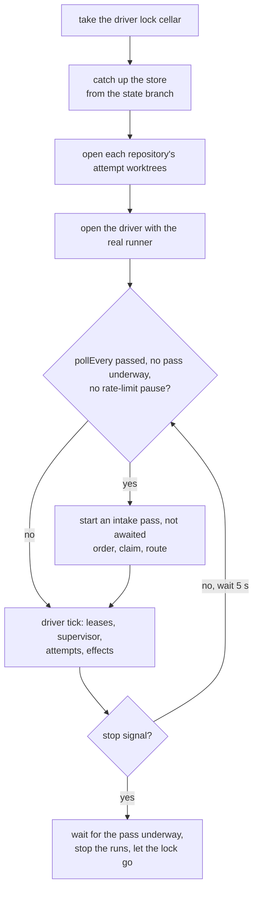

# Drivers

- **One event store per Brewery**, which the Cellar (`foedrum serve`) and interactive sessions drive batches on; every writer appends through the command log, one write transaction at a time ([ADR 0044](../../adr/0044-batch-leases-held-by-the-driver-and-one-command-log.md)).

- **One Brewery per work root, one process per driver** ([ADR 0037](../../adr/0037-attempt-worktrees-in-the-engine-and-driver-locks.md)).
  The work root records its Brewery in `brewery.json`, a marker that stays, and refuses the drivers of any other Brewery.
  Each driver (the Cellar as `cellar`, each interactive session under an id it keeps when resumed) holds `drivers/<owner>.lock`, an exclusive SQLite lock that the operating system frees when the process dies, so a crashed driver's lock is taken over without cleanup and a second process of a live driver is refused (`lockDriver`, `src/engine/driver-lock.ts`).

Foedrum has two **drivers** that share one deterministic engine library and one event store ([ADR 0019](../../adr/0019-interactive-sessions-and-one-command-layer.md)).
The autonomous one, the Cellar, runs this loop (`runServe`, `src/cli/serve.ts`); a slow GitHub never holds up a tick, because the intake pass is not awaited:

- **Autonomous:** the Cellar (`foedrum serve`) picks up orders and commands from GitHub, and later from the Brewhouse dashboard.
  Run in the Brewery's checkout, it reads `foedrum.jsonc` (with the Brewery's `brewery` name), `.foedrum/local.jsonc`, `models.jsonc` (optional: it merges by alias over Foedrum's `defaults/models.jsonc`, [ADR 0153](../../adr/0153-foedrum-s-defaults-map-their-own-model-aliases.md)) and the recipe files, checks `gh`'s login for the Brewery's GitHub host as doctor does, and refuses to start with one line per problem; then it takes the driver lock `cellar`, rebuilds or catches up its store from the state branch, opens each repository's attempt worktrees (making a managed clone first) and the driver with the real runner and the attempt plans, and ticks the driver every 5 seconds until a stop signal (Ctrl+C, a kill, a closed terminal, Ctrl+Break), which stops its runs and lets the lock go (`foedrum serve`, `src/cli/serve.ts` over the pure `serveSetup`; [ADR 0063](../../adr/0063-foedrum-serve-its-configuration-and-wiring.md)).
  Beside the ticks, never inside one, it runs the intake every `pollEvery` (default a minute, ADR 0052): a pass orders labelled Brewery issues, then claims target-repository issues, within `concurrency`, a recipe's `concurrency`, `openOrders` and the touches limit ([limits](../intake/limits.md)), and to its deadline of half a batch lease, and routes the Ordered batches by label; it also records the end of each pull request of a batch on tap, the checks on the head of the open ones once they finish, and checks the open ones against their base when its tip moved ([open pull requests](../intake/open-pull-requests.md)); it starts no pass during GitHub's rate-limit pause, and a stop waits for the pass underway.
  It reads `gh`'s login at its start and gives the driver the status comments, the lane labels, the comments of a conflict with a moved base ([open pull requests](../intake/open-pull-requests.md)), the merge brief of a ready pull request ([GitHub](../humans/github.md), [ADR 0225](../../adr/0225-a-ready-pull-request-gets-a-merge-brief.md)) and the hide of an outdated one ([ADR 0229](../../adr/0229-a-merge-brief-whose-head-moved-is-hidden-as-outdated.md)), the plan comment of an order whose batch has a succeeded plan ([ADR 0233](../../adr/0233-a-plan-is-an-out-doc-whose-paths-the-engine-checks-shown-as-one-comment-per-order.md)), and, first, the sub-issues of an approved plan, after whose last effect the driver records `order.decomposed` under the batch's lease ([ADR 0285](../../adr/0285-an-approved-plan-becomes-brewery-sub-issues-through-the-ledger.md)), as its effects ([ADR 0072](../../adr/0072-the-status-comment-edits-as-revisions-in-the-ledger.md), [ADR 0154](../../adr/0154-lane-labels-on-the-order-s-issue-and-the-status-comment-s-path-line.md)), and with a target intake, or a claimed batch in its store, the claim marks and releases beside them (`combineEffects`, [ADR 0068](../../adr/0068-the-intake-in-foedrum-serve-brewery-orders-and-routing-by-label.md)).

A batch has one driver at a time, held as a batch lease that the driver renews on every tick; an expired lease frees the batch ([ADR 0044](../../adr/0044-batch-leases-held-by-the-driver-and-one-command-log.md)).
A driver (`openDriver`, `src/engine/driver.ts`) takes its lock and runs `startDriver` before any work, takes a free batch only when told to (the Cellar every one, a session the batch it brews) and holds it until the batch has ended with no attempt running and no effect due, unless its `holds` lets the batch go sooner, as resume's driver does once the attempt that continues the session has ended ([ADR 0127](../../adr/0127-foedrum-resume-takes-a-running-batch-over-and-continues-its-step-s-session.md)).
It skips a batch another driver holds, and stops at the next step boundary when another driver holds one of its own: it records how its running attempt ends and starts nothing more there.
A run whose end rejects (the runner broke, not the attempt) is stopped and recorded like any other ended attempt, `blocked` + `environment` with the first line of the error's message, at most 120 characters, as its summary, and lets its lease go; the driver reports it with the whole error (`run_failed`) and its other runs go on ([ADR 0099](../../adr/0099-a-rejected-run-end-is-blocked-on-the-environment-not-a-failed-tick.md)).
An end whose record throws (deciding or appending its finish fails) is reported (`command_failed`) and keeps its lease until it expires, so the supervisor loses and retries its attempt ([ADR 0027](../../adr/0027-supervisor-lost-and-stalled-attempts.md)); a throw from the read of the state after a recorded end is reported as `command_failed` against that end's finish too, although that finish is recorded and its lease released: only the check whether its batch ended failed, and the driver's next look at the ended batches in the store still cleans its worktrees.
Either way the other ends of the pass are still recorded and let their leases go: the driver takes them off its queue one at a time (#278, #289).
Its supervisor acts on its own and the free batches only, and it applies a batch's effects only while it holds the batch's lease, renewed before each effect, one pass at a time, each within a deadline below the lease that aborts it ([ADR 0050](../../adr/0050-the-intake-of-target-repository-issues.md)).
Closing a driver stops the brewer runs it still has and lets its lock go; their ends are not recorded, so its next start loses and retries them (ADR 0063).
Taking over is an explicit, recorded command ([ADR 0124](../../adr/0124-foedrum-takeover-hands-a-batch-to-another-driver-as-a-recorded-command.md)): `foedrum takeover <batch> [--as <name>]`, or `foedrum brew <issue> --take`, puts the batch's lease to the new owner at once and records `batch.taken_over` with who, from where, from which owner and until when that owner's lease ran.
A driver records each start in the transaction that renews its batch's lease, so the one that lost the batch starts nothing more there; an attempt still running under it ends under its attempt lease, and the new holder waits for that lease, also of the attempt the old driver was starting (ADR 0055).
No driver applies an effect of the batch before the old lease's end, by which the effect the old driver may still be applying has ended.
`foedrum resume <batch> [<step>[#<n>]]` steps into a finished brewer attempt's own session (`claude --resume`) in its worktree, recreated when the cleanup removed it, with its settings file and its system prompt file written again ([ADR 0183](../../adr/0183-the-engine-s-fixed-rules-for-a-brewer-go-in-an-appended-system-prompt.md)), its guards on the command line and the attempt's own environment; it holds the attempt's lease, never the batch's, while claude runs in the foreground, says so when the session is not on this machine, and from inside a Claude Code session prints the line to run in a terminal instead ([ADR 0126](../../adr/0126-foedrum-resume-opens-a-finished-attempt-s-session-in-its-worktree.md)).
It finds the attempt's brewer in the recipe the attempt was scheduled under, and in the batch's recipe for an attempt that recorded none ([ADR 0265](../../adr/0265-foedrum-resume-finds-a-finished-attempt-s-brewer-in-the-recipe-it-was-scheduled-under.md)).
On an Ordered or Brewing batch, `foedrum resume <batch> [<step>]` takes the batch over for the step whose session runs or waits to be resumed (`batch.taken_over` with `resumes: <step>`), the driver it took the batch from stops its run of that step at its next tick and records it cancelled (a `foedrum brew` before it lets go), and resume drives the batch on serve's wiring until the retry that continues the session has ended: that attempt opens `claude --resume` in the foreground in its worktree and ends by the out doc the session wrote, then resume lets the batch go to the driver that takes it next, which goes on from the next step ([ADR 0127](../../adr/0127-foedrum-resume-takes-a-running-batch-over-and-continues-its-step-s-session.md)).
It refuses at once, taking nothing over, a step whose latest attempt is an interactive session still open, the one named or else any in the batch, with one line that [interactive steps](../recipes/interactive-steps.md) gives ([ADR 0231](../../adr/0231-foedrum-resume-refuses-an-interactive-step-whose-session-is-open.md)).
On a batch in a parallel group, it takes the child it names, or else the first child with a session, and the other children run on under their own leases until the driver that runs each records its end ([ADR 0168](../../adr/0168-a-parallel-group-runs-its-lens-steps-side-by-side.md)).

Only a driver given `sessions`, `foedrum brew` on a terminal, opens an interactive step's session; any other parks its scheduled attempt Stuck `waiting_for_session` through `await_session` ([interactive steps](../recipes/interactive-steps.md)).

The interactive driver: [foedrum brew and the plugin](../humans/brew.md).
