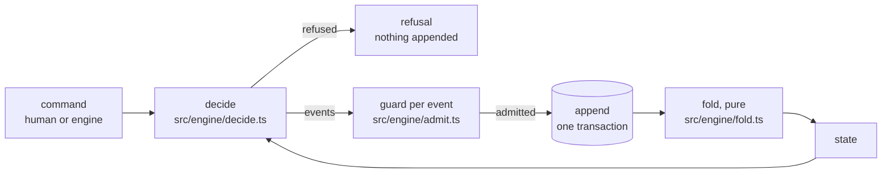

# Events

State is derived from an append-only event log ([ADR 0002](../../adr/0002-event-sourced-engine-on-node-sqlite.md)).
Every change takes one path: `decide` turns a command and the folded state into events or a refusal, the guard checks each event against the state the ones before it lead to, the command log appends them in the transaction it decided in, and the pure fold turns the log back into state (`createCommandLog`, `src/engine/command-log.ts`):

The event types, their fields and the types they use (`OrderRef`, `StuckReason`, `WaitCondition`, …) are defined once, as zod schemas, in [`src/schemas/events.ts`](../../../src/schemas/events.ts).
This table says what each one records.

| Event | Records |
|---|---|
| `batch.ordered` | An order became a batch: its issue (a Brewery issue, or a claimed issue of a target repository, whose order is a Brewery issue the driver opens, [ADR 0144](../../adr/0144-a-claimed-target-issue-gets-a-brewery-issue-that-is-its-order.md)), its parent batch, who routes it (`routeBy`), when it was ordered (`at`, absent on the orders from before [ADR 0179](../../adr/0179-the-live-line-redraws-in-place-and-leads-with-the-batch-s-time.md)); `by` and `via` together when a person ordered it ([ADR 0105](../../adr/0105-foedrum-order-orders-an-issue-again-as-a-human-command-recorded-on-batch-ordered.md)) |
| `batch.recipe_chosen` | The recipe and why, from a label, the router, or a person (with `by` and `via`, and `askedBy`, the step whose question the answer chose it by, [ADR 0232](../../adr/0232-foedrum-mash-routes-an-issue-to-the-innkeeper-whose-question-the-answer-chooses-the-recipe-by.md)) |
| `step.scheduled` | An attempt of a step and its deadline; `route` when an `onFail` or `onBlocked` route scheduled it ([ADR 0064](../../adr/0064-test-first-recipes-when-onblocked-and-a-red-proof-required.md)), or an `onPullRequestFail` route, with the pull request and the head whose checks failed ([ADR 0219](../../adr/0219-a-failing-check-on-an-open-pull-request-sends-its-batch-back-to-a-fix-step.md)), and `cause: 'merged_check'` with the base's `tip` when its merged tree failed ([ADR 0226](../../adr/0226-a-failing-check-on-the-merged-tree-sends-its-batch-back-to-the-fix-step.md)), or `cause: 'conflict'` when it conflicts with the base at `tip` ([ADR 0244](../../adr/0244-a-conflict-with-the-moved-base-sends-its-batch-back-to-the-fix-step.md)), `retry` because the attempt before it failed ([ADR 0117](../../adr/0117-a-retry-resumes-the-session-of-the-attempt-before-it-in-that-attempt-s-worktree.md)), `answered` because a person answered the questions of the attempt before it ([ADR 0118](../../adr/0118-retrymode-resume-loads-and-an-answer-resumes-the-session-that-asked.md)) |
| `step.skipped` | The step's `when` was false when the batch reached it (ADR 0064) |
| `step.started` | An attempt started: a brewer attempt's session, chosen by the driver ([ADR 0116](../../adr/0116-the-driver-records-each-attempt-s-session-and-claude-s-report-goes-on-step-finished.md)), with `resumes`, the session a retry or an answered attempt continues (ADR 0118), and `fallback`, why it started fresh instead (ADR 0117); and the worktree it was given (`repo`, `path`, `branch`, `commit`), none for a resumed session's attempt ([ADR 0037](../../adr/0037-attempt-worktrees-in-the-engine-and-driver-locks.md)); `interactiveSince`, when an interactive step's session opened ([ADR 0222](../../adr/0222-a-recipe-s-brewer-step-may-be-interactive.md)) |
| `step.finished` | How an attempt ended: its outcome, its token usage, a brewer attempt's setup reading ([ADR 0163](../../adr/0163-a-repository-s-setup-runs-before-a-brewer-attempt.md)), a check step's readings ([ADR 0069](../../adr/0069-check-steps-run-the-repositorys-commands-in-an-attempt-of-their-own.md): each `skipped`, `exited` with its exit code, `killed` (`timed-out`, `stopped` or `too-much-output`), `signaled` or `unstarted`, with the last 4,000 characters of the output, lines that look like secrets left out), the house-yeast rules its plan selected and cut and the rule files it left out as invalid ([ADR 0169](../../adr/0169-house-yeast-rules-reach-a-batch-s-brewers-by-scope-and-lens.md)), the attempt's receipt of what it took ([ADR 0172](../../adr/0172-an-attempt-s-receipt-from-its-stream.md)), and `paused` when the driver stopped it as its batch's pause reached its stopAt, so it counts against no retry ([pause and continue](../humans/pause.md)), `usageLimited` when it ended at a usage limit, which counts against no retry either ([the usage window](usage-window.md)), `findings` when a blocking Taster asked for changes: the first 100, cut as a Stuck reason's, and a count of the rest ([ADR 0221](../../adr/0221-foedrum-lenses-reports-each-lens-s-findings-their-ends-and-its-tokens.md)), the version and model claude's init reported, none when the run ended before it (ADR 0116) or ran as an engineer's interactive session ([ADR 0127](../../adr/0127-foedrum-resume-takes-a-running-batch-over-and-continues-its-step-s-session.md)) |
| `input.received` | A person's answers to a step's questions, with `by` and `via` |
| `batch.stuck` | Why (`needs_input` with its questions, `blocked` with its blocker kind and summary, and when a findings route ran out of rounds the rounds and the open findings (ADR 0192), `attempts_exhausted`, `deadline_passed`, `waiting_for_session`: an interactive step that a driver opening no session met (`await_session`) or whose session closed without a valid out doc (ADR 0222), `stalled`, `routing`: Ordered past its routing deadline, `stopped` with who stopped it, from where and why, ADR 0205, or `pull_request_failed` with the openPullRequest step, the pull request, the head whose checks failed, the rounds its `onPullRequestFail` route used, the first five failed checks and how many more, [ADR 0219](../../adr/0219-a-failing-check-on-an-open-pull-request-sends-its-batch-back-to-a-fix-step.md), or `plan_review` with the step and attempt whose plan waits for a person's review, [ADR 0275](../../adr/0275-a-finished-plan-waits-stuck-for-its-review-and-every-comment-links-the-doc-it-sums-up.md)), the options (`answer`, `approve`, `retry`, `skip`, `recipe`, `rewind`, `cancel`) and the reminder |
| `batch.resumed` | A person's `retry`, `skip`, `recipe` or `answer`; `routeBy` for a retry back to Ordered |
| `batch.approved` | A person's sign-off of the plan a batch Stuck as `plan_review` waits with: its step and attempt, `plan`, the digest of that attempt's recorded out doc, which the guard before append checks, `by`, `via` and `at`; the decider puts the batch on tap in the same decision ([ADR 0281](../../adr/0281-foedrum-approve-signs-off-a-plan-by-its-hash-and-puts-the-batch-on-tap.md)) |
| `order.decomposed` | A breakdown: its sub-orders, one repository each, with the paths each `touches` when the plan names them, and their dependencies (`code` or `release`) |
| `batch.waiting` | Conditioning on a merge, a release or a sibling batch, with a reminder |
| `bottle.opened` | A bottle: its repository, sub-orders and pull request |
| `release.observed` | A released version of a repository's package; the ready set counts it for a `release` blocker in that repository whose merge the fold recorded before it ([ADR 0216](../../adr/0216-a-release-blocker-is-done-once-its-repository-is-released-after-its-merge.md)); the intake records one once per version, when it holds the merges it waits for ([ADR 0223](../../adr/0223-the-intake-records-a-release-that-holds-a-waiting-release-blocker-s-merge.md)) |
| `batch.rewound` | A rewind to a step, with each repository's sha, `by` and `via` |
| `batch.on_tap` | A batch done, with its pull requests |
| `batch.cancelled` | A cancel, with `by` and `via` |
| `batch.taken_over` | A person handed the batch from driver `from` to `to`; no effect before `until`; `resumes` names the step whose session `to` continues, whose run `from` stops ([ADR 0127](../../adr/0127-foedrum-resume-takes-a-running-batch-over-and-continues-its-step-s-session.md), [ADR 0124](../../adr/0124-foedrum-takeover-hands-a-batch-to-another-driver-as-a-recorded-command.md)) |
| `pull_request.ended` | A pull request merged or closed, recorded once, by the intake |
| `pull_request.base_checked` | How an open pull request merges with its base's tip that moved: the tip, the head it merged (`head`, absent in an older log, [ADR 0226](../../adr/0226-a-failing-check-on-the-merged-tree-sends-its-batch-back-to-the-fix-step.md)), and the conflicting files, which send the batch back ([ADR 0244](../../adr/0244-a-conflict-with-the-moved-base-sends-its-batch-back-to-the-fix-step.md)), or the bottle branch's tip when someone else pushed to it, or on a clean merge the first reading of the checks on the merged tree that did not pass (`failed`) or why they did not run (`unchecked`) ([open pull requests](../intake/open-pull-requests.md), [ADR 0203](../../adr/0203-an-open-pull-request-s-checks-run-on-its-merged-tree-when-its-base-moves.md)) |
| `pull_request.pair_checked` | How the head of a batch's open pull request merges with another open pull request's head of the Brewery's in the same repository, once per pair of heads, recorded for each of the two batches: both heads, the other pull request, and the conflicting files, which hold nothing ([open pull requests](../intake/open-pull-requests.md), [ADR 0230](../../adr/0230-open-pull-requests-of-one-repository-are-merge-tree-checked-against-each-other.md)) |
| `pull_request.checks_pending` | A check on an open pull request's head still runs, or none is there yet, as the first pass that saw it found, or again once a finished head has a running check: the head and since when ([open pull requests](../intake/open-pull-requests.md), [ADR 0213](../../adr/0213-an-open-pull-request-s-checks-on-its-head-are-recorded-once-they-finish.md)) |
| `pull_request.checks_finished` | Every check on an open pull request's head finished: the head, each check's name, kind, conclusion and https link, links of at most 2,000 characters, at most 100 checks with the failed first, and how many `more`; again on the same head when its checks changed (a re-run) |
| `effect.applied` | The idempotency ledger for external side effects ([the event store](event-store.md)) |
| `order.paused` | A person's pause of an order, or with no `order` of the whole Brewery and its intake, with `by`, `via`, the reason (`why`) and when what still runs is stopped (`stopAt`, with the `zone` it was given in) ([pause and continue](../humans/pause.md)) |
| `order.continued` | A person lifted an order's pause, or with no `order` every pause, with `by` and `via` |
| `order.ranked` | A person moved an order of the intake's queue to a position, kept as an arrival and a tie, or marked it to finish first, with `by`, `via` and `why` ([ranking](../intake/ranking.md)) |
| `step.rescheduled` | The new deadline of a scheduled attempt that had not started when its batch was paused, as its pause is lifted, or while a usage window was closed, as one reopens |
| `usage.window_closed` | A brewer's attempt ended at a usage limit: the `limit`, which names the window's scope (`session` and `weekly` every brewer's, `Opus` and `Sonnet` their family's), claude's `resets` text, the UTC `reopensAt` and whether the reset was `read` ([the usage window](usage-window.md)) |
| `usage.window_opened` | The usage window of `scope` (`all`, `Opus` or `Sonnet`) reopened `at` its `reopensAt`: the brewer attempts it held start again; without a `scope`, as logs before ADR 0215 wrote it, every closed window reopened |

`Surface` is `plugin`, `terminal`, `comment` or `dashboard`.
Session ids are part of the state, so any action can resume the right session ([ADR 0019](../../adr/0019-interactive-sessions-and-one-command-layer.md)).

The zod schemas in `src/schemas/` are the source of the event types.
Every object is strict (unknown fields are rejected), batch and step ids are path segments ([ADR 0024](../../adr/0024-state-branch-layout-outbox-and-divergence.md)), timestamps are ISO 8601 in UTC, a pull request is its web URL, `https://<host>/<owner>/<name>/pull/<n>` written as the URL parser writes it, with a valid `owner/name`, nothing after the number and no credentials (`PullRequestUrl`, read by `pullRequestOf`), a check's link any `https` URL without credentials, shas are full commit hashes, an effect key is the canonical JSON text `["batchId","stepId",attempt,"effect"]`, or `["batchId","effect"]` for an effect of a batch rather than one of its attempts (a claim's marks and release, [ADR 0043](../../adr/0043-target-repository-issues-as-a-work-queue-claimed-by-a-ref.md)), exactly as `JSON.stringify` writes it, and a breakdown's dependencies may only name its own sub-orders and never form a cycle.
