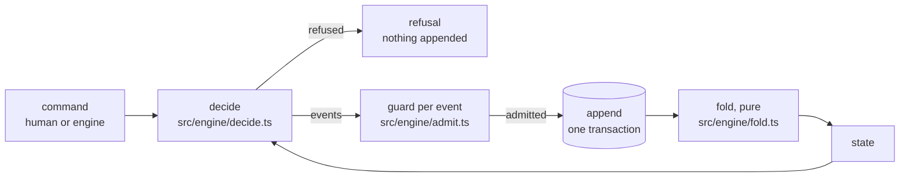

# Events

State is derived from an append-only event log ([ADR 0002](../../adr/0002-event-sourced-engine-on-node-sqlite.md)).
Every change takes one path: `decide` turns a command and the folded state into events or a refusal, the guard checks each event against the state the ones before it lead to, the command log appends them in the transaction it decided in, and the pure fold turns the log back into state (`createCommandLog`, `src/engine/command-log.ts`):

The event types, their fields and the types they use (`OrderRef`, `StuckReason`, `WaitCondition`, …) are defined once, as zod schemas, in [`src/schemas/events.ts`](../../../src/schemas/events.ts).
This table says what each one records.

| Event | Records |
|---|---|
| `batch.ordered` | An order became a batch: its order (a Brewery issue, or a claimed issue of a target repository), its parent batch, who routes it (`routeBy`); `by` and `via` together when a person ordered it ([ADR 0105](../../adr/0105-foedrum-order-orders-an-issue-again-as-a-human-command-recorded-on-batch-ordered.md)) |
| `batch.recipe_chosen` | The recipe and why, from a label, the router, or a person (with `by` and `via`) |
| `step.scheduled` | An attempt of a step and its deadline; `route` when an `onFail` or `onBlocked` route scheduled it ([ADR 0064](../../adr/0064-test-first-recipes-when-onblocked-and-a-red-proof-required.md)), `retry` because the attempt before it failed ([ADR 0117](../../adr/0117-a-retry-resumes-the-session-of-the-attempt-before-it-in-that-attempt-s-worktree.md)), `answered` because a person answered the questions of the attempt before it ([ADR 0118](../../adr/0118-retrymode-resume-loads-and-an-answer-resumes-the-session-that-asked.md)) |
| `step.skipped` | The step's `when` was false when the batch reached it (ADR 0064) |
| `step.started` | An attempt started: a brewer attempt's session, chosen by the driver ([ADR 0116](../../adr/0116-the-driver-records-each-attempt-s-session-and-claude-s-report-goes-on-step-finished.md)), with `resumes`, the session a retry or an answered attempt continues (ADR 0118), and `fallback`, why it started fresh instead (ADR 0117); and the worktree it was given (`repo`, `path`, `branch`, `commit`), none for a resumed session's attempt ([ADR 0037](../../adr/0037-attempt-worktrees-in-the-engine-and-driver-locks.md)) |
| `step.finished` | How an attempt ended: its outcome, its token usage, a check step's readings ([ADR 0069](../../adr/0069-check-steps-run-the-repositorys-commands-in-an-attempt-of-their-own.md): each `skipped`, `exited` with its exit code, `killed` (`timed-out`, `stopped` or `too-much-output`), `signaled` or `unstarted`, with the last 4,000 characters of the output, lines that look like secrets left out), and the version and model claude's init reported, none when the run ended before it (ADR 0116) |
| `input.received` | A person's answers to a step's questions, with `by` and `via` |
| `batch.stuck` | Why (`needs_input` with its questions, `blocked` with its blocker kind and summary, `attempts_exhausted`, `deadline_passed`, `waiting_for_session`, `stalled`, or `routing`: Ordered past its routing deadline), the options (`answer`, `retry`, `skip`, `recipe`, `rewind`, `cancel`) and the reminder |
| `batch.resumed` | A person's `retry`, `skip`, `recipe` or `answer`; `routeBy` for a retry back to Ordered |
| `order.decomposed` | A breakdown: its sub-orders, one repository each, and their dependencies (`code` or `release`) |
| `batch.waiting` | Conditioning on a merge, a release or a sibling batch, with a reminder |
| `bottle.opened` | A bottle: its repository, sub-orders and pull request |
| `release.observed` | A released version of a repository's package |
| `batch.rewound` | A rewind to a step, with each repository's sha, `by` and `via` |
| `batch.on_tap` | A batch done, with its pull requests |
| `batch.cancelled` | A cancel, with `by` and `via` |
| `batch.taken_over` | A person handed the batch from driver `from` to `to`; no effect before `until` ([ADR 0124](../../adr/0124-foedrum-takeover-hands-a-batch-to-another-driver-as-a-recorded-command.md)) |
| `pull_request.ended` | A pull request merged or closed, recorded once, by the intake |
| `effect.applied` | The idempotency ledger for external side effects ([the event store](event-store.md)) |

`Surface` is `plugin`, `terminal`, `comment` or `dashboard`.
Session ids are part of the state, so any action can resume the right session ([ADR 0019](../../adr/0019-interactive-sessions-and-one-command-layer.md)).

The zod schemas in `src/schemas/` are the source of the event types.
Every object is strict (unknown fields are rejected), batch and step ids are path segments ([ADR 0024](../../adr/0024-state-branch-layout-outbox-and-divergence.md)), timestamps are ISO 8601 in UTC, pull requests are `https` URLs without credentials, shas are full commit hashes, an effect key is the canonical JSON text `["batchId","stepId",attempt,"effect"]`, or `["batchId","effect"]` for an effect of a batch rather than one of its attempts (a claim's marks and release, [ADR 0043](../../adr/0043-target-repository-issues-as-a-work-queue-claimed-by-a-ref.md)), exactly as `JSON.stringify` writes it, and a breakdown's dependencies may only name its own sub-orders and never form a cycle.
