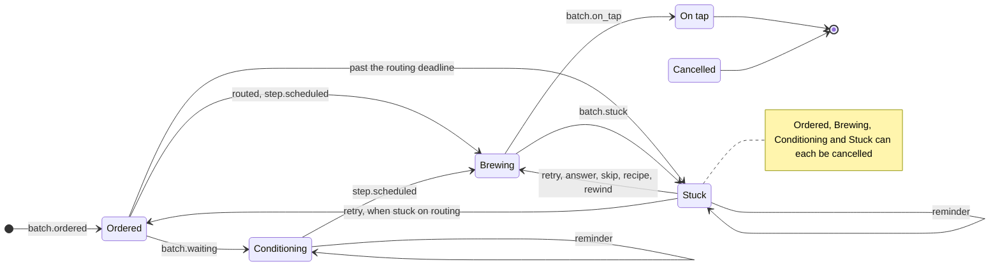

# Batch lifecycle

A batch's lane is the state of its state machine: each event moves it, and the guard allows each event only from the lanes it may come from (`rule`, `src/engine/admit.ts`; the lane it leads to, `src/engine/fold.ts`).

Brewing → Conditioning between steps comes once a recipe step needs it (ADR 0025); until then a batch enters Conditioning only from Ordered.
A retry of a batch Stuck on routing sends it back to Ordered with a new routing deadline; `recipe` brews it (ADR 0032).

The state machine (`src/engine/decide.ts`) is the core of the command layer: it takes the folded state and one command and returns the events to append, or a refusal ([ADR 0025](../../adr/0025-batch-lifecycle-stuck-reminders-and-rewind.md)).
It handles every step outcome and blocker kind itself, and asks the recipe only where a step leads, through a small interface (`src/engine/recipes.ts`).
On tap and cancelled are terminal.
A blocked out doc is recorded as a final failure and routed by its blocker kind ([the out doc contract](../recipes/out-doc.md)).
Rewind is allowed only from Stuck.

The supervisor (`src/engine/supervisor.ts`, run on an interval by `src/engine/supervisor-loop.ts`) is the engine's one liveness mechanism ([ADR 0027](../../adr/0027-supervisor-lost-and-stalled-attempts.md)).
Each tick it turns the due deadlines, the expired leases and the runner's progress signals into engine commands for the state machine, at most one per batch: an attempt past its deadline is expired (Stuck, `deadline_passed`); an Ordered batch past its routing deadline is unrouted (Stuck, `routing`, [ADR 0032](../../adr/0032-routing-deadline-for-ordered-batches.md)); a due Conditioning or Stuck reminder is repeated; a started attempt whose lease expired is lost and retried while the step has attempts left (else Stuck, `attempts_exhausted`); an attempt without a file write or commit for the step's `stall` limit makes the batch Stuck (`stalled`).
Every expired lease is released.
Each command is appended in a transaction of its own, so one that throws is reported and the others go on.
The tick then flushes the state branch, also when it failed, so events a failed push left behind do not wait for the next step boundary; flushes that fail past their deadline (default 10 minutes) are reported, and a `StateBranchStopError` stops the supervisor.
Engine-generated batch ids are `<issue>-<n>` (`src/engine/batch-id.ts`), which always pass `PathSafeId`.

Board lanes are these states: **Ordered · Brewing · Conditioning ⏳ · Stuck 🔔 · On tap**.
Conditioning is waiting with a visible reason ("waiting for lib-core ≥ 2.4.0") and a reminder (default: after 2 days, then every 2 days; configurable per Brewery and recipe, for now one interval per supervisor: [ADR 0027](../../adr/0027-supervisor-lost-and-stalled-attempts.md)) — never silent, but not a failure either.
A Stuck batch has a reminder as well, with the same default.
An Ordered batch waits to be routed by a routing deadline (default 1 hour); past it, it is Stuck on routing ([ADR 0032](../../adr/0032-routing-deadline-for-ordered-batches.md)).
