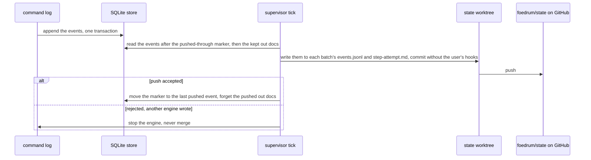

# State in the Brewery repository

The Brewery is a git repository, so it also holds Foedrum's durable state ([ADR 0011](../../adr/0011-state-in-the-brewery-repository.md)).
SQLite is written first; the supervisor's next tick flushes the new events to the state branch, and a rejected push stops the engine instead of merging (`StateBranchStopError`, `src/engine/state-branch-git.ts`):

- On a dedicated **`foedrum/state` branch** (keeping `main` for configuration), each batch has a folder with an append-only `events.jsonl` and its **out docs** (plans, reviews, reports) — readable, reviewable history.
  Events without a batch (bottles, releases) go to a top-level `events.jsonl`.
  Every line carries the store's event id, so a rebuild merges the files by id and gets the same ids and state ([ADR 0024](../../adr/0024-state-branch-layout-outbox-and-divergence.md)).
  Batch and step ids are path segments: lower case, a letter or digit at both ends, at most 64 characters, no Windows device names (`src/schemas/ids.ts`).
  A remote branch with a symbolic link or submodule is refused before checkout.
- **Out docs** go through the store ([ADR 0103](../../adr/0103-out-docs-reach-the-state-branch-through-the-store.md)): the runner ends an attempt with the text it read, `keepOutDocs` keeps it in the store before the driver records `step.finished`, and the flush writes it at `batches/<batch>/<step>-<attempt>.md` in the commit of that event, then forgets it with the marker.
  A kill in between leaves both on the branch, or the next flush writes the doc again; a doc kept after its events were pushed (an abandoned attempt's) is pushed alone.
  The text is model output: stored byte for byte, never a log, never read back as an instruction, and past 256 KiB replaced by a fixed line.
  So its body outlives the worktree the cleanup deletes; `foedrum replay` points at it.
- State is committed at **every step boundary** (`step.finished`, or any event that changes a batch's lane) and pushed.
  SQLite is written first; a flush writes every event after the store's pushed-through marker, commits, pushes and only then moves the marker.
  The local SQLite database is an index and working store that `foedrum serve` rebuilds from the state branch on any machine.
- The branch has its own worktree of the Brewery clone in the work root.
  Commits and pushes skip the user's git hooks; signing follows the clone, and a test commit at start-up refuses to start when signing cannot work unattended.
- **One writer of the state worktree at a time:** a start and a flush hold its writer lock, `<workRoot>/state.lock` (a SQLite file lock, as the driver locks are), so an `index.lock` or `HEAD.lock` a killed git left in the worktree's git folder, and the locks of the branch's ref and the signing check's ref (`refs/heads/foedrum/state.lock`, `refs/foedrum/signing-check.lock`) in the clone's common git folder, are stale at once (its git runs with auto gc and maintenance off, so none outlives the lock): the start removes the clone's before it opens the worktree (whose add may create the branch) and the worktree's before the test commit, a flush all four before it writes, each saying so in one line with the folder it was in, and a flush whose commit left the branch where it was (a user's gc packed it back) fails without pushing ([ADR 0111](../../adr/0111-the-state-branch-s-ref-lock-and-head-lock-are-stale-under-the-writer-lock.md), [ADR 0115](../../adr/0115-no-git-of-the-state-branch-outlives-the-writer-lock-and-its-ref-locks-go-before-the-worktree.md)).
  A start waits up to 150 s for another driver's writer lock; a flush that finds it held fails, and the next tick retries ([ADR 0107](../../adr/0107-one-writer-of-the-state-worktree-at-a-time-and-its-stale-index-lock.md)).
- **One active engine per Brewery:** a rejected push means another engine wrote in between; the engine stops instead of diverging.
  At start-up a missing or behind database is rebuilt from the branch; unpushed local events while the branch moved stop the engine with an error naming both heads.
  Foedrum never merges or rewrites state history.
- **Rewind:** every step records the commit SHA of each repository involved.
  `/foedrum rewind <step>`, offered when a batch is Stuck, resets the batch's branches to those SHAs and appends a `batch.rewound` event that records them.
  History is never rewritten; work continues from an earlier point.
  An already open bottle is **updated in place**: its branch is force-pushed to the rewound state and a comment on the pull request explains the rewind.
  Not yet: for now a batch whose task tree moved after its push fails its openPullRequest action and goes Stuck, rather than going on tap with the old pull request ([ADR 0071](../../adr/0071-the-openpullrequest-action-two-effects-of-the-batch.md)).
- **No duplicate pull requests after a crash:** branch names are deterministic (`foedrum/<batch>/<repo>`, the repository as `<owner>.<name>`), so Foedrum looks up an existing pull request before creating one, even if the last event never reached the state branch; the push and the pull request are effects of the batch in the ledger ([ADR 0071](../../adr/0071-the-openpullrequest-action-two-effects-of-the-batch.md)).
  A branch is pushed to a target repository as `foedrum/<brewery>/<rest>` for the local `foedrum/<rest>`, the Brewery as `<owner>.<name>` in lower case (`remoteBranch`, `src/workspace/attempt-worktrees.ts`), so two Breweries with the same batch ids never push the same branch; the lookup uses that name ([ADR 0043](../../adr/0043-target-repository-issues-as-a-work-queue-claimed-by-a-ref.md)).
