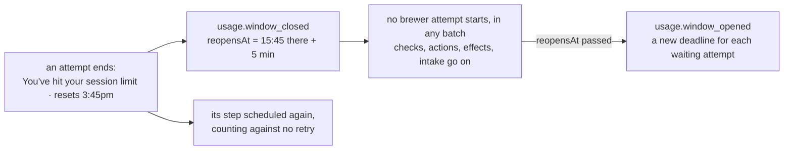

# The usage window

When claude hits a usage limit of its subscription, the engine holds every brewer attempt until the window reopens, and goes on by itself after the reset ([ADR 0206](../../adr/0206-a-run-out-usage-window-holds-every-brewer-attempt-until-it-reopens.md)).

- The runner reads the four documented limits (`session`, `weekly`, `Opus`, `Sonnet`) into the blocked ending's `usageLimit` ([how a brewer runs](../recipes/how-a-brewer-runs.md), [ADR 0091](../../adr/0091-a-run-out-usage-window-blocks-on-the-environment.md)).
- The driver reads the reset in the machine's time zone (`zone`, the machine's by default) as the next moment that matches: `3:45pm` today, or tomorrow once past; `Mon 12:00am` the coming Monday, or the Monday after once past; the wall-clock time is kept across a change of clocks (`reopenOf`, `src/engine/usage-window.ts`).
  It adds a margin of 5 minutes; a reset in another form, or a zone ICU cannot use, reopens the window an hour on, recorded with `read: false`.
- `finish` records the attempt's `step.finished` with `usageLimited`, appends `usage.window_closed` with the limit, claude's reset text, the UTC `reopensAt` and `read`, and schedules the step again as a retry; the recipe counts its attempts without it, so even a step's last allowed attempt leaves the batch brewing.
  A usage limit on an end not blocked on the environment, or without the reopen, is refused.
- A limit while the window is closed moves the reopen only when its own is later; a limit after the reopen closes it again.
- While the window is closed (`State.usageWindow`) the driver starts no scheduled attempt that runs a brewer (`brews`), and starts check steps and action steps as before; a running attempt is not stopped.
- No scheduled attempt that has not started expires while the window is closed, whatever its step: the supervisor issues no `expire` for it and `decide` refuses one.
  The window has a deadline, its `reopensAt`, so this is no exception to I5.
- When `reopensAt` has passed, the supervisor issues `reopen` before its batches' commands: `usage.window_opened`, then `step.rescheduled` for each waiting attempt of each brewing batch no pause holds, as on `continue`; a paused batch gets its deadline at its `continue`, and a Stuck batch, a stopped one included, stays Stuck.
- A spend limit or a too-low credit balance still makes the batch Stuck ([ADR 0129](../../adr/0129-a-spend-limit-or-a-too-low-credit-balance-blocks-on-the-environment.md)).
- An Opus or Sonnet limit holds every brewer too, until #537 holds only that family.
- The status comment of a brewing batch says `⏳ Usage window closed: claude hit its <limit> limit, which resets <reset>; brewers wait until <hh:mm> UTC, <day month>` (`try again at` for an unread reset); `foedrum status` prints the line above the board, and `foedrum replay` lists the window's events since the last reopen before the batch was ordered.
- Both events name no batch, so they go to the state branch's top-level log.
