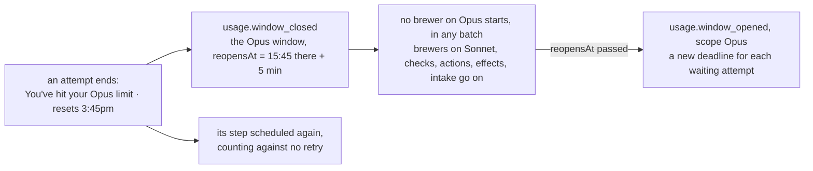

# The usage window

When claude hits a usage limit of its subscription, the engine holds the brewer attempts that limit covers until its window reopens, and goes on by itself after the reset ([ADR 0206](../../adr/0206-a-run-out-usage-window-holds-every-brewer-attempt-until-it-reopens.md)).
A session or weekly limit holds every brewer; an Opus or Sonnet limit only the brewers on that model family, and those whose family cannot be told ([ADR 0215](../../adr/0215-an-opus-or-sonnet-limit-holds-only-the-brewers-of-its-family.md)).

- The runner reads the four documented limits (`session`, `weekly`, `Opus`, `Sonnet`) into the blocked ending's `usageLimit` ([how a brewer runs](../recipes/how-a-brewer-runs.md), [ADR 0091](../../adr/0091-a-run-out-usage-window-blocks-on-the-environment.md)).
- The limit names its window's scope (`scopeOf`): `all` for a session or weekly limit, `Opus` and `Sonnet` for theirs.
- The driver reads the reset in the machine's time zone (`zone`, the machine's by default) as the next moment that matches: `3:45pm` today, or tomorrow once it passed over an hour ago; `Mon 12:00am` the coming Monday, or the Monday after once it passed over an hour ago (a reset handled minutes late is still the one claude named, also across midnight); the wall-clock time is kept across a change of clocks (`reopenOf`, `src/engine/usage-window.ts`).
  It adds a margin of 5 minutes; a reset in another form, or a zone ICU cannot use, reopens the window an hour on, recorded with `read: false`.
- `finish` records the attempt's `step.finished` with `usageLimited`, appends `usage.window_closed` with the limit, claude's reset text, the UTC `reopensAt` and `read`, and schedules the step again as a retry; the recipe counts its attempts without it, so even a step's last allowed attempt leaves the batch brewing.
  A usage limit on an end not blocked on the environment, or without the reopen, is refused.
- A limit while its scope's window is closed moves that reopen only when its own is later; a limit of another scope closes its own window beside it; a limit after the reopen closes the window again.
- The closed windows are `State.usageWindows`, one per scope.
  A `usage.window_closed` logged before ADR 0215 folds by its limit too, and a `usage.window_opened` without a `scope` opens every closed window.
- A brewer attempt's family is read from its model as the attempt runs it, a blind-tasting swap included (`familyOfBrewer`, `src/brewers/attempt-plan.ts`): Opus when a word of the model id or family is `opus`, Sonnet when one is `sonnet` (`familyOf`).
  A model of another family, with both words, or a brewer whose alias has no model cannot be told, and every closed window holds it.
- While the `all` window or the window of its family is closed, the driver starts no scheduled attempt that runs a brewer (`brews`, `family`), and starts check steps and action steps as before; a running attempt is not stopped.
- No scheduled attempt that has not started expires while any window is closed, whatever its step or family: the supervisor issues no `expire` for it and `decide` refuses one.
  Each window has a deadline, its `reopensAt`, so this is no exception to I5.
- When one or more `reopensAt` have passed, the supervisor issues `reopen` before its batches' commands: a `usage.window_opened` for each of those windows, with its `scope`, then `step.rescheduled` for each waiting attempt of each brewing batch no pause holds, as on `continue`, also while another window stays closed; a paused batch gets its deadline at its `continue`, and a Stuck batch, a stopped one included, stays Stuck.
- A spend limit or a too-low credit balance still makes the batch Stuck ([ADR 0129](../../adr/0129-a-spend-limit-or-a-too-low-credit-balance-blocks-on-the-environment.md)).
- The status comment of a brewing batch says, for each closed window, every brewer's first, then Opus, then Sonnet: `⏳ Usage window closed: claude hit its <limit> limit, which resets <reset>; brewers wait until <hh:mm> UTC, <day month>`, or for a family `⏳ Opus usage window closed: claude hit its Opus limit, which resets <reset>; brewers on Opus wait until …` (`try again at` for an unread reset).
  Plain `foedrum status` prints the same lines above its batches (not the `--watch` board), and `foedrum replay` lists the window events since every window was last open before the batch was ordered.
- Both events name no batch ([the state branch](state-branch.md)).
