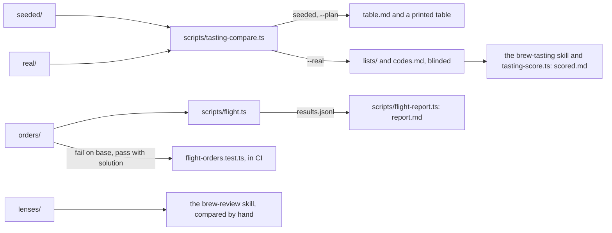

# Evaluation: the tasting room and the Flight

Foedrum's tests show that its code does what it should ([Testing](testing/README.md)).
Evaluation measures how well its brewers, recipes, lenses and models do on work like a person's.
No test can pin that down, since a model's answer differs from run to run.

## The tasting room

The **tasting room** is `tasting-room/` at the repository's root: Foedrum's benchmark ([ADR 0404](../adr/0404-the-flight-s-tasting-room-is-a-folder-of-orders-each-proved-by-its-hidden-tests.md), [ADR 0410](../adr/0410-the-tasting-room-holds-all-benchmark-material-a-folder-per-kind.md)).
It is kept apart from `test/fixtures/`, which holds inputs for tests of Foedrum's own code.
It has a folder per kind of material, and [its README](../../tasting-room/README.md) says what each is for:
- `orders/`: the Flight's orders. Each is a tiny made-up repository with one trap a weaker setup can miss, the order's text, **hidden acceptance tests** a brewer never sees and a reference solution;
- `seeded/`: a seeded change with one planted defect per default diff lens and its key, and in `seeded/plan/` a seeded plan with one planted mistake per default plan lens;
- `real/`: the three orders of #879 as they stood when they brewed, and the pinned Taster the real setups start from;
- `lenses/`: planted-defect samples, each a change whose expected findings its README lists.

How the parts fit:



## What runs today

Every comparison is a script or a skill run by hand from a checkout.
A real run needs `claude`'s login and spends tokens, which no test may ([ADR 0057](../adr/0057-real-claude-tests-are-opt-in-and-claude-proofs-leave-the-suite.md)).
Each brews with `foedrum brew`'s own run in a scratch Brewery on the fake code host.
It keeps its runs and records under `.foedrum/tmp/tasting-compare/`, a Flight's under `.foedrum/tmp/flight/`, and goes on where it stopped when run again.
`--dry-run` plays every model step scripted, so it shows what a run will do before any token is spent.
A dry run keeps its records in a `dry-run/` folder of their own, inside the folder a real run uses.
`--runs <n>` sets the runs per setup (3 when left out).

- **The seeded comparison:** do the default diff lenses find the planted defects better apart or together?

  ```
  node scripts/tasting-compare.ts
  node scripts/tasting-compare.ts --dry-run
  ```

  It tastes `seeded/`'s change in three setups: the seven default diff lenses apart, the seven together, and Nip's three as measured together ([ADR 0224](../adr/0224-the-default-recipes-taste-apart-or-together-as-a-seeded-comparison-measured.md)).
  It prints a table of the planted defects each setup found, the other findings, tokens and time, and writes `results.jsonl` and `table.md` under `.foedrum/tmp/tasting-compare/`.

  On another model and effort:

  ```
  node scripts/tasting-compare.ts --model strong --effort larger
  ```

  `--model <level or id> --effort <effort>` runs every Taster step on that model and effort ([ADR 0405](../adr/0405-the-seeded-comparison-tastes-on-a-given-model-and-effort.md)).
  Its records are kept apart, under `seeded/<model>-<effort>`.
- **The seeded plan:** do the default plan lenses find the planted mistakes better apart or together?

  ```
  node scripts/tasting-compare.ts --plan
  node scripts/tasting-compare.ts --plan --dry-run
  ```

  It tastes `seeded/plan/` with the seven default plan lenses apart and together, and mash's three together; the plan itself is scripted ([ADR 0323](../adr/0323-a-seeded-plan-measures-the-plan-lenses-apart-and-together-after-the-merge.md)).
  It writes its records and table under `.foedrum/tmp/tasting-compare/plan/`.
- **Real heads:** what do fixed Taster setups find on the heads of three real orders?

  ```
  node scripts/tasting-compare.ts --real
  node scripts/tasting-compare.ts --real --setups opus,high --orders 867 --comparison my-check
  node scripts/tasting-compare.ts --real --dry-run
  ```

  It tastes the brewed heads of `real/`'s three orders in fixed Taster setups, #867 also with its maintainer's comment ([ADR 0332](../adr/0332-tasting-compare-real-re-tastes-brewed-heads-and-writes-blinded-lists.md), [ADR 0333](../adr/0333-a-brewer-s-order-holds-the-maintainers-comments.md)).
  `--setups` and `--orders` choose among them, and `--comparison <name>` keeps a comparison's runs apart.
  It writes one blinded list per order in `lists/`, with the setups named only in `codes.md`, under `.foedrum/tmp/tasting-compare/real/`, or `real/comparisons/<name>/` with `--comparison`.
  It scores nothing: the key is in #879, out of the repository, since a Taster reads the repository.
  Every setup but `today`, `nip`, `deep` and `apart7` starts from `real/taster-reads.md`, so each tastes as it did when it was measured ([ADR 0352](../adr/0352-nip-s-correctness-acceptance-and-security-tasters-run-at-high-effort-without-the-rules-read.md)).
- **A real brewer:** how well does a real Cellarman on a given model and effort build the three heads again?

  ```
  node scripts/tasting-compare.ts --real --brewer cellarman --model claude-sonnet-5-5 --effort larger
  node scripts/tasting-compare.ts --real --brewer cellarman --model claude-sonnet-5-5 --effort larger --dry-run
  ```

  It builds the three heads again with a real Cellarman from their own failing tests ([ADR 0394](../adr/0394-tasting-compare-real-runs-a-real-cellarman-on-a-model-and-effort-it-is-given.md)).
  It records whether the checks passed, attempts, tokens and time, for a person to score blind.
  It writes one blinded list per order under `.foedrum/tmp/tasting-compare/real/brewers/`, or `real/comparisons/<name>/brewers/` with `--comparison`, with the setups named only in `codes.md`.
  A dry run's Cellarman is scripted, so its count of passed checks measures nothing: a dry run shows the setup only.

  From the real Brewmaster's plan, and with the Maltster's map:

  ```
  node scripts/tasting-compare.ts --real --sub-orders
  node scripts/tasting-compare.ts --real --brewer cellarman --model claude-sonnet-5-5 --effort larger --order-text plan
  node scripts/tasting-compare.ts --real --brewer cellarman --model claude-sonnet-5-5 --effort larger --map
  ```

  `--real --sub-orders` keeps the real Brewmaster's plan of each order, in `.foedrum/tmp/tasting-compare/real/sub-orders/<order>.md`.
  `--order-text plan` then starts the Cellarman from it ([ADR 0396](../adr/0396-tasting-compare-real-starts-a-cellarman-run-from-the-brewmaster-s-kept-sub-order.md)).
  `--map` runs a real Maltster's map step first ([ADR 0398](../adr/0398-tasting-compare-real-measures-cellarman-with-and-without-the-maltster-s-map.md)).
  Every brewer run counts each step's `Grep`, `Glob` and `Read` calls.
  Each takes `--dry-run` too.
- **A Taster built from settings:** what does a Taster setup made from four settings find on the three heads?

  ```
  node scripts/tasting-compare.ts --real --brewer taster --model strong --effort larger --lenses apart --rules reads
  node scripts/tasting-compare.ts --real --brewer taster --model strong --effort larger --lenses apart --rules reads --dry-run
  ```

  `--model <level or id> --effort <effort> --lenses apart|together --rules reads|bare` make the setup ([ADR 0402](../adr/0402-tasting-compare-real-tastes-with-a-taster-setup-built-from-settings.md)).
  Its records and lists go beside the fixed setups', under `.foedrum/tmp/tasting-compare/real/`.
- **`/brew-tasting`:** how does that Taster setup score against #879's key?

  ```
  /brew-tasting --model strong --effort larger --lenses apart --rules reads
  /brew-tasting --model strong --effort larger --lenses apart --rules reads --dry-run
  ```

  In Claude Code, it runs the Taster built from the settings a person names ([ADR 0403](../adr/0403-a-skill-tastes-the-settings-a-person-names-and-a-script-unblinds-a-blind-scorer-s-marks.md)).
  A read-only `taster` agent that never sees the setups scores the lists against #879's key.
  `scripts/tasting-score.ts` unblinds its marks into one table, `scored.md`, in `.foedrum/tmp/tasting-compare/real/comparisons/<name>/`.
  With `--dry-run` it stops before the key and the scorer, and says where the lists are.
  The skill's unblinding step, which a person can also run alone:

  ```
  node scripts/tasting-score.ts --folder <folder> --key <folder>/key.md --marks <folder>/marks.json
  ```

- **The lens samples:** does the review skill or a lens still find what it should after its prompt changed?
  A change to the review skill or a lens is run by `/brew-review` against `lenses/planted-demo`.
  The acceptance lens is run against `lenses/planted-acceptance`.
  The test-design lens is also run against `planted-drifted-fake`, `planted-empty-passes` and `planted-snapshot-only`.
  The run is compared by hand with the sample's table of expected findings (CLAUDE.md, Tests).
  There is no command of its own and no dry run.
- **The Flight's fairness proof:** is every order fair?

  ```
  node scripts/with-checkout-tmp.ts --import ./scripts/lower-priority.ts --test test/integration/flight-orders.test.ts
  ```

  For every order in `orders/`, `test/integration/flight-orders.test.ts` runs its hidden tests twice ([ADR 0404](../adr/0404-the-flight-s-tasting-room-is-a-folder-of-orders-each-proved-by-its-hidden-tests.md)):
  on the starting repository, where they must fail, and with the reference solution, where they must pass.
  It needs no model, so CI runs it with the other integration tests.
  It proves an order fair, not that a brewer solves it.
- **A Flight:** how many orders does a recipe as it ships, or with one brewer moved, solve?

  ```
  node scripts/flight.ts --recipe nip
  node scripts/flight.ts --recipe nip --brewer cellarman --model claude-opus-5-5 --effort larger
  node scripts/flight.ts --recipe nip --dry-run
  ```

  It brews every order of `orders/` 3 times with a default recipe as it ships, or with only that brewer's steps moved ([ADR 0409](../adr/0409-a-flight-brews-every-tasting-room-order-on-a-recipe-as-it-ships-or-with-one-brewer-swapped.md)).
  `--recipe` takes a default recipe that opens a pull request; `--brewer` takes `--model <level or id> --effort <effort>` with it.
  Then it runs the order's hidden tests over the head a person gets, in the check sandbox as a check step runs (unsandboxed on native Windows).
  It records whether they passed, the changes outside its allowed paths and the tokens, turns and time.
  It writes `results.jsonl` and `table.md` under `.foedrum/tmp/flight/<recipe>[-<brewer>-<model>-<effort>]/`.
  `--dry-run` scripts every brewer and skips the recipe's test-first steps.
- **A Flight report:** did the candidate Flight do better than the baseline, order by order, or is it too close to call?

  ```
  node scripts/flight-report.ts --baseline .foedrum/tmp/flight/nip --candidate .foedrum/tmp/flight/nip-cellarman-claude-opus-5-5-larger
  ```

  It reads both folders' `results.jsonl`, writes the report as `report.md` in the candidate's folder, and prints it, unless it writes a tasted entry (below) ([ADR 0411](../adr/0411-a-flight-report-calls-equal-passes-the-same-and-counts-a-run-that-measured-nothing-as-not-passed.md)).
  Each order both Flights measured gets a row: the hidden tests passed in each ("3 of 3 against 1 of 3"), and, over the runs that measured something, those with changes outside its paths and the tokens and the brewers' time per run, and a verdict.
  A difference is called only when one Flight passes every run and the other at most one ([ADR 0404](../adr/0404-the-flight-s-tasting-room-is-a-folder-of-orders-each-proved-by-its-hidden-tests.md)); equal counts of equal runs are the same, two Flights that both passed every run are never a difference, and anything else is too close to call (ADR 0411).
  A run that measured nothing counts as one that did not pass, and an order only one Flight has, or that one measured no run of, is listed under the table and left out of the counts.
  One summary line gives each Flight's orders passed on every run, the orders too close to call and the candidate's tokens per order against the baseline's, never a cost in money.
  For a real Flight whose candidate swapped a brewer, the report keeps the latest result in a `tasted` list (#1141, [ADR 0416](../adr/0416-models-jsonc-keeps-a-tasted-list-the-latest-flight-of-each-brewer-recipe-level-and-effort.md)):
  - it adds that brewer's entry to `defaults/models.jsonc`'s `tasted` list, or replaces the one of its brewer, recipe, level and effort;
  - it writes `pull-request.md` beside `report.md`, and prints the pull request's title and description;
  - a person or a session opens the pull request and adds its link to the entry.

  Moving a level's model in `claude.models` is the person's choice, made by hand in that pull request.
  A dry run of either Flight writes no entry and ends with exit 0.
  None is written either, and the report ends with exit 1, for:
  - a candidate as it ships;
  - two Flights of different recipes;
  - a recipe that is no default recipe;
  - no order measured by both Flights;
  - a brewer whose steps named two model ids or none in either Flight.

  Each time the report says why in one line.

## Not built yet

- **`foedrum taste`** (#1143): a command that is to list the tasting suggestions and run a picked one: swap one brewer's model, run the Flight several times, compare with the baseline, record the entry into the Brewery's own `models.jsonc` and open the pull request itself, in place of the model watcher (#1085, [ADR 0416](../adr/0416-models-jsonc-keeps-a-tasted-list-the-latest-flight-of-each-brewer-recipe-level-and-effort.md)).
  Until it comes, the comparisons above are its pieces.
- **Tasting suggestions** (#1142): untasted models in use, cheaper levels or efforts that might hold, and stale results.
- **Real batches as samples:** a batch that went Stuck or needed a person's fixes is to be exported into the tasting room as an order.
- **Metrics per recipe, brewer and model:** hidden-test pass rate, first-attempt gravity pass rate, retries, Stuck rate, tokens, duration, diff size and planted-defect recall; today each comparison prints its own table.
- Planted bugs for Infection check and pull requests with planted defects for Guest tasting.
- The same Flight gating a change to Foedrum's own default brewers and recipes, as the lens samples do by hand today.
