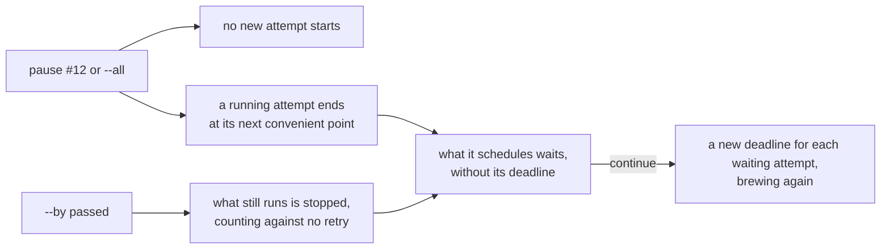
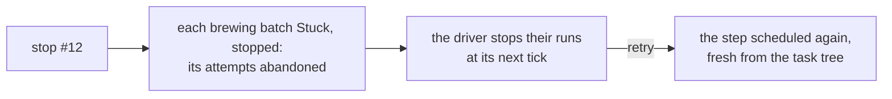

# Pause, continue and stop

An engineer halts work with `foedrum pause` and goes on with `foedrum continue`, for one order or for the whole Brewery ([ADR 0202](../../adr/0202-pause-and-continue-hold-an-order-or-the-whole-brewery-at-its-next-convenient-point.md)), or ends an order's work at once with `foedrum stop` ([stop](#stop)).

- `pause [<order> | --all] [--by <time>] [--why <reason>]` and `continue [<order> | --all]` are recorded commands: `order.paused` and `order.continued` carry who issued them and from where, and the pause its reason; with no `order`, they are `--all`.
- An order is written as `order` takes an issue (`<alias>#<n>`, `#<n>`); its pause holds every batch of that issue, a sub-order's batch with its order's; `--all` holds every batch, those ordered later too, and the intake.
- A pause of an order with no batch that has not ended is refused, and a pause of a sub-order, or of the Brewery issue that is a claimed issue's order, is refused with the order to pause instead; a second pause of the same scope replaces the first, and under `--all` an order's own `--by` still stops it when it comes first; `continue <order>` is refused while `--all` holds, and `continue --all` lifts every pause.
- No driver starts a scheduled attempt of a paused batch, so `serve` starts nothing paused, also after a restart; `brew` of a paused order is refused with a line that says to continue it, and a `brew` underway ends with that line once a pause that came holds its batch and nothing of it runs.
- A running attempt ends as it would: its out doc, a question, a pull request opened, a review delivered; a parallel group's children each end at their own point, and the group waits for the ones that had not started.
- The supervisor expires no scheduled attempt of a paused batch that has not started, an exception to I5 and one of the exceptions to "every wait has a deadline" ([invariants](../engine/invariants.md)), since the person chose the wait (the others are a blocked sub-order, [ADR 0211](../../adr/0211-the-intake-starts-ready-sub-orders-at-their-order-s-rank-once-their-blockers-merged.md) and [ADR 0216](../../adr/0216-a-release-blocker-is-done-once-its-repository-is-released-after-its-merge.md), the wait for the checks on an open pull request's head, [ADR 0213](../../adr/0213-an-open-pull-request-s-checks-on-its-head-are-recorded-once-they-finish.md), and an interactive step's open session, [ADR 0222](../../adr/0222-a-recipe-s-brewer-step-may-be-interactive.md)); `continue` gives each such attempt of the batches it lifts a new deadline from its step (`step.rescheduled`). Running attempts keep their deadlines, stall limits and reminders, and effects go on.
- `--by` takes a local time (`17:30`, today in the machine's time zone, tomorrow once past) or a duration (`20m`); the event records the UTC instant and the machine's zone. At that instant the driver stops what still runs of the paused batches; the end is recorded with `paused`, counts against none of the step's retries, and the step is scheduled again as a retry, waiting for `continue`; the driver's flag decides, so an end that comes after the pause was lifted or replaced is the pause's too.
- Under `--all` the intake orders and claims nothing, and the engine's `order` is refused; it still records pull request ends and the checks on their heads ([open pull requests](../intake/open-pull-requests.md)), checks bases and routes Ordered batches. A person's `foedrum order` is not held.
- The status comment says **Paused** with who, from where, why and the `--by` instant in UTC with the time in its zone; `foedrum status` adds `paused by …` to the batch's line, and `foedrum replay` lists the pause and continue events that held it and the pause in its state.
- Only a person continues, until the Innkeeper's planning job (#227); `stop` kills at once.
- A closed usage window holds brewers, or those of its family, beside a pause, and reopens by itself: a paused batch's attempt starts once both are lifted, and gets its new deadline at `continue` ([the usage window](../engine/usage-window.md)).

## Stop

`foedrum stop <order> [--why <reason>]` ends an order's work at once, and `retry` continues it from the same step ([ADR 0205](../../adr/0205-stop-makes-an-order-s-brewing-batches-stuck-at-once-and-retry-continues-them.md)).

- The order is named and refused as a pause's is: a sub-order, or the Brewery issue that is a claimed issue's order, is refused with the order to stop; an order with no brewing batch is refused too. There is no `--all`: `pause --all --by` stops everything that runs, and one `continue --all` lifts it.
- Each brewing batch of the order, its sub-orders' too, goes Stuck with reason `stopped`, which carries who stopped it, from where and why, and names the first step whose latest attempt had not finished; a batch with nothing running, only scheduled, goes Stuck the same way. Ordered, Conditioning and Stuck batches are left as they are.
- Stuck abandons the batch's unfinished attempts, so the driver that runs one stops its process tree at its next tick, and the runner's end of it is refused; the attempt counts toward `maxAttempts` like any abandoned one. What it committed stays on its attempt branch while the batch has not ended, where `rewind` reaches it, and what it had not committed is lost.
- A stopped batch offers `retry`, `skip`, `recipe`, `rewind` and `cancel`, with the Stuck reminder; `retry` always schedules the named step, fresh from the task tree as after any abandoned attempt ([ADR 0117](../../adr/0117-a-retry-resumes-the-session-of-the-attempt-before-it-in-that-attempt-s-worktree.md)), and in a parallel group also the other children that had not ended; resuming the stopped session and spending no attempt is #536.
- A stop leaves a pause as it is, so a retried step of a paused batch waits for `continue`; a pause of a stopped batch holds what its retry schedules.
- The status comment's Stuck line, `foedrum stuck`, `status` and `replay` say `stopped`, with who, from where and why.
