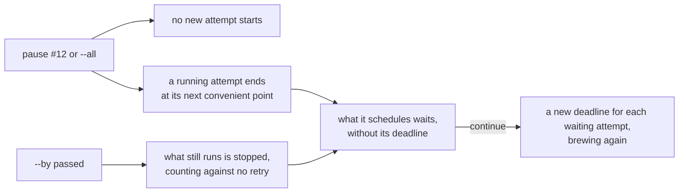

# Pause and continue

An engineer halts work with `foedrum pause` and goes on with `foedrum continue`, for one order or for the whole Brewery ([ADR 0202](../../adr/0202-pause-and-continue-hold-an-order-or-the-whole-brewery-at-its-next-convenient-point.md)).

- `pause [<order> | --all] [--by <time>] [--why <reason>]` and `continue [<order> | --all]` are recorded commands: `order.paused` and `order.continued` carry who issued them and from where, and the pause its reason; with no `order`, they are `--all`.
- An order is written as `order` takes an issue (`<alias>#<n>`, `#<n>`); its pause holds every batch of that issue, a sub-order's batch with its order's; `--all` holds every batch, those ordered later too, and the intake.
- A pause of an order with no batch that has not ended is refused; a second pause of the same scope replaces the first, and under `--all` an order's own `--by` still stops it when it comes first; `continue <order>` is refused while `--all` holds, and `continue --all` lifts every pause.
- No driver starts a scheduled attempt of a paused batch, so `serve` starts nothing paused, also after a restart; `brew` of a paused order is refused with a line that says to continue it.
- A running attempt ends as it would: its out doc, a question, a pull request opened, a review delivered; a parallel group's children each end at their own point, and the group waits for the ones that had not started.
- The supervisor expires no scheduled attempt of a paused batch that has not started, the one exception to I5 and to "every wait has a deadline", since the person chose the wait; `continue` gives each such attempt of the batches it lifts a new deadline from its step (`step.rescheduled`). Running attempts keep their deadlines, stall limits and reminders, and effects go on.
- `--by` takes a local time (`17:30`, today in the machine's time zone, tomorrow once past) or a duration (`20m`); the event records the UTC instant and the machine's zone. At that instant the driver stops what still runs of the paused batches; the end is recorded with `paused`, counts against none of the step's retries, and the step is scheduled again as a retry, waiting for `continue`; an end that comes after the pause was lifted or replaced is an ordinary cancelled end.
- Under `--all` the intake orders and claims nothing, and the engine's `order` is refused; it still records pull request ends, checks bases and routes Ordered batches. A person's `foedrum order` is not held.
- The status comment says **Paused** with who, from where, why and the `--by` instant in UTC with the time in its zone; `foedrum status` adds `paused by …` to the batch's line, and `foedrum replay` lists the pause and continue events that held it and the pause in its state.
- Only a person continues, until the Innkeeper's planning job (#227); `stop` (#518) kills at once.
