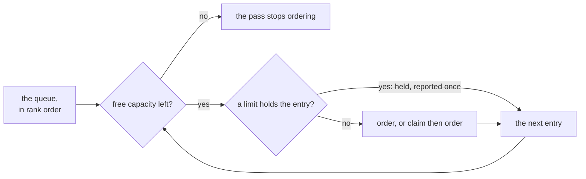

# Limits

Besides the Brewery's `concurrency`, three limits hold what the intake starts: a recipe's `concurrency`, the Brewery's open-order limit ([ADR 0217](../../adr/0217-a-recipe-s-concurrency-and-the-open-order-limit-hold-what-the-intake-starts.md)) and the touches limit.

- **Where they act:** in the pass's walk of its queue ([ranking](ranking.md)): an entry a limit holds is skipped, keeps its place, and the walk goes on, so a held order never leaves a slot empty that a later one could take (`startTally`, `src/engine/limits.ts`).
  A rank orders what the limits let start, and never overrides them.
- **A recipe's `concurrency`** (1 to 20, none by default) counts its batches Brewing, the Ordered ones the pass will route to it by their Brewery issue's one label as listed, and those the walk ordered before; the Brewery's `concurrency` caps it, since the walk never orders past the free capacity.
  A Brewery issue's or a sub-order's recipe is its one `recipe:<name>` label in the listing; a claimed issue's is known only once its Brewery issue is open ([routing](routing.md)), so the pass's routing also leaves a batch Ordered while its recipe brews its `concurrency`, and reports that once (`routeHold`); its routing deadline stands.
- **The open-order limit** (`openOrders`, 1 to 20, default 3) holds a new order, Brewery issue or target issue, while that many orders are open; a target issue it holds is not claimed, and a ready sub-order of an open order is never held by it.
- **An open order** is a Brewery issue's or a claimed target issue's (`orderOfBatch`) with work left: a batch of it, its own or a sub-order's, Ordered, Brewing, Conditioning or Stuck, or a sub-order of its latest breakdown without a batch while its latest batch is not cancelled (`openOrders`).
  So a paused, a stopped or a Stuck order counts; one with only batches On tap or cancelled does not, even with its pull request still open.
  A sub-order left without a batch keeps its order open also when it waits for a closed pull request or its own issue was closed, until a person orders the blocker again, a new breakdown leaves it out, or the order is cancelled.
- **Not held:** a batch that goes back to Brewing (a retry, a `continue`, an answer), a person's `recipe` for a Stuck batch, and `foedrum brew`; the limits pace what the intake starts by itself.
- **No event:** what a limit holds is a function of the folded state, the listing and the config, as the ready set is.
- **Where it shows:** `serve` prints `<repo>#<n> waits: <why>` once per issue and reason; `foedrum status` prints, above the board, one line per limit that holds, a recipe's from its batches Brewing (`recipe nip: 1 of 1 at once (12-1); its next orders wait`) and the open orders once the limit is reached (`limitLines`).
  It reads foedrum.jsonc and the recipes only while some order is open (`mayHold`), and says in one line when they do not load; `status --watch` does not show them yet.
- **The touches limit** ([ADR 0257](../../adr/0257-sub-orders-whose-touches-overlap-never-brew-side-by-side.md)): a sub-order whose plan `touches` overlap those of a sub-order with a batch Ordered or Brewing, or that the walk started, is held until that one's batch leaves Ordered and Brewing.
  An Ordered batch holds because its route can be held over passes, as a recipe's concurrency counts it.
  An overlap is a shared path or a path under a folder the other touches, in one repository, compared without case as a checkout on Windows or macOS reads them; a sub-order without `touches` is never held.
  `foedrum status` prints `sub-order #11 waits for sub-order #10 (10-1): their touches overlap` after the other limits' lines.
