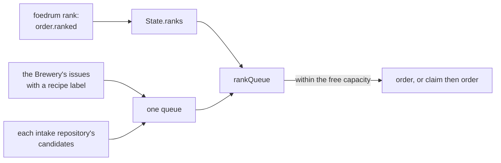

# Ranking

The intake orders and claims its queue in rank order: by arrival, unless a person moved an order with `foedrum rank` ([ADR 0208](../../adr/0208-orders-are-claimed-in-rank-order-by-arrival-unless-a-person-moved-one-with-foedrum-rank.md)).

- **The queue** is what a pass would order or claim now and has not: the Brewery's issues that `isBreweryOrder` passes, and each intake repository's candidates (`isCandidate`); an order that was ordered or claimed has left it (`intakeQueue`, `src/engine/intake.ts`).
- **Ready sub-orders** are in the queue too ([ADR 0211](../../adr/0211-the-intake-starts-ready-sub-orders-at-their-order-s-rank-once-their-blockers-merged.md)): each at its order's place, its order's rank or else its order's arrival from the Brewery listing, the sub-orders of one order in their plan's order, and a started order's next sub-order ahead of a new order of the same place ([work breakdown](work-breakdown.md)).
  A sub-order is ordered as `<issue>-1` under its order's latest batch, and routed by its `recipe:` label as any Brewery issue's batch; one whose issue, or whose order's issue, the pass did not list open is not ordered.
- **Arrival** is an issue's creation time on GitHub (`TargetIssue.created`, from `created_at`), across the Brewery and every repository; in the same second the Brewery's issue goes first, then the order `foedrum.jsonc` lists the repositories in, then the number.
- **A pass** walks the whole queue in rank order within the free capacity, skipping what a recipe's `concurrency`, the open-order limit or the touches limit holds ([limits](limits.md)): a Brewery issue it orders, a target issue it claims first; a claim another Brewery holds costs no capacity, and a claim the code host fails ends that repository's claims for the pass ([target issues](target-issues.md)).
  `pause --all` holds it whatever the ranks ([pause and continue](../humans/pause.md)).
- **`foedrum rank <order> <n>`** reads the queue as a pass would, through gh's login, and gives the order the arrival of the order now at place `n` among those without the mark, ahead of it; past the end, the time of the rank.
  So a rank is a relative place: the order moves up as the orders ahead of it go, and an order that arrives later goes behind it.
- **`foedrum rank <order> first`** marks it to finish first: ahead of every order without the mark, the marked ones by when they were marked.
- The ranked orders of one arrival go ahead of its unranked ones, by a tie the rank records, the lower ahead, so an order ranked next to a ranked order of the same arrival lands on its side of it, and one ranked next to unranked orders of its arrival goes ahead of all of them; a later rank of the same order replaces the earlier one (`rankQueue`, `placeAt`, `src/engine/ranks.ts`).
- `foedrum rank <order>` prints the order's place in the queue now and its rank, and appends nothing; `rank` is refused for an order with a batch and no sub-order of its latest breakdown left without one, a sub-order, a claimed issue's Brewery issue, an order not in the queue, or a queue it cannot read (`rankRefusal`).
- `order.ranked` `{ order, place, by, via, why? }`, a place being `first` or a position with its arrival and tie, is folded into `State.ranks` by order; it names no batch, so it is in the state branch's top-level log, and `foedrum replay` lists the ranks of a batch's order.
- A started order with sub-orders left is ranked as any order and moves them; its ready sub-orders count as one place, and with none ready it is placed at its arrival (`onePerOrder`, `hasSubOrdersLeft`).
- Next: the board (#240) shows the queue, and the Innkeeper (#227) ranks through the same command.
