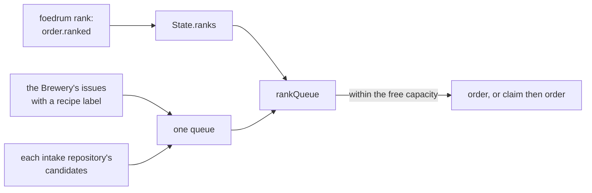

# Ranking

The intake orders and claims its queue in rank order: by arrival, unless a person moved an order with `foedrum rank` ([ADR 0208](../../adr/0208-orders-are-claimed-in-rank-order-by-arrival-unless-a-person-moved-one-with-foedrum-rank.md)).

- **The queue** is what a pass would order or claim now and has not: the Brewery's issues that `isBreweryOrder` passes, and each intake repository's candidates (`isCandidate`); an order that was ordered or claimed has left it (`intakeQueue`, `src/engine/intake.ts`).
- **Arrival** is an issue's creation time on GitHub (`TargetIssue.created`, from `created_at`), across the Brewery and every repository; in the same second the Brewery's issue goes first, then the order `foedrum.jsonc` lists the repositories in, then the number.
- **A pass** walks the whole queue in rank order within the free capacity: a Brewery issue it orders, a target issue it claims first; a claim another Brewery holds costs no capacity, and a claim the code host fails ends that repository's claims for the pass ([target issues](target-issues.md)).
  `pause --all` holds it whatever the ranks ([pause and continue](../humans/pause.md)).
- **`foedrum rank <order> <n>`** reads the queue as a pass would, through gh's login, and gives the order the arrival of the order now at place `n` among those without the mark, ahead of it; past the end, the time of the rank.
  So a rank is a relative place: the order moves up as the orders ahead of it go, and an order that arrives later goes behind it.
- **`foedrum rank <order> first`** marks it to finish first: ahead of every order without the mark, the marked ones by when they were marked.
- A ranked order goes ahead of an unranked one with the same arrival, the later of two ranks ahead; a later rank of the same order replaces the earlier one (`rankQueue`, `arrivalAt`, `src/engine/ranks.ts`).
- `foedrum rank <order>` prints the order's place in the queue now and its rank; `rank` is refused for an order with a batch, a sub-order, a claimed issue's Brewery issue, an order not in the queue, or a queue it cannot read (`rankRefusal`).
- `order.ranked` `{ order, place, by, via, why? }` is folded into `State.ranks` by order; it names no batch, so it is in the state branch's top-level log, and `foedrum replay` lists the ranks of a batch's order.
- Next: the ready set of sub-orders (#531) ranks them within their order's rank, and the limits (#532) say what may run side by side; the board (#240) shows the queue, and the Innkeeper (#227) ranks through the same command.
