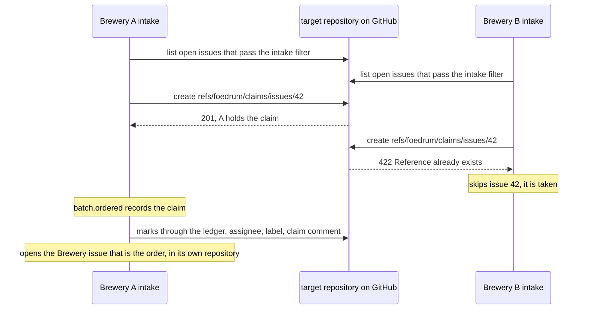

# Target-repository issues: a work queue

A team often shares a target repository while every member has a private Brewery, so several Breweries pick issues from one repository ([ADR 0043](../../adr/0043-target-repository-issues-as-a-work-queue-claimed-by-a-ref.md)).
GitHub refuses to create a ref that exists, so the claim ref decides which Brewery takes an issue (`githubClaimHost`, `src/github/claims.ts`):

- **A work queue where a Brewery asks for it.** A repository with an **intake filter** (labels, optionally a milestone) has its open issues polled.
  The intake picks an issue that passes the filter, has no assignee or only this Brewery's own GitHub user (assign an issue to yourself and your Brewery picks it up), was opened by one of the Brewery's allow-listed users ([security](../security.md)), and has no batch in this Brewery in any lane (`isCandidate`, `src/engine/issue-claims.ts`).
  A pass claims candidates oldest first, only up to the Brewery's free capacity (`claimCandidates`'s `limit`: the capacity less its Ordered and Brewing batches), and leaves the rest for the next pass and for the other Breweries.
  Such a repository names a short **alias** in `foedrum.jsonc` (a lower-case letter, then letters and digits, at most 20, unique; `foedrum doctor` refuses a duplicate), and the batch of a claimed issue is `<alias>-<issue>`, which never collides with a Brewery issue's `<issue>-<n>`.
  Its `OrderRef` names the repository, and its batch is kept apart from the Brewery's own orders and sub-orders, whose numbers it would collide with (`createIntake`, `src/engine/intake.ts`; [ADR 0050](../../adr/0050-the-intake-of-target-repository-issues.md)).
- **The claim** is the ref `refs/foedrum/claims/issues/<n>` in the target repository, created through the API: creating a ref that exists fails, so exactly one Brewery wins.
  It points at a commit whose message names the Brewery (`{"brewery","issue","claimedAt"}`, no host or user names).
  A ref that names this Brewery is its own claim, left by a run killed before it ordered the batch, or by a `foedrum order` refused or stopped after its claim (running it again finds the claim as its own, [ADR 0105](../../adr/0105-foedrum-order-orders-an-issue-again-as-a-human-command-recorded-on-batch-ordered.md)); any other ref, or one that cannot be read, skips the issue.
  The claim comes before the order, and is the second effect outside the idempotency ledger next to the state branch's push: it is idempotent by its own atomic creation, and `batch.ordered` records it.
- **The marks** follow the order, through the ledger as the driver's effects of the batch (`claimEffectsDue`, `claimEffects`): the issue is assigned to the Brewery's user, labelled `foedrum:claimed` (the claim, not the lane: it stays through Stuck and Conditioning), and gets a claim comment naming the Brewery and batch, a comment of its own next to the status comment ([on GitHub](../humans/github.md)).
- **The Brewery issue** is the order of a claimed issue: the target issue shows only the marks, and the order's own work happens in the private Brewery ([ADR 0144](../../adr/0144-a-claimed-target-issue-gets-a-brewery-issue-that-is-its-order.md)).
  After the marks, the driver opens it once, through the ledger (`order.issue`), with only the target issue's title and a body that links the target issue and carries the effect's key.
  A run killed before it recorded finds it by that key in an issue its own identity opened (`IssueMarks.findIssue`).
  Its number is the ledger's result for that effect (`claimOrderOf`, `src/engine/claim-orders.ts`), and `foedrum status` and `foedrum stuck` show both issues: `#200 (web#123)`, or `web#123` until it is open.
  The batch keeps its id `<alias>-<issue>`, and `batch.ordered` keeps the target issue.
  Its pull requests are opened in the target repository and close the target issue (`Closes owner/name#<n>`); they never name the Brewery issue.
  The intake never orders that Brewery issue as one of the Brewery's own, and `foedrum order #<n>` of it is refused with the claimed issue to order instead.
- **Release** when the batch is cancelled or every pull request it opened is merged or closed: the label goes, a release comment says why, and the ref is deleted if it still names this Brewery, only while it points at the commit that was read (GraphQL `updateRefs` with `beforeOid`, proven against GitHub in an opt-in integration test, [ADR 0050](../../adr/0050-the-intake-of-target-repository-issues.md)).
  The end of each pull request is a recorded event, `pull_request.ended`, which the intake appends when its poll sees a merge or a close; what is due follows from it, never from asking the code host.
  A merge closes the target issue, and the release closes its Brewery issue too (`release.order`, before the ref goes); a cancel or a closed pull request leaves both open.
  A Brewery issue a person deleted is gone (GitHub answers 410): its close records that instead of failing, so it never holds off the rest of the release.
  The assignee stays, so the release comment of a batch that was not merged ends with "Unassign the issue to make it available again." A silent Brewery's claim is never taken over automatically; a human releases it (delete the ref, unassign the issue).
- **Ordering again** is a person's: `foedrum order <alias>#<n>` claims the issue again (won or ours; taken is refused with its holder) and orders it as `<alias>-<n>-<k>`, and `foedrum order #<n>` orders a Brewery issue again as `<n>-<k>`.
  `decide` refuses it while the issue has a live batch, or while its last claim is held or its release not yet applied (`claimStanding`), and records it on `batch.ordered` with `by` and `via`; the intake's own order of a target issue is refused the same way, so the two never order one issue twice ([ADR 0105](../../adr/0105-foedrum-order-orders-an-issue-again-as-a-human-command-recorded-on-batch-ordered.md)).
  A claimed issue ordered again keeps its Brewery issue, which the new batch reopens however it was closed (`order.reopen`, found done while it is open); when a person deleted it, the new batch opens its own ([ADR 0144](../../adr/0144-a-claimed-target-issue-gets-a-brewery-issue-that-is-its-order.md)).
- Orders made in the Brewery and their sub-orders need no claim: nobody else can see them.
  Every branch pushed to a target repository carries the Brewery ([the state branch](../engine/state-branch.md)), so two Breweries never push the same branch.
