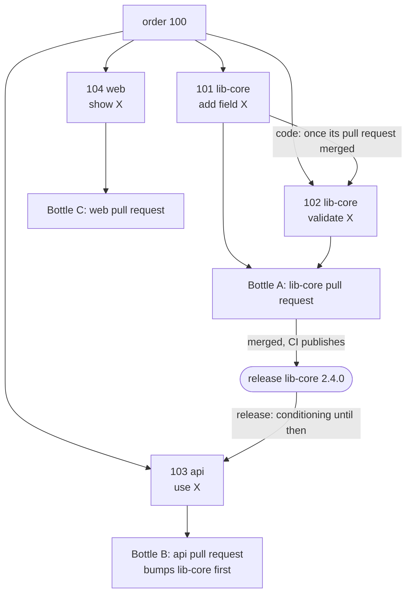

# Work breakdown: orders, sub-orders and bottles

Enterprise changes usually span several repositories.
Cross-repository work is a core capability, not an add-on ([ADR 0013](../../adr/0013-single-repo-sub-orders-bottles-and-releases.md)).

- **Work items live in the Brewery, or are claimed from a target repository.** Orders and sub-orders are Brewery issues, private to the Brewery; an issue of a target repository that this Brewery claimed gets a Brewery issue that is its order ([target-repository issues](../intake/target-issues.md), [ADR 0043](../../adr/0043-target-repository-issues-as-a-work-queue-claimed-by-a-ref.md), [ADR 0144](../../adr/0144-a-claimed-target-issue-gets-a-brewery-issue-that-is-its-order.md)).
  Foedrum never creates issues in target repositories, and edits only the issues it claimed.
- **Decomposition.** A decomposition step (Maltster + Brewmaster) splits an order into **sub-orders** — GitHub sub-issues of the order — and records dependencies between them as native "blocked by" links.
  The breakdown is posted as **READY / NOT READY** and brewing starts after `/foedrum approve` — **approval is on by default**; recipes can switch it off.
  A breakdown produced interactively with the `/foedrum:refine` plugin ([interactive refinement](../humans/refinement.md)) counts as approved.
- **One sub-order, one repository.** A sub-order never spans repositories.
  A brewer *writes* in exactly one repository and may *read* sibling repositories for context.
- **Each sub-order gets its own batch** and recipe, once it is **ready**: in its order's latest breakdown, without a batch, and every sub-order it is blocked by done, its pull request merged ([ADR 0211](../../adr/0211-the-intake-starts-ready-sub-orders-at-their-order-s-rank-once-their-blockers-merged.md)).
  The ready set is a pure function of the fold (`readySubOrders`, `src/engine/ready-set.ts`); the intake orders the ready sub-orders of all orders at their order's rank, in their plan's order ([ranking](ranking.md)), within the free capacity and their recipe's `concurrency`; the open-order limit never holds one ([limits](limits.md)).
  A sub-order of a paused order, of an order stopped while a batch of it is still Stuck `stopped`, or of an order whose latest batch was cancelled, is not ordered; a cancelled sub-order never is.
  A bottle's pull request counts as merged when a batch it bottles records it `merged`: whoever opens bottles lists it in each bottled batch's `batch.on_tap`.
- **Bottling: choosing what goes into a pull request.** A **bottle** is a pull request.
  It bundles one or more finished sub-orders of the same repository: their branches are merged into a bottle branch by plain git (conflicts go to the Blender).
  Policy per recipe: `"bottling": "perSubOrder" | "perRepo" | "manual"`; manually with `/foedrum bottle #101 #102`.
  Bottles of the same order reference each other and carry a suggested merge order.
- **Dependency kinds:**

| Kind | Meaning | The dependent batch waits for |
|---|---|---|
| `code` | Builds on another sub-order's code in the same repository | That sub-order's pull request to be merged, so it starts from a base that holds the change (ADR 0211) |
| `release` | Needs a published version of another repository's library | The bottle to be merged, CI to publish, and the **release signal** to report the new version; the dependent batch then starts by bumping the dependency; until the release signal is recorded (#538) such a sub-order is never ready |

- **Release signals** are configured per repository: **GitHub release or tag** first; package registries (NuGet, npm, Maven, …) later through the same interface.
  Developing against a pre-release build is a later option.

An example: order 100 splits into four sub-orders, one repository each, bottled per repository.
The api sub-order needs a published lib-core, so it conditions until the release signal reports it.

