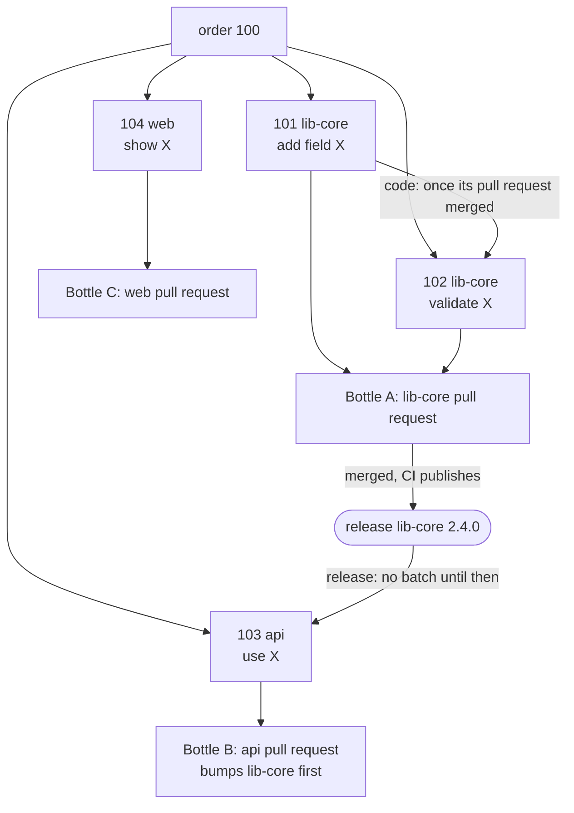

# Work breakdown: orders, sub-orders and bottles

Enterprise changes usually span several repositories.
Cross-repository work is a core capability, not an add-on ([ADR 0013](../../adr/0013-single-repo-sub-orders-bottles-and-releases.md)).

- **Work items live in the Brewery, or are claimed from a target repository.** Orders and sub-orders are Brewery issues, private to the Brewery; an issue of a target repository that this Brewery claimed gets a Brewery issue that is its order ([target-repository issues](../intake/target-issues.md), [ADR 0043](../../adr/0043-target-repository-issues-as-a-work-queue-claimed-by-a-ref.md), [ADR 0144](../../adr/0144-a-claimed-target-issue-gets-a-brewery-issue-that-is-its-order.md)).
  Foedrum never creates issues in target repositories, and edits only the issues it claimed.
- **Decomposition.** A decomposition step splits an order into **sub-orders** — GitHub sub-issues of the order — and records dependencies between them as native "blocked by" links.
  Foedrum's default is the `mash` recipe's `plan` step, the Brewmaster, which gathers the context the Maltster would (the repository's instructions and design documents, the code the order reaches) and writes the plan in the same session, read-only, on the `planner` alias; it asks with `needs_input` when the order leaves a decision open, and a retry after an invalid plan resumes its session, told why ([ADR 0234](../../adr/0234-the-brewmaster-writes-a-plan-on-the-planner-alias-and-mash-runs-it.md)).
  The breakdown is posted as **READY / NOT READY** and brewing starts after `/foedrum approve` — **approval is on by default**; recipes can switch it off.
  A breakdown produced interactively with the `/foedrum:refine` plugin ([interactive refinement](../humans/refinement.md)) counts as approved.
- **The plan is an out doc.** A brewer whose `output.schema` is `plan` writes the breakdown as its out doc's frontmatter (`PlanOutDoc`, `src/schemas/plan.ts`, [ADR 0233](../../adr/0233-a-plan-is-an-out-doc-whose-paths-the-engine-checks-shown-as-one-comment-per-order.md)): per sub-order an `id` of the plan's own, a one-line `title`, its `repo`, a `size` (an estimate of `lines` and a one-line `mechanism`), `doneWhen`, the paths it `touches` (1 to 20, `new: true` when one does not exist yet), its `dependencies` (`on` another id, `code` or `release`, no cycle), its `recipe` and `why`, `testFirst: false` only with `testFirstOff`, and `ready`, or `ready: false` with its `refinement`; and optional `alternatives`, the other cuts considered and why this one.
  A missing or wrong field fails the attempt retryably, naming the field's path.
  A `done` plan's body holds its summary and each of its assumptions as a list item, word for word, so the out doc its comments link reads on GitHub; one that does not fails the attempt retryably, naming the first assumption missing (`unreadableBody`, [ADR 0275](../../adr/0275-a-finished-plan-waits-stuck-for-its-review-and-every-comment-links-the-doc-it-sums-up.md)).
  After a `done`, with no model, every path not marked new must exist in its repository: the attempt's own at the commit its worktree started at, another of the Brewery's at its base as its clone has it, resolved when the attempt is planned (one `git ls-tree` per repository, a second past 24,000 characters of paths, `touchesChecked`, `src/engine/plan-touches.ts`); a missing path or a repository the Brewery does not list fails the attempt retryably, naming the sub-order, the path and the commit.
  A base the clone has no ref of yet is fetched through that repository's worktree manager when the attempt is planned, in practice once, since a fetch that succeeds leaves the ref; one that still cannot be read blocks the attempt on its environment only when a sub-order reads a path in that repository.
  The latest succeeded plan of an order's batch is one comment on the order's issue, edited in place each round and by a later batch of the order ([GitHub as the human surface](../humans/github.md)).
  Nothing records the plan as `order.decomposed` yet: a `mash` batch waits Stuck with its plan ready for review ([ADR 0275](../../adr/0275-a-finished-plan-waits-stuck-for-its-review-and-every-comment-links-the-doc-it-sums-up.md)) until a person signs it off with `foedrum approve <batch>`, after correcting it with the Brewmaster in a `foedrum lauter <batch>` session if they choose, whose plan needs an `approve` of its own ([interactive steps](../recipes/interactive-steps.md), [ADR 0286](../../adr/0286-foedrum-lauter-corrects-a-plan-at-gate-1-in-an-interactive-session.md)), and it goes on tap, its approval recorded by the digest of the plan's out doc ([ADR 0281](../../adr/0281-foedrum-approve-signs-off-a-plan-by-its-hash-and-puts-the-batch-on-tap.md)); a signed-off plan becomes sub-issues once #590 is built, and until then its sub-orders are ordered by hand.
- **One sub-order, one repository.** A sub-order never spans repositories.
  A brewer *writes* in exactly one repository and may *read* sibling repositories for context.
- **Each sub-order gets its own batch** and recipe, once it is **ready**: in its order's latest breakdown, without a batch, and every sub-order it is blocked by done, its pull request merged ([ADR 0211](../../adr/0211-the-intake-starts-ready-sub-orders-at-their-order-s-rank-once-their-blockers-merged.md)), and for a `release` dependency a release of its repository recorded after that merge ([ADR 0216](../../adr/0216-a-release-blocker-is-done-once-its-repository-is-released-after-its-merge.md)).
  The ready set is a pure function of the fold (`readySubOrders`, `src/engine/ready-set.ts`); the intake orders the ready sub-orders of all orders at their order's rank, in their plan's order ([ranking](ranking.md)), within the free capacity and their recipe's `concurrency`, and never beside one whose `touches` overlap theirs; the open-order limit never holds one ([limits](limits.md)).
  A sub-order of a paused order, of an order stopped while a batch of it is still Stuck `stopped`, or of an order whose latest batch was cancelled, is not ordered; a cancelled sub-order never is.
  A bottle's pull request counts as merged when a batch it bottles records it `merged`: whoever opens bottles lists it in each bottled batch's `batch.on_tap`.
- **Bottling: choosing what goes into a pull request.** A **bottle** is a pull request.
  It bundles one or more finished sub-orders of the same repository: their branches are merged into a bottle branch by plain git (conflicts go to the Blender).
  Policy per recipe: `"bottling": "perSubOrder" | "perRepo" | "manual"`; manually with `/foedrum bottle #101 #102`.
  Bottles of the same order reference each other and carry a suggested merge order.
- **Dependency kinds:**

| Kind | Meaning | The dependent batch waits for |
|---|---|---|
| `code` | Builds on another sub-order's code in the same repository | That sub-order's pull request to be merged, so it starts from a base that holds the change (ADR 0211) |
| `release` | Needs a published version of another repository's library | That sub-order's pull request (or its bottle's) to be merged, and then a `release.observed` of its repository: any release of it after the merge counts, since a breakdown names no package or version (ADR 0216); the dependent batch's recipe then bumps the dependency |

- **Release signals** need no configuration: each intake pass reads, through gh, the latest **GitHub release**, else the newest tag, of every repository a merged `release` blocker waits on, and no other ([ADR 0223](../../adr/0223-the-intake-records-a-release-that-holds-a-waiting-release-blocker-s-merge.md)); package registries (NuGet, npm, Maven, …) later.
  It records a `release.observed` only when the release holds a merge of every blocker that waits on that repository (GitHub's compare of the tag with the merge commit, not done for a release published before the merge, or a tag whose commit is older than the merge commit), once per version, so the sub-orders they block start in that pass.
  Developing against a pre-release build is a later option.

An example: order 100 splits into four sub-orders, one repository each, bottled per repository.
The api sub-order needs a published lib-core, so it has no batch until a release of lib-core is recorded after Bottle A merged: it waits outside Conditioning, as a `code` wait does.

