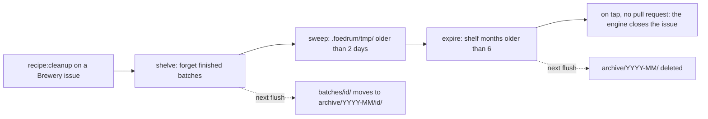

# The Cellarer

**The Cellarer** is engine code with no model, prompt or tokens that keeps a Brewery tidy ([ADR 0380](../../adr/0380-the-cellarer-shelves-finished-batches-off-the-store-sweeps-old-temporary-files-and-expires-the-shelf.md)).
A recipe step names one of its jobs, `{ "id": "shelve", "cellarer": "shelve" }` (`CellarerStep`, `src/schemas/recipe.ts`), and the driver runs it itself, as it runs [the openPullRequest action](open-pull-request.md): one effect keyed by its attempt, found by the ledger alone, its result the effect's recorded output (`cleanupActions`, `src/engine/cleanup-actions.ts`; `CellarerOutput`, `src/schemas/cellarer.ts`).
The driver picks a step's actions by the action it is (`actionsByKind`).

## The jobs

- **`shelve`** takes every batch `archivable` takes (`src/engine/archive.ts`) but its own.
  A batch is taken only with its whole family, the order it was split from and its sub-orders, and only when every batch of it has ended (`batchEnded`), has no mark, no batch or attempt lease, no effect still due (a source that cannot say counts as due) and nothing the state branch does not have yet (an event past the pushed-through marker, or an out doc the store keeps).
  In one transaction the store forgets them (`forget`, [the event store](../engine/event-store.md)) and records each with the month, `YYYY-MM` in UTC, it was shelved in; the next flush moves each one's folder to the shelf ([the state branch](../engine/state-branch.md)).
- **`sweep`** removes each entry of the Brewery's `.foedrum/tmp/` whose newest file or folder inside changed more than 2 days ago, reading links as themselves, and keeps what it removed and what it could not (`sweepTemp`, `src/engine/temp-sweep.ts`).
- **`expire`** records the month 6 months before the current one; the next flush deletes every month of the shelf before it.

## What shows it

A finished step's line in the status comment says what the Cellarer did: ``- ✅ `shelve`: the Cellarer shelved 3 finished batches``, `the Cellarer swept 2 old entries of .foedrum/tmp/` (and `, and could not remove 1`) or `the Cellarer expired the shelf's months before 2026-05` ([GitHub](../humans/github.md)).
`foedrum status` shows a running one as `the Cellarer at shelve #1`.

## The cleanup recipe

The default `cleanup` (`defaults/recipes/cleanup.jsonc`) is of type `tend` and runs `shelve`, `sweep` and `expire` ([defaults](defaults.md)).
A person labels a Brewery issue `recipe:cleanup`; `foedrum brew <n>` or serve's intake runs it like any order.
Its batch goes on tap with no pull request, the engine closes its issue (`The cleanup is done; Foedrum closes this issue.`), which ends it, and the next cleanup shelves it.
