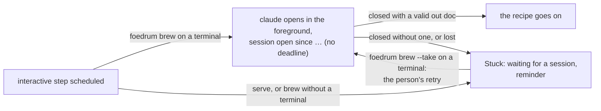

# Interactive steps

A brewer step that needs a person in the conversation says so in the recipe ([ADR 0222](../../adr/0222-a-recipe-s-brewer-step-may-be-interactive.md)):

```jsonc
{ "id": "lauter", "brewer": "maltster", "interactive": true, "prompt": "Walk the plan through with me." }
```



- `interactive` is only `true`, and `prompt` is non-empty text of at most 4 KiB; each needs the other, and only a brewer step takes them.
  The load refuses an interactive step in a parallel group, or with a `lens` or `lenses`.
- The session runs with the step's brewer: its model, effort, tools, settings, system prompt file and out doc, as every attempt.
  Its brewer still never calls `AskUserQuestion` ([ADR 0006](../../adr/0006-no-mid-run-questions.md)); its out doc may say `needs_input`.
- The recipe's prompt follows the brewer file's body in the instructions, before the round texts and the out doc contract, with the inputs in their nonce tags after them.
  The runner writes the whole prompt to `<attempt>.prompt.md` beside the attempt's settings file, the settings allow Read of that file alone (`Read(//<path in POSIX form>)`), and claude's first message is the engine's fixed line `Read <that file>: it is your task in this session.`
  What the person types is never recorded; only the out doc reaches the log.
- Only `foedrum brew` on a terminal outside Claude Code opens the session ([foedrum brew and the plugin](../humans/brew.md)): `claude "<first message>" --session-id <the recorded id>` with resume's guards and no print-mode flag, in the foreground, while brew's lines wait and Ctrl+C is claude's.
  Every other attempt of the batch runs headless, a `retryMode: resume` retry included, and a retry of an interactive step opens a fresh session with the whole prompt.
- A driver that opens no session (`serve`, `resume`, brew without a terminal) does not start the step's attempt: it issues `await_session`, and the batch is Stuck `waiting_for_session` with its reminder and the usual options.
  The status lines name `foedrum brew <issue> --take`, to run in a terminal.
- A session closed without a valid out doc, or an attempt lost when foedrum died, makes the batch wait for a session again, never a headless retry; with no attempt left the batch is Stuck `attempts_exhausted`.
  An attempt a Stuck abandoned before it started counts against no retry, for every step.
- An open session has no deadline and no stall limit: the supervisor does not expire a started attempt of an interactive step, and its lease, renewed while foedrum runs, ends it when foedrum dies.
  `step.started` records `interactiveSince`, and the status comment says `session open since <time>` on the step's line.
  A `stop` or `cancel` still ends the wait; what the session writes after that is not read.
- `foedrum resume` of an open interactive attempt is refused at once and takes nothing over: the session cannot be stopped from outside, and it must close with its out doc before the batch goes on ([ADR 0231](../../adr/0231-foedrum-resume-refuses-an-interactive-step-whose-session-is-open.md)).
  Its line names the driver that holds the batch, since when the session is open and until when the lease runs, asks to close it there so it reports, and names `foedrum brew <issue> --take` to open it again; with no live lease, it says no driver holds the batch, which waits for a session again once the attempt's lease lapses.
