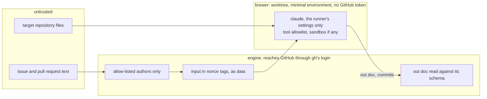

# Security model

A brewer is a model that reads untrusted text, so it runs as the least trusted part: the engine reaches GitHub through `gh`'s own login and decides, and the brewer gets a worktree, a minimal environment without a GitHub token (`brewerBaseEnv`) and only the runner's own settings.

| Threat | Mitigation |
|---|---|
| Prompt injection through issue or PR text | Only allow-listed authors create orders and commands; untrusted text goes between tags with a fresh random nonce per prompt, as data, and input containing the nonce is refused ([ADR 0041](../adr/0041-untrusted-input-in-per-prompt-nonce-tags.md); a mitigation, not the boundary); brewers have tool allowlists; `AskUserQuestion` and pushing are always denied |
| Agents running malicious install scripts in target repos | Brewer environment forces `npm_config_ignore_scripts=true`; sandbox by default, container optional |
| Repository-controlled agent settings or hooks | Only the runner's own settings file loads (`--setting-sources ""`): no project, local or user settings, so neither the repository nor the user's `~/.claude/settings.json` can widen a brewer; `--safe-mode` keeps the repository's hooks, MCP servers and `CLAUDE.md` out ([ADR 0046](../adr/0046-only-the-runners-settings-the-init-check-and-a-line-by-line-stream.md)). How `context: repo` gives a brewer the repository's instructions is open |
| Secret leakage | Minimal environment per brewer; Foedrum holds no GitHub token: `gh` and git run without the token variables and answer from `gh`'s login in the OS keyring ([ADR 0073](../adr/0073-github-only-through-gh-s-own-login.md)); brewers never get the token variables, and no rule a brewer may have starts `gh`; doctor says what can still read gh's login: a brewer or a check step on the permissions-only level, on the sandboxed level a brewer's shell commands, with gh's hosts file at its default path and the token variables hidden (on WSL2 not the Windows user's logins under `/mnt`, ADR 0087) but the OS keyring left open by the sandbox docs, and on native Windows check steps ([ADR 0076](../adr/0076-check-steps-run-in-an-os-sandbox-with-no-network.md)); a login a brewer did read is stopped at the push ([ADR 0079](../adr/0079-the-push-scans-the-batch-s-commits-for-secrets.md)) and left out of the pull request body and the status comment ([ADR 0088](../adr/0088-out-doc-text-that-looks-like-a-secret-is-left-out-of-the-pull-request-and-the-status-comment.md)) when it looks like one ([ADR 0082](../adr/0082-brewers-never-allow-gh.md), [ADR 0087](../adr/0087-sandboxed-commands-go-through-the-allow-rules-and-never-see-credentials.md)) |
| Foedrum's own dependencies | [Dependency policy](../../DEPENDENCIES.md) ([ADR 0004](../adr/0004-built-in-first-dependency-policy.md)) |
| Brewers acting outside their worktree | Generated per-attempt settings allow file tools only inside the worktree under `dontAsk`: `attemptSettings` writes a bare `Read`, `Grep` or `Glob` as `Read(./**)` and a bare `Edit`, `Write`, `MultiEdit` or `NotebookEdit` as `Edit(./**)`, since Claude Code consults only `Read` and `Edit` path rules, and the settings schema refuses a bare file-tool allow rule and a path rule for `Write`, `MultiEdit`, `NotebookEdit` or `Glob`, so a call outside, through `..` or through a link that leads outside is denied ([ADR 0049](../adr/0049-reviewers-read-only-inside-the-checkout.md), [ADR 0093](../adr/0093-brewers-file-tool-rules-are-read-and-edit-rules-scoped-to-the-worktree.md)); OS sandbox where available ([isolation levels](platform/isolation.md)); `scope` guard after every attempt. The clone's git configuration, which every attempt worktree shares, is this row's too: the engine's push, its lookup and the worktree fetch read it, and keeping a brewer from writing it is the sandbox's and the attempt settings' job, not the engine's. At the permissions-only level (native Windows), where neither a brewer's commands nor check steps run in an OS sandbox, a brewer can already run code it wrote as the user (an allowed toolchain command running a script it edited), which reaches more than the clone's configuration; the owner closes it through the check sandbox (ADR 0076) and, for the brewer, a `denyWrite` in the attempt settings where the sandbox applies. The engine adds no layer for it ([ADR 0137](../adr/0137-the-push-its-lookup-and-the-worktree-fetch-run-in-the-clone-again.md), `docs/trust-boundaries.md`) |
| A brewer pushing with the user's credentials | No allow rule reaches git with no fixed subcommand ([ADR 0062](../adr/0062-brewers-never-allow-git-with-no-fixed-subcommand.md)); a brewer's git, and a check step's, asks no credential helper, askpass program or terminal, sends no stored cookie, and refuses ssh and remote helpers, through variables the runner forces last (a netrc login in the user's home still goes, until #135) ([ADR 0109](../adr/0109-a-brewer-s-git-holds-no-push-credential.md)); a push that still gets a login is the sandbox's to stop on the sandboxed level, and on the permissions-only level, or from a check step on native Windows ([ADR 0076](../adr/0076-check-steps-run-in-an-os-sandbox-with-no-network.md)), nothing stops or finds it, since the `noPush` guard that compared the remote's refs around each attempt is gone ([ADR 0133](../adr/0133-the-nopush-guard-goes-a-brewer-s-git-holds-no-push-credential.md)) |
| Reviewer agents reading outside the checkout | `taster` and `brett` run the read guard (`scripts/read-guard.ts`) before every `Read`, `Grep` and `Glob`: only paths that resolve inside the checkout, after links, junctions, short names and case, get through ([ADR 0049](../adr/0049-reviewers-read-only-inside-the-checkout.md)) |
| Windows process spawning | Every CLI argument validated against a strict pattern; prompts and settings passed via stdin and files, never as arguments |

**Authentication:** Claude — whatever the user's `claude` CLI is logged in with.
GitHub — the maintainer's `gh` login (`gh auth login`, kept in the OS keyring), for the API through `gh api` and for git pushes with `gh` as git's credential helper (`gh auth setup-git`); `foedrum doctor` checks both, and Foedrum never holds a token ([ADR 0073](../adr/0073-github-only-through-gh-s-own-login.md)).
A GitHub App comes later, as a second kind of `gh` login.
