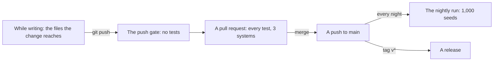

# Testing strategy

Stability is proven, not claimed.

| Page | What it covers |
|---|---|
| [Unit tests](unit.md) | No processes, the CPU-time budget |
| [Integration tests](integration.md) | A few per tool boundary |
| [Fake brewer runner](fake-runner.md) | Scripted brewer behaviours |
| [Property tests](property.md) | Invariants I1–I6 on generated scenarios |
| [Chaos tests](chaos.md) | The real driver, killed at random points |
| [End-to-end tests](end-to-end.md) | Nip through serve, end to end; browser tests not yet |

No test of any layer holds the wall clock to a limit, since load from other sessions stretches it (only a lower bound may read it, [ADR 0075](../../adr/0075-only-a-lower-bound-reads-the-wall-clock-and-doctor-runs-against-stub-tools.md)).
Instead ([ADR 0070](../../adr/0070-tests-never-hold-the-wall-clock-to-a-limit.md)):
- deadlines and timers are injected and driven by the test;
- "at once" is proven by an order of events;
- a wait for an end is only guarded against a hang;
- a performance property is measured in CPU time.

## Which tests run when

Each test runs at the stage where it pays ([ADR 0241](../../adr/0241-each-test-runs-at-the-stage-where-it-pays-the-check-runs-the-test-files-a-change-reaches.md)).



- **While writing** (`scripts/check.ts`, `scripts/affected-tests.ts`):
  - a red or green step runs the test files it changes with `node --test`;
  - `npm run check` runs the typecheck, the lint, the guards and the unit, property and chaos test files the change reaches, without coverage.
- **The push gate** (`.claude/settings.json`, `scripts/precheck.ts`): before a `git push` in a Claude Code session, `npm run check -- --no-tests`, every step but the tests ([ADR 0249](../../adr/0249-the-push-gate-runs-no-tests.md)).
- **A pull request** (`.github/workflows/ci.yml`, `package.yml`, `release.yml`):
  - on Linux, Windows and macOS: `npm run check -- --all` (every unit, property and chaos file, with coverage and its thresholds), `npm run test:integration` and `npm audit signatures`;
  - on Linux only: the dependency guard with publish dates, the property tests with 500 seeds and the chaos tests with 200 runs;
  - on Linux and Windows: the tests against the installed `claude` that the change reaches, and the package built, installed and started;
  - once: `npm audit --omit=dev` and the CLA check;
  - a pull request that changes `release.yml` or `package.yml` also runs the release as a dry run.
- **A push to `main`** (`.github/workflows/ci.yml`, [ADR 0407](../../adr/0407-a-pull-request-asks-for-one-macos-job.md)):
  - the same platform checks, extra seeds, dependency guard and audit as a pull request, with no CLA check and no release dry run;
  - the package on all three systems;
  - every test against the installed `claude` on macOS, and none on Linux and Windows.
- **The nightly run, 03:17 UTC** (`.github/workflows/ci.yml`): as a push to `main`, with the property and chaos tests at 1,000 each on every leg, and every test against the installed `claude` on all three systems.
- **A release** (`.github/workflows/release.yml`, [ADR 0388](../../adr/0388-a-tag-on-a-green-main-publishes-through-trusted-publishing-and-a-dry-run-proves-the-rest.md)): a tag `v*` on a merge commit of `main` whose CI run passed; the package built, installed and started on all three systems, then published.

`ci-ok`, the one required check, passes only when the platform checks, the tests against the installed `claude`, the package and the audit passed, and on a pull request the CLA check.

To run the same steps by hand:

```
node --test test/unit/fold.test.ts
npm run check
npm run check -- --no-tests
npm run check -- --all
npm run test:integration
```

- **Cross-platform:** the unit, property, chaos and integration tests run on Windows, macOS and Linux in every CI run.
  On a pull request the tests against the installed `claude` and the package leave out macOS, which the push to `main` runs ([ADR 0407](../../adr/0407-a-pull-request-asks-for-one-macos-job.md), [cross-platform rules](../platform/cross-platform.md)).
- **Coverage:** `npm test` fails below 90% of lines, 85% of branches and 90% of functions (its script in `package.json`).
  CI runs it on every leg through `npm run check -- --all`.
- **Evaluations** ([evaluation](../evaluation.md)) measure agent quality, separately from correctness tests.
  Among them, the planted-defect samples in `tasting-room/lenses/` check the review skill and a lens after its prompt changes.
  No test runs them: a person compares the run with the sample's table of expected findings.

Foedrum's own code is written test-first, with the red commit before the implementation commit ([ADR 0017](../../adr/0017-test-first-recipes-and-tasting-lenses.md)).
Every pull request but one of plain documentation goes through a review skill that applies the same red proof, lenses and mutation check Foedrum ships.

Browser testing *in target repositories* is a recipe concern, not a Foedrum test:
- a gravity reading can run the repository's own end-to-end suite (`"check": ["test", "npx playwright test"]`);
- a verification brewer (Lab tech) can use a browser tool to exercise a UI change and attach screenshots to the pull request (M6).
