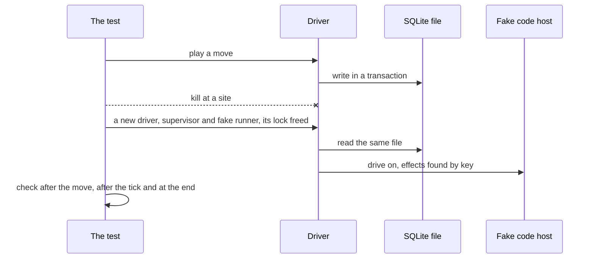
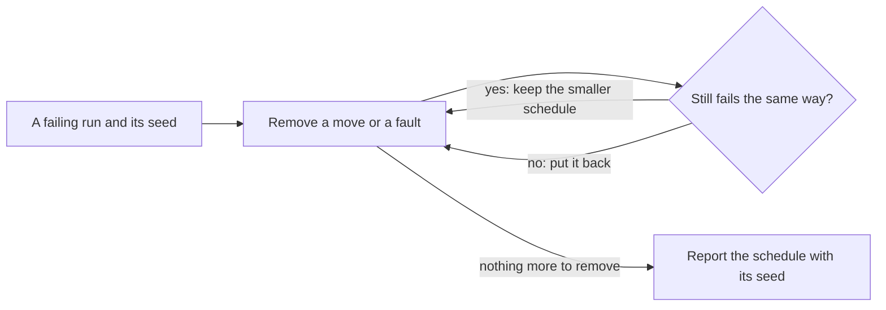

# Chaos tests

**Chaos tests** (`test/chaos/`, `test/helpers/chaos.ts`): the engine scenarios of the property tests played against the real driver (`openDriver`) on an SQLite file.
The driver is killed at random points and restarted on the same file, with a new driver, supervisor and fake runner and its lock freed.
It is killed:
- before every write in a transaction;
- after every commit;
- on both sides of an effect reaching the fake code host.

A kill is an exception the driver cannot catch, so no process is started or killed.



What is checked:
- after every move, at most one live lease per step (I2);
- after every tick the engine lived through, no batch past its deadline, routing deadline or reminder;
- at the end, after a last tick the engine lived through, every batch is on tap, cancelled, Stuck or Conditioning, or Ordered before its routing deadline;
- at the end, every effect due is on the code host exactly once and in the ledger.

## Two drivers and a terminal

Two drivers on one store run the same scenarios (`test/chaos/drivers.test.ts`):
- a killed driver may stay down for a few moves;
- a live one stalls now and then while its brewers run;
- the terminal issues human commands between a driver's read and its append, takeovers among them, which hand any leased batch to the other driver.

There ([ADR 0051](../../adr/0051-chaos-runs-on-the-real-driver-with-two-drivers-and-a-terminal.md), [ADR 0124](../../adr/0124-foedrum-takeover-hands-a-batch-to-another-driver-as-a-recorded-command.md)):
- each attempt is started at most once, only under its batch's lease (as the driver held it in its last transaction, so work it had in flight when a takeover landed counts);
- no two calls for one effect key overlap;
- the guard accepts every committed event in order;
- a restarted driver drives on its batches (but for one handed over during its start);
- nothing waits for a driver that is down once its leases expired, while a taken-over batch's effects wait until the old lease's end.

## The other kill tests

- **Worktrees** (`test/chaos/worktrees.test.ts`, ADR 0084): the attempt worktrees run in an in-memory clone that decides through `planWorktree` and `planClean`, killed while it makes, records and cleans them.
  No attempt runs without its worktree, nothing of a live batch or a running attempt is removed, and nothing of an ended batch but its task tree's branch is left at rest.
- **State branch** (`test/chaos/state-branch.test.ts`): it runs in memory too, with the pure core deciding and the store keeping the marker, killed while it writes the log and on both sides of the push.
  The remote always holds the store's first events once, the marker never runs ahead of it, every start brings the branch in line, and a flush at rest pushes every event.
- **Intake** (`test/chaos/intake.test.ts`, [ADR 0068](../../adr/0068-the-intake-in-foedrum-serve-brewery-orders-and-routing-by-label.md)): the intake is killed after one of its orders committed, before its route.
  A restarted intake routes what the dead pass left Ordered and never orders an issue twice.
  Without one, the supervisor's first tick after the routing deadline makes each such batch Stuck on routing.
- **Pause** (`test/chaos/pause.test.ts`, [ADR 0202](../../adr/0202-pause-and-continue-hold-an-order-or-the-whole-brewery-at-its-next-convenient-point.md)): a driver is killed and started again while a person's pause holds one order or the whole Brewery, maybe with `--by`, and a night passes.
  Nothing held starts while paused, none of it goes Stuck, and once continued every held batch is on tap.
- **A failing batch** (`test/chaos/failing-batch.test.ts`, [ADR 0335](../../adr/0335-a-batch-that-keeps-failing-is-marked-after-an-hour-and-stuck-when-a-reading-hides-its-deadline.md)): one batch per site fails past the hour (a reading, the effects' reading, one effect) while another runs, under kills and clock jumps.
  - No brewing batch that cannot be read stays brewing past its hour.
  - A failing effect marks its batch and never makes it Stuck.
  - The healthy batch carries no mark, and the marks stay few.
  - Once the throws stop, every batch comes on tap with no mark.
- **Batch isolation** (`test/chaos/batch-isolation.test.ts`, [ADR 0328](../../adr/0328-one-batch-s-error-stops-no-other-in-the-supervisor-or-the-drive.md)): batches throw at a driver's sites for a while (the deadline's reading, the drive, an attempt's start, the effects' reading), under kills and clock jumps.
  No tick rejects, a batch that reads meets its deadlines, a failure is said once until it changes or recovers, and every batch is on tap once it reads.

## Faults, shrinking and runs

Every fault (a kill, a pause, a driver kept down or stalled, a terminal command) is a decision at a site: the move by its number in the run as first played, the driver, and its count among decisions of its kind in that move.
A failing run is shrunk by removing moves and faults, each fault staying at its site, to a schedule that still fails the same way.
It is reported with its seed (`test/helpers/chaos-shrink.ts`, [ADR 0061](../../adr/0061-chaos-faults-at-sites-shrinking-worktrees-and-the-state-branch.md)).



`FOEDRUM_RUNS` sets the runs ([ADR 0033](../../adr/0033-chaos-tests-effects-found-by-key-and-leases-at-start.md), [ADR 0134](../../adr/0134-the-red-proof-runs-once-the-review-drops-its-coverage-delta-and-property-and-chaos-run-on-one-leg-per-pull-request.md)):
- when it is unset, as in `npm run check`, 5 for the kill tests that share `chaosRuns` (`test/helpers/chaos-shrink.ts`), while some files set their own default (10 or 30);
- 200 on CI's Linux leg per pull request;
- 1,000 on every leg in the nightly run.

The shrinker's own tests (`test/chaos/shrink.test.ts`) run 3 when `FOEDRUM_RUNS` is unset, as in `npm run check` ([ADR 0243](../../adr/0243-the-shrinker-s-tests-run-within-foedrum-runs.md)):
- below a dozen, they find and shrink each planted failure in twelve-move runs, and from a dozen on in forty-move runs;
- the replay plays the last `runs` of a dozen seeds and seeds 10 to 12 at least (10 to 12 in the check), until every kind of fault showed.

To run one file, at its own count and at the pull request's, in a POSIX shell (Git Bash on Windows):

```
node --test test/chaos/restarts.test.ts
FOEDRUM_RUNS=200 node --test test/chaos/restarts.test.ts
```

In PowerShell:

```
$env:FOEDRUM_RUNS = 200; node --test test/chaos/restarts.test.ts
```

Not yet covered: the real runner's processes, a second process of a live driver, and two drivers flushing one state worktree.
