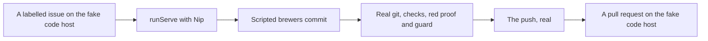

# End-to-end tests

**End-to-end tests** (from M1): a labelled issue in a throwaway Brewery becomes a pull request through serve's own `runServe` with Nip from `defaults/`.
The test is `test/integration/nip.test.ts`, in `npm run test:integration` on every CI leg.

- **Real:** git, the attempt worktrees, the target's own test command in the check steps, the red proof, the guard, the route input and the push.
- **Faked:** GitHub is the fake code host behind the fake gh.
  The brewers are a scripted Maltster, which commits the target's test map, Gauger, Cellarman, Finer and Taster (`test/helpers/nip-fixture.ts`).
  So the run is deterministic and needs no login or model.

The same run with the real `claude` against the fake Messages API is opt-in with `FOEDRUM_REAL_CLAUDE=1`, which CI's `real-claude` job sets ([ADR 0399](../../adr/0399-ci-runs-the-tests-against-the-installed-claude-with-a-claude-pinned-in-a-lockfile-of-its-own.md), [ADR 0121](../../adr/0121-the-m1-end-to-end-test-runs-nip-through-serve-with-real-git-and-checks-and-faked-github-and-brewers.md)).

`foedrum brew`'s run of a Brewery is held by the demo's second order in `test/integration/demo.test.ts` ([ADR 0367](../../adr/0367-the-demo-s-second-order-holds-what-foedrum-brew-s-integration-test-held.md)).
`problemsOf` (`scripts/demo/core.ts`) fails the run when:
- the code host has no pull request from that order's bottle branch into `main`;
- or the branch does not end at the Cellarman's third fix.

`foedrum brew`'s own logic is tested on fakes in `test/unit/brew.test.ts`.

**Browser end-to-end tests** are not built yet.
From M6, when the dashboard exists, they are to use Playwright Test as a development dependency, subject to the admission checklist.
Browsers are to be downloaded by an explicit command, not an install script.
