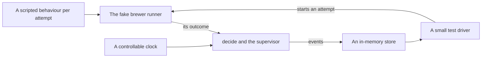

# Fake brewer runner

**Fake brewer runner** (`test/helpers/fake-brewer-runner.ts`) with scripted behaviours: succeed, fail (retryable or not), hang, crash mid-step, garbage output, no out doc, exceed budget, ask a question, a storm of permission denials.
Each has an end-to-end test through `decide`, the supervisor and a small test driver against an in-memory store with a controllable clock ([ADR 0028](../../adr/0028-brewer-runner-outcomes-environment-and-test-first.md)).

