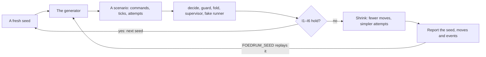

# Property tests

**Property tests** on the engine: generated sequences must keep invariants I1–I6.

A seeded generator (`test/helpers/event-sequences.ts`, no dependency) writes two things:
- event sequences for the fold;
- engine scenarios for the invariants: commands chosen from the folded state, supervisor ticks that move a controllable clock, and what the fake brewer runner does in each attempt (hangs, lost attempts, stalls, denial storms).

A scenario runs through `decide`, the guard, the fold, the supervisor and the fake runner on an in-memory store (`test/helpers/simulation.ts`), with one property per invariant in `test/property/`.



Each run starts from a fresh seed.
A failure is shrunk to fewer moves and simpler attempts and reported with its seed, moves and events.
Setting the environment variable `FOEDRUM_SEED` to that seed replays it, in a POSIX shell (Git Bash on Windows) or in PowerShell:

```
FOEDRUM_SEED=<seed> node --test test/property/invariant-i2.test.ts
$env:FOEDRUM_SEED = <seed>; node --test test/property/invariant-i2.test.ts; Remove-Item Env:FOEDRUM_SEED
```

`FOEDRUM_RUNS` sets how many seeds each property runs (ADR 0134):
- few in `npm run check`, to stay within the per-file budget;
- 500 on CI's Linux leg per pull request;
- 1,000 on every leg in the nightly run.
