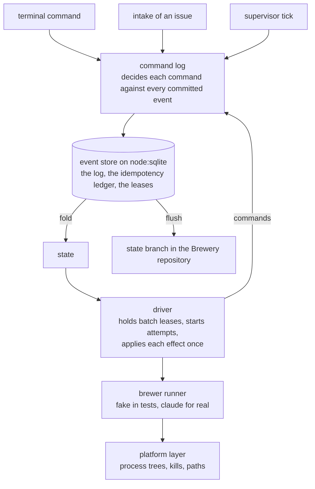

# M0 — Foundations: what it built

Closed 2026-10-17 · 42 issues · ADRs 0001–0058 · [GitHub milestone](https://github.com/EdwinBekaert/foedrum/milestone/1?closed=1)

Foedrum's engine moves each batch (one run of a recipe for one order) forward unattended. M0
built that engine and the proof that a crash can neither lose nor repeat what it does. Every
change to a batch is an event in an append-only log, and the state is a fold of that log. Every
writer goes through one command layer, which decides a command against all the events committed
so far, inside the transaction that appends its own (ADR 0019, ADR 0044).

| Part | Where |
|---|---|
| Command log, `decide` and the guard | `src/engine/command-log.ts:35`, `src/engine/decide.ts:123`, `src/engine/admit.ts` |
| Event store | `src/engine/sqlite-event-store.ts:155` |
| Fold, state branch | `src/engine/fold.ts:175`, `src/engine/state-branch-git.ts:95` |
| Supervisor, intake | `src/engine/supervisor-loop.ts:83`, `src/engine/intake.ts` |
| Driver, effects | `src/engine/driver.ts:116`, `src/engine/effects.ts:40` |
| Brewer runner, platform | `src/engine/brewer-runner.ts:46`, `src/platform/` |

## The exit criterion

**1,000 chaos runs with random engine kills: no lost or duplicated side effects, no silent
stalls.** The chaos tests (`test/chaos/`, `test/helpers/chaos.ts:55`) play engine scenarios
against the real driver on an SQLite file. They kill the driver at random points (inside a
transaction, after a commit, on both sides of an effect reaching the code host), restart it on
the same file, and check invariants I1–I6 (architecture §4.4) after every move. A second set
runs two drivers and a terminal on one store (ADR 0051). CI runs 200 of them on every pull
request and 1,000 nightly, on all six legs (`.github/workflows/ci.yml`).

The 1,000-run nightly job first passed on all six legs on 2026-10-17. The same day, a random seed
on a pull request found a real driver bug: two live attempt leases on one step after Stuck and a
retry (#150, I2). It was fixed in #153 (ADR 0055), with the seed as a regression test.

## What it built

| Area | What | Issues |
|---|---|---|
| Events and state | Event, outcome and out-doc schemas, the JSONC and frontmatter readers, the fold, the batch state machine with Conditioning, Stuck and rewind | #4, #5, #8, #9, #52, #65 |
| Durability | The event store on `node:sqlite` (WAL, append-only), the idempotency ledger (I4), the state branch that keeps events and out docs in the Brewery repository | #6, #7, #16 |
| Keeping batches moving | The supervisor (leases, deadlines, stall detection, reminders), a routing deadline for Ordered batches, so I1 holds without an exemption | #10, #98 |
| Running brewers | The `BrewerRunner` interface, the fake runner and the claude runner (ADRs 0046–0048), a minimal environment for brewers, attempt worktrees that are created, recorded, recreated and cleaned up | #11, #49, #56, #81 |
| Platform | Process trees and kills on Windows and POSIX, `.cmd` spawns, output caps, paths, executables, file locks, a robust `removeTree` | #12, #91, #92 |
| CLI | `doctor`, `status`, `replay` | #13, #99 |
| Proof | Property tests for I1–I6, the chaos harness, test layers (unit tests start no processes), the test budget in CPU time | #14, #15, #58, #87, #108, #111 |
| Repository and CI | Scaffolding, CI on Windows, macOS and Linux, the dependency guard | #1, #2, #3, #75, #86, #109 |
| Working on Foedrum | The local gate before every push, the `/brew-review` skill with red proof, lenses, Brett's mutants and the coverage delta, reviewers kept inside the checkout | #23, #24, #40, #41, #42, #43, #59, #61, #70, #80 |

Some M1 work landed before M0 closed: claiming target-repository issues (#120, ADR 0043),
intake (#103, ADR 0050), the GitHub tracker (#142, ADR 0052) and recipe files that load into
the engine (#141, ADR 0053). So did test runs at below-normal priority, with reviews scoped to
the change (#140, ADR 0054).

## Not in M0

- **Chaos cases for worktrees and the state branch, and shrinking a failing run** (#144). The
  chaos tests drive the real driver with a fake runner, and worktrees are not part of them yet
  (architecture §9).
- **`foedrum serve` with the real runner** (#148), and the plugin commands brew, resume and
  takeover (#37): M1.
- **Test-first recipes** (#25, #176): a recipe with a brewer that writes commits needs a red
  proof, or `testFirst: false`, to load (ADR 0064); the red proof itself runs with #176.

Read next: [the engine](../design/engine/README.md) for the data model and invariants,
then the [ADR index](../adr/README.md).
