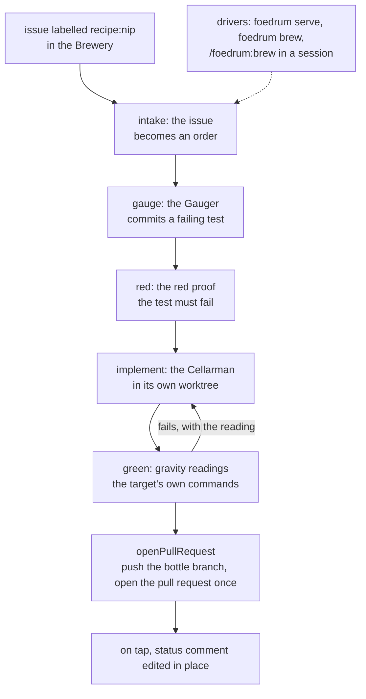

# M1 — First pour: what it built

Closed 2026-10-23 · 93 issues (91 done, 2 not planned) · ADRs 0059–0150 · [GitHub milestone](https://github.com/EdwinBekaert/foedrum/milestone/2?closed=1)

M0 built an engine that moves a batch forward unattended and survives being killed. M1 put a
real pipeline on it: a labelled issue in a Brewery becomes an order, Nip (the test-first recipe
in `defaults/`) brews it with a Gauger that writes a failing test and a Cellarman that makes it
pass, the target's own commands check the result, and the batch goes on tap with one pull request
and one status comment. It runs in `foedrum serve`'s Cellar, as one `foedrum brew` from a
terminal, or as `/foedrum:brew` from a Claude Code session.



| Part | Where |
|---|---|
| Intake, claims, the GitHub tracker | `src/engine/intake.ts:143`, `src/engine/claim-effects.ts:134`, `src/github/tracker.ts:35` |
| Recipe and brewer files, defaults | `src/engine/recipe-files.ts:422`, `src/engine/brewery-files.ts`, `defaults/` |
| The claude runner, attempt plans and settings | `src/brewers/claude-runner.ts:441`, `src/brewers/attempt-plans.ts`, `src/brewers/attempt-settings.ts` |
| Attempt worktrees from local clones | `src/workspace/attempt-worktrees-git.ts:219` |
| Red proof, gravity readings | `src/checks/red-proof.ts:102`, `src/checks/check-runner.ts:124` |
| Pull request, status comment | `src/engine/pull-request-actions.ts:134`, `src/engine/status-comment.ts:361` |
| Drivers | `src/cli/serve.ts:146`, `src/cli/brew.ts:90`, `plugin/skills/` |

## The exit criterion

**A real issue in a test Brewery becomes a pull request end to end, covered by an automated E2E
test on all three platforms.** `test/integration/nip.test.ts` (#180, ADR 0121) runs a labelled
issue in a throwaway Brewery through `foedrum serve`'s own wiring with Nip from `defaults/`. Git,
the attempt worktrees, the recipe loader, the red proof, the testsUnchanged guard and the target's
own `node --test` are real. GitHub is the tests' fake code host behind a fake gh (ADR 0073), and
the brewers are the scripted Gauger and Cellarman of the Nip fixture, so no model runs. The
Cellarman's first fix fails the check, its second attempt gets that reading (ADR 0128) and passes,
and the pull request opens. It passed on Windows, macOS and Linux for main at `d4c1534`. With
`FOEDRUM_REAL_CLAUDE=1` the same run uses the real claude runner against a fake Messages API
(ADR 0057).

## What it built

| Area | What | Issues |
|---|---|---|
| Orders | Polling intake that orders labelled issues and routes them, claims so that one Brewery brews a target issue, the GitHub tracker with ETags and rate-limit backoff, ordering again after a cancel | #103, #120, #142, #145, #186 |
| Recipes | Recipe and brewer files that load or fail closed, test-first recipes with a red proof and the testsUnchanged guard, a task tree shared by a batch's steps, the defaults (Nip, the Gauger, the Cellarman and the lens text), a routed attempt that gets what sent it back | #25, #141, #168, #176, #205, #218, #290, #341 |
| Running brewers | The claude CLI's flags and stream verified, attempt plans with the recipe's limits, untrusted input in per-prompt nonce tags, the out doc contract, file-tool rules scoped to the worktree, a run-out usage window as Stuck on environment, each attempt's session recorded and resumed | #17, #106, #135, #148, #167, #195, #196, #222, #234, #238, #324, #325 |
| Checks | Gravity readings with the repository's own commands, at the attempt's isolation level, and the guards reading git in the clone | #177, #190, #210, #376 |
| Delivery | `openPullRequest`, pushed once, with the base fetched first and the commits scanned for secrets; one status comment per order, edited in place, without text that looks like a secret | #178, #179, #202, #209, #235 |
| Credentials | GitHub only through gh's own login, brewers that never reach gh and hold no credentials that let a push succeed, the engine's git ignoring clone config a brewer could write | #173, #194, #200, #204, #229, #263, #299, #362, #364 |
| Durability | Chaos cases for worktrees and the state branch with shrinking, out docs on the state branch, branches kept until they are recorded, stale lock files after a kill, a driver pass that records every ended run | #107, #144, #150, #197, #215, #221, #232, #255, #278, #289, #300, #306, #309, #320 |
| Drivers | `foedrum serve`, `foedrum brew`, `foedrum takeover`, `foedrum resume`, and the Claude Code plugin with brew, status, stuck, answer and resume | #37, #130, #162, #334, #335, #336, #337 |
| Seeing it | `npm run demo`, and the end-to-end test | #180, #193, #268, #366 |
| Working on Foedrum | House yeast for reviews, the gate's denylist and its checks of what is pushed and posted, the gate made smaller, the red proof once per pull request, the test budget failing only in CI, the ADR index rebuilt at milestone close, `/brew-last-call` | #32, #131, #132, #212, #220, #248, #264, #267, #280, #281, #291, #297, #307, #312, #314, #329, #330, #343, #345, #360, #361, #363, #396 |

Closed as not planned: a Windows git flake in the worktrees' fetch (#174) and filter drivers in an
attempt worktree's checkout (#270).

## Not in M1

- **A recorded brew on github.com with a real model.** The exit test fakes GitHub and the
  brewers; the recording of the demo is #277.
- **The npm package and `npx foedrum init`**: M3. Until then the plugin needs a `foedrum` command
  on your PATH (below).
- **Planning before brewing** (#373 and its sub-issues), parallel steps and lens steps (#26), the
  Innkeeper (#227) and an answerer for brewers' questions (#398): M2.

Read next: [the engine](../design/engine/README.md), the [recipes](../design/recipes/README.md),
then the [ADR index](../adr/README.md).

## See it

```sh
npm ci
npm run demo
```

`npm run demo` makes a scratch Brewery and target repository in `.foedrum/tmp/demo/`, with bare
remotes there, and brews an order with Nip's steps, the test-first recipe in Foedrum's `defaults/`,
tasted by three lenses at once (the demo Brewery's own recipe, `nip-parallel`), through
`foedrum serve`'s own Cellar; then a second order with `foedrum brew`, and it shows
`foedrum resume`'s line for the Cellarman's attempt. The Gauger and the Cellarman are scripted (the
Nip fixture of the M1 end-to-end test) and the code host is an in-process fake, so it needs node
and git only: no gh, no GitHub, no `claude`, no network, and nothing on your machine's git
configuration (ADR 0097, ADR 0139). The red proof and the checks run the target's own
`node --test`. It takes about 2 minutes on a Windows laptop.

It walks through eleven steps and waits for Enter between them. `npm run demo -- --no-pause` goes
straight through, as it does when its input is not a terminal.

| Step | What to look for |
|---|---|
| 1. The diagnosis serve runs with | The demo's own diagnosis, not `foedrum doctor` on your machine: the demo starts no `claude` and no gh, so it checks neither. |
| 2. The order comes in | An issue in the Brewery, labelled `recipe:nip-parallel` by a user it lists, is all serve needs to take it as a batch: Nip's steps, tasted by three lenses at once. |
| 3. `foedrum status` as the batch moves | The batch goes from the order to brewing, and the Gauger's `gauge #1` has committed a failing test when the Cellar is killed. |
| 4. The kill and the restart | The Cellar is killed with SIGKILL mid-attempt. The restart finds `gauge #1` lost, because the Cellar running it stopped, and brews it again as `gauge #2`. |
| 5. The red proof and the failed check | `red #1` must see the Gauger's test fail before `implement #1` may start. `green #1` fails the Cellarman's first fix, so `implement #2` starts, told why: the failed checks of step `green`, with the failed test's own `not ok` line. `correctness #1` blocks with a finding, so `implement #3` fixes it and round 2 approves. The restarted Cellar ends here: the batch on tap, its cleanup, and serve stopped. |
| 6. The pull request and the status comment | One pull request and one status comment on the fake code host, though the Cellar lived twice. Its path has a line per round. The comment is shown as its Markdown, without its hidden revision marker. The pull request is #2 because the fake host numbers comments and pull requests from one counter. |
| 7. On tap | `foedrum status` shows the batch on tap, with its pull request. |
| 8. `foedrum lenses` | Each lens's rounds, findings and tokens: correctness's finding is fixed; `diff/acceptance`, not in this recipe, has no rounds. |
| 9. `foedrum brew 2 --as ann` | The same order again as issue #2, labelled `recipe:nip-parallel` once the Cellar has stopped and brewed from a terminal instead of the Cellar: `foedrum brew` orders it, routes it by its label, and drives that one batch to its own pull request. |
| 10. `foedrum resume 1-1 implement#2` | `resume` finds the Cellarman's session of that attempt and prints the line that opens it in its worktree in a terminal. The demo opens it nowhere, since it starts no `claude`. |
| 11. `foedrum replay 1-1` | Every event the batch went through, and the state the fold makes of them. |

`foedrum status`, `foedrum lenses`, `foedrum resume` and `foedrum replay` are the CLI's own commands, run in the
scratch Brewery: they read its event store, and nothing else that could reach GitHub.
`foedrum brew` runs on the demo's seams, as the Cellar does.

To brew a real order from a Claude Code session, install the plugin:

```sh
claude plugin marketplace add EdwinBekaert/foedrum
claude plugin install foedrum@foedrum
```

or, from a checkout, start the session in the Brewery's root with
`claude --plugin-dir <checkout>/plugin`. Then run `/foedrum:brew <issue>` in a session started in
that Brewery's root. Its skills run `foedrum` from your PATH, and that one does reach gh,
GitHub and `claude` (ADR 0125). The npm package is not published yet, so put a command named
`foedrum` on your PATH that runs `node <checkout>/src/cli/main.ts` with its arguments, in a
checkout after `npm ci`.
From a terminal outside a Claude Code session, `foedrum brew` needs a name for its driver: run
`foedrum brew <issue> --as <name>`, or it refuses with "give --as <name>".

Recording: _to come in #700, made by hand (asciinema or a GIF), with no new dependency._

<details>
<summary>The text of <code>npm run demo -- --no-pause</code></summary>

```text
demo: a scratch Brewery demo/brewery and its target demo/web in <demo>

Step 1 of 11: The diagnosis serve runs with
Look for: the demo's own diagnosis, not foedrum doctor on this machine: it
          starts no claude and no gh.
demo: what foedrum doctor would tell serve, given by the demo instead:
  claude     the demo brewer, never started
  isolation  permissions only: the demo brewer is scripted
  problems   none

Step 2 of 11: The order comes in
Look for: an issue labelled recipe:nip-parallel is all serve needs: Nip's steps,
          tasted by three lenses at once.
demo: issue #1 of demo/brewery by ann, labelled recipe:nip-parallel, on the fake code host:
  "Greet a visitor who gives no name"
  greet("") should say "Hello, stranger!" instead of "Hello, !".

## What to build

- [ ] `greet("")` returns "Hello, stranger!"
- [ ] a test pins it down


Step 3 of 11: foedrum status as the batch moves
Look for: the batch goes from the order to brewing; gauge #1 commits a failing
          test before the kill.
demo: the Cellar starts and brews, and is killed mid-attempt
  foedrum serve: brewing for demo/brewery in <demo>\work; Ctrl+C stops it
  foedrum serve: check steps run outside an OS sandbox on native Windows: their commands can run code a brewer wrote, with network and home-folder access (ADR 0076)
  foedrum serve: ordered demo/brewery#1 as batch 1-1
  foedrum serve: routed batch 1-1 to the recipe nip-parallel
  $ foedrum status
    1 batch

      1-1  #1  brewing  gauge #1 started

Step 4 of 11: The kill and the restart
Look for: the restart finds gauge #1 lost with the killed Cellar, and brews it
          again as gauge #2.
  demo: the Gauger committed its test; the Cellar is killed mid-attempt
demo: the Cellar starts again on the same Brewery
  foedrum serve: removed a stale index.lock from the state worktree: <demo>\brewery\.git\worktrees\state\index.lock
  foedrum serve: brewing for demo/brewery in <demo>\work; Ctrl+C stops it
  foedrum serve: check steps run outside an OS sandbox on native Windows: their commands can run code a brewer wrote, with network and home-folder access (ADR 0076)
  demo: the restart found gauge #1 lost (the Cellar running it stopped, so its lease ran out); gauge #2 brews it again
  $ foedrum status
    1 batch

      1-1  #1  brewing  gauge #2 started

Step 5 of 11: The red proof and the failed check
Look for: red #1 sees the test fail; green #1 fails, so implement #2 is told
          why; correctness #1 blocks, so implement #3 runs and round 2 approves.
  demo: gauge #2 is told why step gauge runs again: the failure of gauge#1
  $ foedrum status
    1 batch

      1-1  #1  brewing  red #1 started
  $ foedrum status
    1 batch

      1-1  #1  brewing  implement #1 started
  $ foedrum status
    1 batch

      1-1  #1  brewing  fine #1 started
  $ foedrum status
    1 batch

      1-1  #1  brewing  green #1 started
  $ foedrum status
    1 batch

      1-1  #1  brewing  implement #2 started
  demo: implement #2 is told why step implement runs again: the failed checks of step green
    not ok 2 - greets a stranger when no name is given
  $ foedrum status
    1 batch

      1-1  #1  brewing  fine #2 started
  $ foedrum status
    1 batch

      1-1  #1  brewing  green #2 started
  $ foedrum status
    1 batch

      1-1  #1  brewing  correctness #1 started, security #1 scheduled, test-design #1 scheduled
  $ foedrum status
    1 batch

      1-1  #1  brewing  correctness #1 started, security #1 started, test-design #1 scheduled
  $ foedrum status
    1 batch

      1-1  #1  brewing  correctness #1 started, security #1 started, test-design #1 started
  $ foedrum status
    1 batch

      1-1  #1  brewing  test-design #1 started
  $ foedrum status
    1 batch

      1-1  #1  brewing  implement #3 started
  demo: implement #3 is told why step implement runs again: the findings of step correctness
  $ foedrum status
    1 batch

      1-1  #1  brewing  fine #3 started
  $ foedrum status
    1 batch

      1-1  #1  brewing  green #3 started
  $ foedrum status
    1 batch

      1-1  #1  brewing  correctness #2 started, security #2 scheduled, test-design #2 scheduled
  $ foedrum status
    1 batch

      1-1  #1  brewing  correctness #2 started, security #2 started, test-design #2 scheduled
  demo: correctness #2 is told the change since commit 26d9fce0f4254137b0dbd46593ed6f8ac2be1ae2, as {roundChange}, and the earlier findings, as {earlierFindings}:
    Round correctness#1:
    - major in greet.mjs:2: a name of only spaces is greeted as itself, not as a stranger
      fixed: greet trims the name before it asks whether it is empty
  demo: security #2 is told the change since commit 26d9fce0f4254137b0dbd46593ed6f8ac2be1ae2, as {roundChange}, and the earlier findings, as {earlierFindings}:
    Round security#1:
    - minor in greet.mjs:2: the name goes into the greeting as it is: a caller that writes the greeting into HTML must escape it
      open
  $ foedrum status
    1 batch

      1-1  #1  brewing  correctness #2 started, security #2 started, test-design #2 started
  $ foedrum status
    1 batch

      1-1  #1  brewing  test-design #2 started
  demo: test-design #2 is told the change since commit 26d9fce0f4254137b0dbd46593ed6f8ac2be1ae2, as {roundChange}, and the earlier findings, as {earlierFindings}:
    Round test-design#1:
    - minor in greet.test.mjs:10: the new test covers the empty name only; a name of only spaces has no test
      open
  $ foedrum status
    1 batch

      1-1  #1  on tap  https://github.com/demo/web/pull/2
  foedrum serve: cleaned batch 1-1: removed 18 worktrees; deleted 17 branches; removed batch folder 1-1; removed attempt settings 1-1; kept branch foedrum/1-1/test-design/2: it holds the task tree of batch 1-1, whose pull request is open (ADR 0219)
  demo: batch 1-1 is on tap: https://github.com/demo/web/pull/2
  foedrum serve: stopped

Step 6 of 11: The pull request and the status comment
Look for: one pull request and one status comment, though the Cellar lived
          twice; its path has a line per round.
demo: pull request #2 on demo/web: "Greet a visitor who gives no name", foedrum/demo.brewery/1-1/demo.web into main
demo: it is #2: the fake code host numbers comments and pull requests from one counter, and the status comment came first (GitHub numbers each repository's issues and pull requests together, and comments apart)
demo: status comment by cellar-bot on demo/brewery#1, its Markdown without the hidden revision marker:
  ### Foedrum · batch `1-1`

  🍻 **On tap**

  Recipe **nip-parallel**, chosen by its label
  Path: `gauge #1` ❌ the attempt was lost → `gauge #2` ✅ → `red #1` ✅ → `implement #1` ✅ → `fine #1` ✅ → `green #1` ❌ the check "test" failed with exit code 1
  → `implement #2` ✅ → `fine #2` ✅ → `green #2` ✅ → `correctness #1` ❌ blocked (findings) → `security #1` ✅ → `test-design #1` ✅
  → `implement #3` ✅ → `fine #3` ✅ → `green #3` ✅ → `correctness #2` ✅ → `security #2` ✅ → `test-design #2` ✅ → `open-pull-request #1` ✅
  - ✅ `gauge`
  - ✅ `red`
  - ✅ `implement`
  - ✅ `fine`
  - ✅ `green`
  - ✅ `correctness`
  - ✅ `security`
  - ✅ `test-design`
  - ✅ `open-pull-request`

  **Findings**
  - `security`: minor in greet.mjs:2: the name goes into the greeting as it is: a caller that writes the greeting into HTML must escape it
  - `test-design`: minor in greet.test.mjs:10: the new test covers the empty name only; a name of only spaces has no test

  **Simplifications**
  - `fine`: nothing to simplify: greet is one expression, and the change reuses nothing it repeats

  **Pull requests**
  - <https://github.com/demo/web/pull/2> is not ready to merge yet: no merge brief

Step 7 of 11: On tap
Look for: foedrum status shows the batch on tap, with its pull request.
$ foedrum status
  1 batch

    1-1  #1  on tap  https://github.com/demo/web/pull/2

Step 8 of 11: foedrum lenses
Look for: each lens's rounds, findings and tokens: correctness's finding is
          fixed; diff/acceptance, not in this recipe, has no rounds.
$ foedrum lenses
  diff/acceptance  defaults/lenses/diff/acceptance.md
    no rounds
  diff/correctness  defaults/lenses/diff/correctness.md
    2 rounds, 1 finding: 1 major
    ended: 1 fixed
    rounds to pass: 2 (1 step)
    tokens: none reported
  diff/security  defaults/lenses/diff/security.md
    2 rounds, 1 finding: 1 minor
    ended: 1 open
    rounds to pass: 1 (1 step)
    tokens: none reported
  diff/test-design  defaults/lenses/diff/test-design.md
    2 rounds, 1 finding: 1 minor
    ended: 1 open
    rounds to pass: 1 (1 step)
    tokens: none reported

Step 9 of 11: foedrum brew 2 --as ann
Look for: the same order again as issue #2, brewed from a terminal: foedrum brew
          orders, routes and drives it to its pull request.
demo: ann labels issue #2 recipe:nip-parallel, now the Cellar has stopped
$ foedrum brew 2 --as ann
  foedrum brew: ordered #2 as batch 2-1
  foedrum brew: routed batch 2-1 to the recipe nip-parallel
  foedrum brew: brewing batch 2-1 as ann
  foedrum brew: status comment: https://github.com/demo/brewery/issues/2#issuecomment-3
  foedrum brew: batch 2-1 brewing: gauge #1 started
  foedrum brew: batch 2-1 brewing: red #1 started
  foedrum brew: batch 2-1 brewing: implement #1 started
  foedrum brew: batch 2-1 brewing: fine #1 started
  foedrum brew: batch 2-1 brewing: green #1 started
  foedrum brew: batch 2-1 brewing: implement #2 started
  foedrum brew: batch 2-1 brewing: fine #2 started
  foedrum brew: batch 2-1 brewing: green #2 started
  foedrum brew: batch 2-1 brewing: test-design #1 started
  foedrum brew: batch 2-1 brewing: implement #3 started
  foedrum brew: batch 2-1 brewing: fine #3 started
  foedrum brew: batch 2-1 brewing: green #3 started
  foedrum brew: batch 2-1 brewing: test-design #2 started
  foedrum brew: cleaned batch 2-1: removed 17 worktrees; deleted 16 branches; removed batch folder 2-1; removed attempt settings 2-1; kept branch foedrum/2-1/test-design/2: it holds the task tree of batch 2-1, whose pull request is open (ADR 0219)
  foedrum brew: batch 2-1 is on tap: https://github.com/demo/web/pull/4

Step 10 of 11: foedrum resume 1-1 implement#2
Look for: the line that opens the Cellarman's session in its worktree; the demo
          opens it nowhere, since it starts no claude.
$ foedrum resume 1-1 implement#2
  foedrum resume opens claude in a terminal, which a Claude Code session cannot hand over; run this in a terminal in <demo>\brewery:
    foedrum resume 1-1 implement#2

Step 11 of 11: foedrum replay 1-1
Look for: the state the fold makes of the batch's events; foedrum replay lists
          every event above it.
$ foedrum replay 1-1
  Batch 1-1, issue #1

  Events  70, left out here: foedrum replay 1-1 lists them

  State
    lane    on tap: https://github.com/demo/web/pull/2
    recipe  nip-parallel, chosen by label: the label recipe:nip-parallel
    out docs  on the state branch at batches/1-1/<step>-<attempt>.md
    steps
      gauge              #1 finished: failed: the attempt was lost: the Cellar running it stopped, so its lease ran out; #2 finished: succeeded
      red                #1 finished: succeeded
      implement          #1 finished: succeeded; #2 finished: succeeded; #3 finished: succeeded
      fine               #1 finished: succeeded; #2 finished: succeeded; #3 finished: succeeded
      green              #1 finished: failed: the check "test" (node --test --test-reporter=tap) failed with exit code 1; #2 finished: succeeded; #3 finished: succeeded
      correctness        #1 finished: failed: blocked (findings): the Taster asks for changes: One major finding through diff/correctness: changes asked for.; #2 finished: succeeded
      security           #1 finished: succeeded; #2 finished: succeeded
      test-design        #1 finished: succeeded; #2 finished: succeeded
      open-pull-request  #1 finished: succeeded

demo: both orders on tap, one through a crash and a restart, each with one pull request and one status comment
```

</details>
