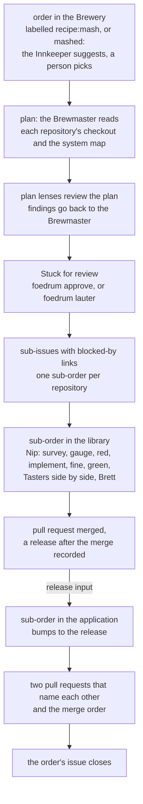

# M2 — The ladder: what it built

Closed 2026-11-09 · 248 issues (229 done, the last call among them; 19 not planned) · ADRs 0151–0358 · [GitHub milestone](https://github.com/EdwinBekaert/foedrum/milestone/3?closed=1)

M1 brewed one order in one repository with one fixed recipe. M2 made Foedrum plan before it brews.
An order gets its recipe from its `recipe:` label, from a person's answer to the Innkeeper's
suggestion through `foedrum mash`, or from a person's `foedrum recipe`; nothing picks one by
itself, and a sub-order gets the one its approved plan names. The Brewmaster reads every repository the Brewery lists and writes a plan of sub-orders,
one repository each, with `code` and `release` dependencies between them. Plan lenses review it,
and a person approves it. The approved plan becomes Brewery sub-issues, and each sub-order brews
when its blockers have merged, or have been released. Brewing gained steps of its own: the
Maltster's test map, the Finer, a parallel group of Tasters whose findings go back along one
route, and Brett's mutants. When every sub-order's pull request has merged, the order closes.



| Part | Where |
|---|---|
| Recipe and brewer files, routing by label, the Innkeeper | `src/engine/recipe-files.ts:1193`, `src/engine/resolve-recipe.ts:16`, `src/engine/recipe-label.ts:46`, `defaults/brewers/innkeeper.md` |
| The plan, its comment, approve and lauter | `defaults/brewers/brewmaster.md`, `defaults/recipes/mash.jsonc`, `defaults/recipes/deep-mash.jsonc`, `src/engine/plan-comment.ts:134`, `src/engine/decide.ts:1266` |
| Sub-issues and blocked-by links | `src/engine/plan-issues.ts:89`, `src/github/sub-issues.ts:35` |
| The ready set, releases and the `release` input | `src/engine/ready-set.ts:51`, `src/engine/releases.ts:87`, `src/engine/release-input.ts:34` |
| Sibling sections, the order's end and its close | `src/engine/sibling-pull-requests.ts:52`, `src/engine/order-end.ts:71`, `src/engine/brewery-closes.ts:80` |
| Tasting: lens rounds and the diff and plan lenses | `src/engine/lens-rounds.ts:56`, `defaults/lenses/diff/`, `defaults/lenses/plan/` |
| Brett's mutants | `src/checks/mutants.ts`, `src/checks/mutant-run.ts:112`, `src/engine/survivors.ts:9` |
| The test map and the Maltster's survey | `src/checks/test-map.ts:30`, `src/checks/survey.ts`, `src/checks/uncovered.ts`, `defaults/brewers/maltster.md` |
| The system map | `src/engine/system-map.ts:17`, `src/formats/` |
| House yeast for brewers | `src/brewers/house-yeast.ts:41` |
| Limits, ranks, pauses and the usage window | `src/engine/limits.ts:35`, `src/engine/ranks.ts:48`, `src/engine/pauses.ts:17`, `src/engine/usage-window.ts` |
| The merge brief and handovers | `src/engine/merge-brief.ts:31`, `src/engine/handover.ts:35` |

## The exit criterion

**An order across two repositories, where the second needs a release of the first, ends with two
linked pull requests and the version bump; routing is visible and overridable** (`ROADMAP.md`).

It is shown twice, offline and on GitHub.

- **Offline, in every CI run.** `npm run demo -- ladder` (#739, #775, ADR 0294) runs the order in
  fourteen steps on `foedrum serve`'s own seams, with a fake code host and scripted brewers. The
  Brewmaster reads `demo/lib` and `demo/web`'s manifests and plans a sub-order in each, the second
  with a `release` dependency on the first. Between lives of the Cellar the demo merges the library's
  pull request, commits `package.json` at 1.4.0, tags it `v1.4.0` and releases it, as a person and
  the library's CI would. The application's Cellarman reads the tag from its `release` input and
  writes the bump. The two pull requests' sibling sections name each other, and the order's issue
  closes. `test/integration/demo-ladder.test.ts` runs it, and its test "npm run demo -- ladder
  --no-pause ends with two pull requests that name each other" passed on Windows, macOS and Linux
  in CI run 42631285604, for main at `ff49d2f4`. It also ran to its end in the last call's worktree.
  The order is labelled `recipe:mash`, so the status comment says the recipe was "chosen by its
  label"; the default demo's step 12 shows the other half of routing, the Innkeeper asking which
  recipe brews it and a person's answer choosing it (ADR 0283).
- **On GitHub, with real models.** On 2026-11-02 the maintainer's private Brewery brewed one order,
  labelled `recipe:mash`, into two public repositories. Its plan made two sub-issues of the order.
  The library's pull request,
  [foedrum-ladder-lib#2](https://github.com/EdwinBekaert/foedrum-ladder-lib/pull/2), merged at
  19:12, and the library's release workflow (`github-actions[bot]`) published `v1.2.0` from it within half a minute. The
  application's pull request,
  [foedrum-ladder-app#2](https://github.com/EdwinBekaert/foedrum-ladder-app/pull/2), changes
  `package.json` from `foedrum-ladder-lib#v1.1.0` to `#v1.2.0` and calls the new French greeting.
  Each pull request's "Pull requests of this order" section names the other and the order to merge
  them in. The application's pull request merged at 19:21, and the order's issue and both
  sub-issues were closed as completed by 19:22. What was checked: both pull requests' bodies and
  the application's diff (`gh pr view`, `gh pr diff`), the library's releases (`gh release list`),
  and the Brewery issues' parent links, state and labels through `gh api`.

## What it built

| Area | What | Issues |
|---|---|---|
| Routing | The Innkeeper suggests a recipe and a person picks it (`foedrum mash`), a recipe label chosen on the Brewery issue, a claimed target issue's order by its Brewery issue, one number per piece of work, one live batch per issue | #387, #413, #414, #584, #592, #694, #865, #881, #902, #949, #957 |
| Planning | The Brewmaster and `mash`, the plan out doc and its `touches` check, the plan comment, approve and lauter at gate 1, the plan entry as an input to the Gauger and acceptance, every Brewery repository read in its own checkout, the system map from npm, .NET, Cargo and Go manifests with no model | #585, #586, #588, #589, #591, #658, #659, #731, #763, #765, #768, #808, #855 |
| Plan review | A Taster reviews a plan, findings go back to the Brewmaster, seven plan lenses (`mash` three, `deep-mash` seven), a plan's security mark reaches its sub-order, a seeded plan to measure them | #386, #800, #801, #802, #803, #804 |
| Sub-orders | Sub-issues with blocked-by links, the ready sub-orders of all orders started by rank and plan order within the Brewery's and the recipes' limits, no two overlapping sub-orders side by side, a release-blocked sub-order started once its blocker is released, with the release as its input | #18, #239, #531, #532, #538, #558, #566, #590, #723, #736 |
| The order's end | Pull requests of one order name each other and the merge order, a private Brewery issue never named in a public pull request, the order shown done and closed once every pull request merged, how each pull request ended in `foedrum status` | #737, #738, #741, #746, #905, #925 |
| Pull requests | Checks watched on the head and on the merged tree when the base moves, a failing check or a conflict sending the batch back to its fix step with the job log, the body rendered again on each push, the merge brief, the target's rules for pull requests, Mermaid labels quoted | #271, #274, #412, #436, #480, #481, #511, #526, #544, #546, #547, #548, #549, #550, #551, #559, #574, #947 |
| Tasting | Lens steps with a default Taster in a parallel group, acceptance, necessity, security and design conformance as default lenses, later rounds on the change since the last, dispositions with evidence, every finding of a group along one route, only the Tasters with findings run again, the risk left, a pre-existing finding becomes an issue | #26, #244, #428, #452, #500, #501, #502, #521, #545, #560, #675, #696, #782, #876, #914, #926, #938, #950, #951 |
| Brett | Mutants as checked one-line edits on the change's lines, run by the engine in scratch trees against a fresh baseline, survivors listed or blocking | #223, #449, #597, #797, #798, #799, #807, #906 |
| The red proof | The test map and the Maltster's survey, LCOV and Cobertura coverage, an uncovered or skipped changed line fails the check, the regression tests a Gauger names, a stale map sent back to the change that made it, no reading of test names | #444, #660, #661, #706, #707, #708, #709, #710, #711, #718, #727, #740, #747, #750, #907 |
| Brewers | The Finer, the Cellarman that writes the least code and reads the Gauger's tests, brewers that run the repository's own checks, interactive steps, sessions resumed after a stop or the end of their turns, takeovers, handovers kept as proposals, receipts in tokens and time, the maintainers' comments in the order | #169, #326, #327, #338, #394, #432, #447, #455, #467, #483, #536, #569, #781, #877, #878, #892 |
| House yeast | Rules reaching brewers by scope and lens, the code's author as well as its reviewer, and Foedrum's own sessions | #434, #453, #671, #677, #685 |
| Commands and limits | `pause`, `stop`, `continue` and `rank`, the usage window and one model family's limit, spend limits, `foedrum init`, `status --watch`, the live line, `foedrum brewers` and `foedrum lenses` | #241, #242, #257, #283, #404, #442, #463, #518, #537, #561, #654, #873, #883 |
| Isolation | Setup in the check sandbox with the network kept, toolchains under the home re-opened to sandboxed commands, wrappers read as npx is, secrets scanned when a step ends | #247, #349, #382, #427, #439, #472, #473 |
| Seeing it | The demo's parallel group and tasting loop, `npm run demo -- ladder`, the fake code host's merges and releases | #448, #503, #662, #739, #767 |
| Working on Foedrum | The push gate running no tests, the check running the tests a change reaches, `/brew-audit`, review metrics, tasting-compare | #595, #596, #610, #626, #673, #879, #916, #933 |

The table names the issues that built each part; the rest of the 229 are fixes and smaller changes
around them ([the milestone](https://github.com/EdwinBekaert/foedrum/milestone/3?closed=1)).

Closed as not planned: 19 issues. Most were replaced by smaller ones that M2 built: the plan
recipe and gate 1 (#388, #389, #390, #391, by #584–#590 and #800–#802), the deep-mash recipe
(#587, by #802), Brett (#393, by #797–#799), the tasting rounds (#260, #261, by #500 and #501),
`/foedrum:refine` (#19, by `foedrum lauter`, #589), one flow on every surface (#405, by #592),
and the lane labels (#407, by #777). Others were dropped: an answerer brewer (#398), shared check
slots (#594), simplify as a diff lens (#429, the Finer instead, #455), and #160, #161, #191,
#219 and #310.

## Not in M2

- **Mermaid recipe diagrams in status comments**: dropped from `ROADMAP.md`'s M2 row at this
  last call (#964), with no issue filed. The plan comment draws the order of the sub-orders, but
  no status comment draws its recipe.
- **A router that picks a recipe for an unlabelled issue**: dropped from `ROADMAP.md`'s M2 row
  at this last call (#964): ADR 0232 chose a person's answer to the Innkeeper's suggestion, the
  routing above, over a model call for every unlabelled issue. Automatic choice is #373: M6.
- **The recipes Half-pint, Pint, Growler, Keg and Guest tasting**: M5 (`ROADMAP.md`). The defaults
  are `nip`, `mash-in`, `mash` and `deep-mash` (`defaults/recipes/`).
- **A recording of the demo** (#700) and the npm package with `npx foedrum init`: M3.
- **An Innkeeper that plans what to brew next** (#227) and an analyse-and-refine recipe for every
  order (#373): M6.

Read next: [the engine](../design/engine/README.md), the [recipes](../design/recipes/README.md),
then the [ADR index](../adr/README.md).

## See it

```sh
npm ci
npm run demo -- ladder
```

`npm run demo -- ladder` makes a scratch Brewery and two target repositories, `demo/lib` and
`demo/web`, in `.foedrum/tmp/demo/`, with bare remotes there, and walks the order in fourteen
steps, each with what to look for, waiting for Enter between them (`--no-pause` goes straight through). Like `npm run demo`, it
needs node and git only: no gh, no GitHub, no `claude` and no network (ADR 0294).

| Step | What to look for |
|---|---|
| 1. The order, and its plan from a folder of checkouts | `recipe:mash`, "chosen by its label"; the map the Brewmaster reads links `demo/web` to `demo/lib`; a sub-order in each, each with its recipe. |
| 2. `foedrum approve 1` | The plan signed off by its digest: the batch goes on tap. |
| 3. The sub-issues | One Brewery issue per sub-order under the order, labelled `foedrum:sub-order` and `recipe:ladder`, the second blocked by the first. |
| 4. The sub-order in `demo/lib` | Ordered, brewed by the Cellarman and opened as a pull request on `demo/lib`; the one in `demo/web` waits, ordered by no one. |
| 5. The merge, and `demo/lib`'s CI | The demo merges the pull request as a person would, and plays the CI: `package.json` at 1.4.0, the tag `v1.4.0` on that commit, and a release. |
| 6. The merge and the release recorded | The intake reads the pull request merged and records `v1.4.0`, which holds the merge: the sub-order in `demo/web` is ready. |
| 7. The sub-order in `demo/web`, with the release input | Ordered with the release it waited for: its tag as written, its page, its notes and the merged pull request. |
| 8. The bump to 1.4.0 | The Cellarman read `v1.4.0` in its prompt and wrote 1.4.0 into `package.json`: nothing in the demo names the version. |
| 9. The pull request on `demo/web` | The second pull request of the order. |
| 10. The pull requests of this order | Each pull request names the other, its state, and that `demo/lib`'s merges and is released first. |
| 11. The merge on `demo/web` | The demo merges the second pull request, as a person would. |
| 12. The order's status comment | Every sub-order merged, `demo/lib`'s with its release `v1.4.0`. |
| 13. The order's issue closed | The engine closes the order with a comment that names both pull requests. |
| 14. `foedrum status 1` | Each pull request merged, then planning tokens apart from brewing. |

`npm run demo`, M1's walk-through, still runs its twelve steps
([M1's page](m1.md#see-it)); its last step mashes an order to a plan that waits for its review.
