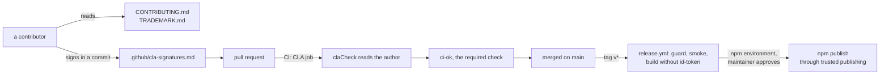

# M3 — Open doors: what it built

Closes the day its last call merges · 72 issues (71 done, the last call among them; 1 not planned) · ADRs 0359–0401 · [GitHub milestone](https://github.com/EdwinBekaert/foedrum/milestone/4?closed=1)

M2 made Foedrum plan before it brews. M3 opened the repository: it is public, it says how to contribute, under which licence grant and with what name, and it can be packaged and published from a tagged, green `main`.
Around that, M3 closed gaps a real Brewery would meet first: who may approve a target issue and what happens when it changes after approval, a recipe's type and guidance, a person's four states of a batch, the Maltster's code map, model levels and efforts of Foedrum's own, the checks a brewer runs before its end, a review that asks for changes, and rack's cleanup.

| Part | Where |
|---|---|
| The contribution guide, the CLA and its check | `CONTRIBUTING.md`, `CLA.md`, `.github/cla-signatures.md`, `scripts/cla-check/core.ts:22`, the `cla` job in `.github/workflows/ci.yml:232` |
| The trademark policy and the copyright notice | `TRADEMARK.md`, `README.md:118` |
| The package and its release | `.github/workflows/package.yml`, `.github/workflows/release.yml`, `docs/design/delivery.md` |
| Who approves a target issue, and a changed order | `src/engine/issue-claims.ts:84`, `src/engine/order-changes.ts:88`, `src/engine/order-changes.ts:185` |
| A recipe's type and guidance | `src/schemas/recipe.ts:350`, `src/schemas/recipe.ts:363`, `src/engine/fold.ts:266` |
| What a person reads a batch as | `src/engine/batch-state.ts:43` |
| Model levels and efforts | `src/schemas/models.ts:7`, `src/schemas/models.ts:11`, `defaults/models.jsonc` |
| The Maltster's code map | `defaults/brewers/maltster-map.md`, `defaults/recipes/nip.jsonc`, `defaults/recipes/deep-brew.jsonc` |
| Checks before a brewer's end, and a review that asks for changes | `src/brewers/send-back.ts:80`, `src/engine/pr-reviews.ts:122` |
| Look before merging | `src/engine/look-before-merging.ts:119` |
| Rack and its issue every 4 weeks | `src/engine/rack.ts:131`, `src/engine/rack-schedule.ts:117`, `defaults/recipes/rack.jsonc` |
| The test line init writes | `src/checks/test-line.ts:179` |
| Init's place | `src/cli/init.ts:282` |

## The exit criterion

**The repository is open to read and to contributors: `CONTRIBUTING.md`, `CLA.md` with the CI check, `TRADEMARK.md` and the README are merged** (`ROADMAP.md`).

- `CONTRIBUTING.md` merged in #1042, `CLA.md`, `.github/cla-signatures.md` and `scripts/cla-check.ts` in #1039, and `TRADEMARK.md` in #1043 (`git log --first-parent origin/main -- <file>`, read in the last call's worktree at `73198a25`).
- The README gained what Foedrum changes on a person's machine (#835) and the copyright notice (#1035); it links the CLA and the trademark policy at `README.md:122`.
- The CLA check runs on every pull request: the `CLA` job passed on #1076's run 43712202664, and `ci-ok` needs it on a pull request (`.github/workflows/ci.yml:277-280`).
- The repository is public: `gh repo view --json visibility` answers `PUBLIC`.
- `main` at `73198a25` is green: CI run 43712804235 of its push succeeded.

The criterion is met.

## What it built

| Area | What | Issues |
|---|---|---|
| Opening the repository | Contribution guide, CLA and its check, the CLA's open-source promise, trademark policy, copyright notice, what Foedrum changes on a machine | #1023, #1024, #1041, #1025, #1035, #835 |
| Delivery | The package ships the JavaScript `tsc` emits, CI installs the tarball on three platforms, a tag on a green `main` publishes through trusted publishing, init from the package offers no shim | #1000, #27, #1030 |
| Intake | An issue is taken only when someone in `users` added its labels, and one changed after its approval asks the engineer; its brewers read every comment made before the approval | #903, #976, #985 |
| Recipes | A recipe's type, its guidance, the default recipe for `foedrum brew`, `decoction` renamed `deep-mash`, `deep-brew`, `mash --override`, routes counting their rounds per run, test-first off for a sub-order, model levels and efforts | #929, #977, #930, #931, #915, #932, #981, #848, #1058 |
| Brewing | The Maltster's code map, checks before a brewer's end, a review that sends a batch back, look before merging, out doc secrets kept off the state branch, a step skipped while blocked left out of the draft rule | #983, #993, #872, #992, #756, #823 |
| What a person reads | Four states of a batch, plain words, the Innkeeper on a deeper plan, merge briefs that read every recipe a batch brewed, an ended batch's plan comment left alone on an upgrade | #834, #927, #836, #871, #972, #825 |
| Rack | Archive, delete, temporary files, an issue every 4 weeks, and what is kept in `.foedrum/tmp` | #921, #1012, #1018, #1019, #828 |
| Init | The Brewery's repository, labels, shim and `/foedrum:init`, the command on the PATH, where init runs, the test line | #512, #529, #530, #1033, #856 |
| The check sandbox | Away from the host's abstract sockets, slirp4netns under its own sandbox, pasta first where its resolver works | #425, #577, #705 |
| The push gate and the code | The gate in parts, more of git's option forms, one tick, shared effects, `latestAttempt`, the CLI's shared driver setup, SHA-1 repositories | #613, #617, #636, #637, #616, #621, #622, #623, #624 |
| Tests and tooling | Integration tests moved to unit tests, opt-in suites in CI, tests against the installed `claude`, test helpers, tasting-compare against a real Cellarman, the Explore agent | #869, #896, #897, #898, #899, #900, #615, #995, #1052, #1055, #1045, #1054 |
| The demo | Mash in the demo, a polished walkthrough, the intake's 404 | #663, #277, #721 |

Not planned: #939 (a Taster step of several lenses saying per lens whether it blocks).

## Not in M3

- The README's banner, which the roadmap row names: no issue holds it.
- The first npm publish: #1022, in M7, which owns it (`ROADMAP.md`); M3 built the pipeline and published nothing (ADR 0388).
- The demo's recording: M7's row names it; #277 polished the walkthrough it will record.

## See it

- Read [`CONTRIBUTING.md`](../../CONTRIBUTING.md), [`CLA.md`](../../CLA.md) and [`TRADEMARK.md`](../../TRADEMARK.md).
- Open a pull request without a line in `.github/cla-signatures.md`: its `CLA` check fails and names the line to add.
- Run the release's dry run: GitHub's Actions tab, workflow Release, "Run workflow" on `main`.
- `npm run demo` runs an order through Nip's steps, with the Maltster's map before the Gauger, offline.
